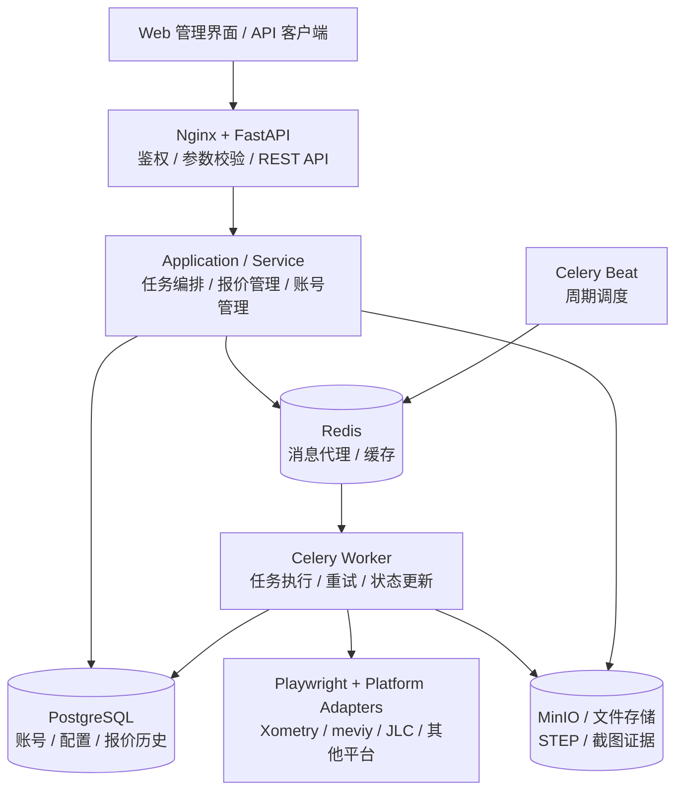
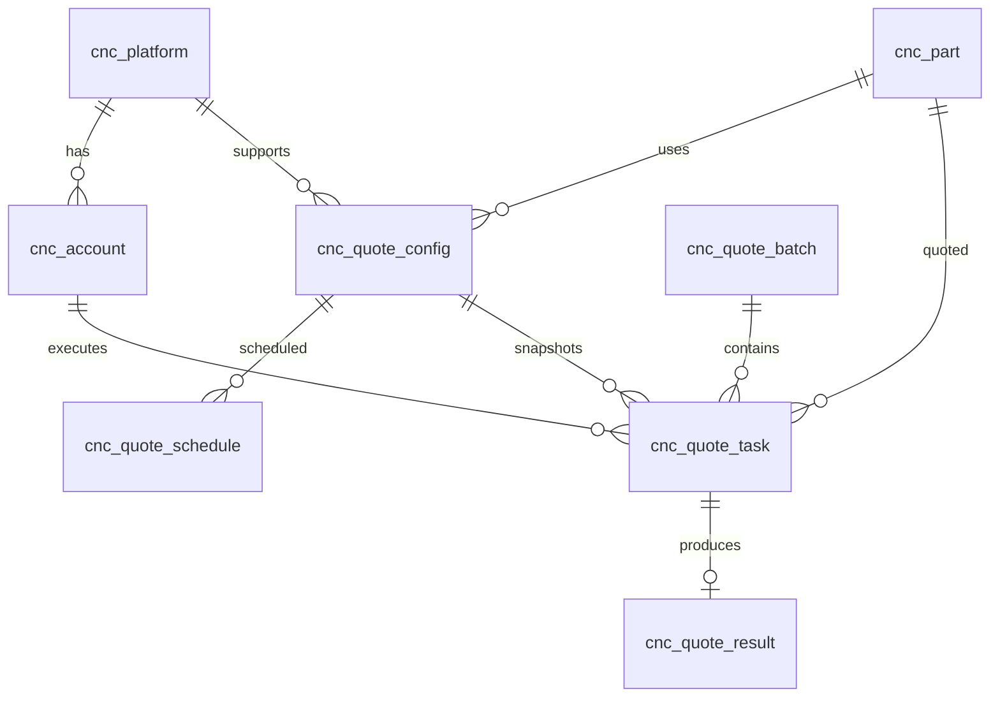
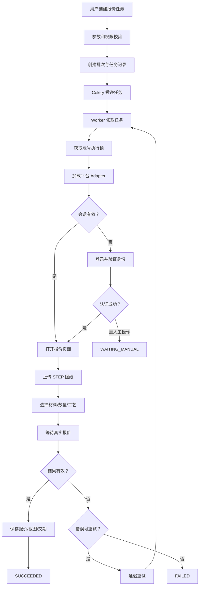
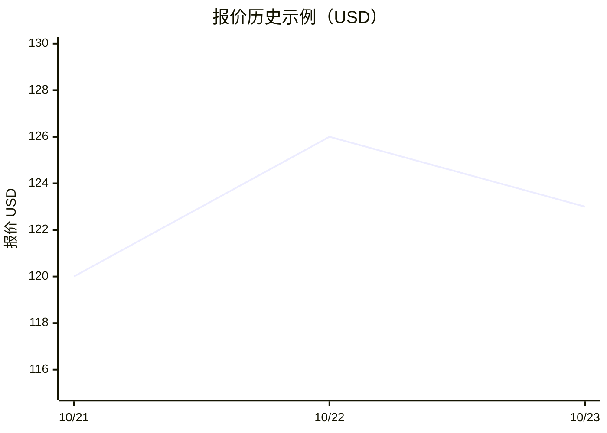

# CNC 竞品报价监测系统技术设计方案

> **版本**：v1.0  
> **架构类型**：传统 Python Web + 浏览器自动化 + 异步任务  
> **开发目标**：5 天 MVP  
> **需求依据**：《竞品报价监测》（附件 `deepseek_markdown_20261020_c35235(1).md`）  
> **技术约束**：不采用 AI Agent、LangChain、LangGraph、DeepAgents 或复杂大模型编排链路。

---

## 一、需求分析与总体技术选型

### 1.1 业务目标

根据附件《竞品报价监测》，系统需要自动登录 CNC 加工报价平台，上传 STEP 图纸，配置材料、数量、表面处理等参数，获取真实报价及交期，并支持批量询价、定时监测、价格历史和截图留证。附件要求 5 天内完成演示，至少打通两个平台，并允许先实现单平台完整流程。

本方案将原需求中的 Agent 自主决策能力替换为**确定性业务工作流（Deterministic Workflow）**，不使用 LangChain、LangGraph、DeepAgents 或任何 LLM 编排框架。

核心设计原则：

- **业务层**：采用传统分层架构，负责账号、图纸、报价配置和任务管理。
- **自动化层**：通过 Playwright 执行预定义浏览器操作，不依赖模型自主决策。
- **任务层**：通过 Celery 实现批量执行、异步重试和周期性监测。
- **持久化层**：PostgreSQL 保存业务数据和报价历史，文件存储保存图纸及截图。
- **扩展层**：使用 Adapter（适配器模式）隔离各竞品网站的操作差异。

### 1.2 推荐技术栈

| 技术领域 | 推荐技术 | 选型理由 |
|---|---|---|
| 开发语言 | Python 3.12 | 稳定成熟，兼容主要后端及自动化生态 |
| Web 框架 | **FastAPI** | 原生 ASGI、Pydantic 校验、OpenAPI 文档、开发效率高 |
| ORM | **SQLAlchemy 2.x** | 成熟的 ORM、事务管理和 PostgreSQL 支持 |
| 数据库 | PostgreSQL 16/17 | 事务可靠，支持 JSONB、复杂筛选和历史分析 |
| 数据库迁移 | Alembic | 表结构版本化及增量迁移 |
| 缓存与消息代理 | Redis 7.x | 缓存、任务消息传递、短期状态 |
| 异步任务队列 | **Celery 5.x** | 异步任务、自动重试、任务路由和多进程 Worker |
| 定时调度 | Celery Beat | 定时扫描监测计划并分发任务 |
| 浏览器自动化 | **Playwright Python** | Chromium 自动化、文件上传、页面等待、截图、会话复用 |
| API 数据校验 | Pydantic v2 | 请求校验、响应序列化、类型约束 |
| HTTP 客户端 | HTTPX | 内部 HTTP 调用及经过授权的外部接口调用 |
| 身份认证 | PyJWT + pwdlib | JWT 认证与用户密码哈希 |
| 敏感数据加密 | cryptography | 账号凭据、浏览器会话状态的可逆加密 |
| 文件存储 | MinIO / 本地 Volume | 保存 STEP 文件、截图、执行证据 |
| 日志 | structlog / logging | 结构化日志及任务链路追踪 |
| Web 服务 | Uvicorn + Nginx | ASGI 应用运行及 HTTPS 反向代理 |
| 测试 | pytest + pytest-asyncio | API、业务逻辑及浏览器集成测试 |
| 部署 | Docker Compose | 多服务部署简单，适合当前项目规模 |

> 以上是工程选型，不代表附件已指定这些技术；具体依赖版本应在实施时锁定并完成兼容性测试。

**为什么推荐 FastAPI 而不是 Django？**

两者都适用，但当前需求主要是 REST API、后台任务调度和浏览器自动化，而不是复杂的传统内容管理站点。FastAPI 的 API 开发、类型校验和轻量分层组织更适合这一场景。

**为什么采用 Celery + Playwright？**

Celery 负责“何时执行、如何排队、失败如何恢复”，Playwright 负责“如何操作竞品网站”。二者职责明确，能够避免浏览器长耗时任务占用 Web 请求线程。

Playwright 支持独立 Browser Context 以及复用已认证的浏览器状态，但会话数据可能包含敏感 Cookie，必须加密保护。

### 1.3 整体技术架构



API、调度器和浏览器 Worker 作为独立进程或容器运行。PostgreSQL 同时为 Web 服务和 Worker 提供业务数据持久化。

**FastAPI 不直接执行网页报价，所有长时间浏览器操作都通过 Celery Worker 执行。**

调用关系：

`HTTP API → Service → PostgreSQL 持久化任务 → Celery → Playwright → 报价结果入库`

这使得 Web 服务和浏览器自动化服务能够独立部署、扩容和故障恢复。

---

## 二、项目分层架构设计

### 2.1 架构模式

推荐采用 **模块化单体架构（Modular Monolith）+ 分层设计 + 独立异步 Worker**。

项目规模不大，不建议引入微服务、DDD 全套复杂抽象、事件总线或分布式工作流引擎。

建议划分为五层：

| 分层 | 核心职责 | 典型组件 |
|---|---|---|
| API 层 | REST 接口、认证、参数校验 | Router、Schema、Depends |
| Application 层 | 应用服务、用例协调、任务创建 | QuoteService、AccountService |
| Domain 层 | 业务模型、报价规则、状态机 | Entity、Enum、Policy |
| Infrastructure 层 | 数据库、Redis、Celery、文件存储 | Repository、Task、Storage |
| Automation 层 | 浏览器操作和竞品平台适配 | Playwright、Adapter |

核心要求是：**Router 不直接编写 SQL，Service 不直接操作网页 DOM，Adapter 不负责业务事务。**

### 2.2 推荐目录结构

```text
cnc-quote-monitor/
├── app/
│   ├── main.py                  # FastAPI 入口
│   │
│   ├── api/                     # API 接口层
│   │   ├── dependencies.py
│   │   └── v1/
│   │       ├── auth.py
│   │       ├── platforms.py
│   │       ├── accounts.py
│   │       ├── parts.py
│   │       ├── quote_configs.py
│   │       ├── quote_jobs.py
│   │       ├── quotes.py
│   │       └── schedules.py
│   │
│   ├── schemas/                 # Pydantic 请求/响应
│   │   ├── account.py
│   │   ├── part.py
│   │   ├── quote.py
│   │   └── schedule.py
│   │
│   ├── services/                # 业务应用服务
│   │   ├── account_service.py
│   │   ├── part_service.py
│   │   ├── quote_service.py
│   │   ├── quote_job_service.py
│   │   └── schedule_service.py
│   │
│   ├── domain/                  # 业务规则
│   │   ├── enums.py
│   │   ├── exceptions.py
│   │   └── quote_policy.py
│   │
│   ├── models/                  # SQLAlchemy ORM
│   │   ├── platform.py
│   │   ├── account.py
│   │   ├── part.py
│   │   ├── quote_config.py
│   │   ├── quote_job.py
│   │   ├── quote_result.py
│   │   └── schedule.py
│   │
│   ├── repositories/            # 数据访问层
│   │   ├── account_repository.py
│   │   ├── quote_repository.py
│   │   └── task_repository.py
│   │
│   ├── automation/              # 浏览器自动化模块
│   │   ├── base.py              # 统一适配器接口
│   │   ├── registry.py          # 平台注册与选择
│   │   ├── browser_manager.py   # 浏览器生命周期
│   │   ├── session_manager.py   # 会话复用
│   │   ├── exceptions.py
│   │   └── adapters/
│   │       ├── xometry.py
│   │       ├── jlc_cnc.py
│   │       └── rapid_direct.py
│   │
│   ├── infrastructure/
│   │   ├── database.py
│   │   ├── redis.py
│   │   ├── security.py
│   │   ├── storage.py
│   │   └── tasks/
│   │       ├── celery_app.py
│   │       ├── quote_tasks.py
│   │       └── schedule_tasks.py
│   │
│   └── core/
│       ├── config.py            # Pydantic Settings
│       └── logging.py
│
├── alembic/                     # 数据库迁移
├── tests/
│   ├── unit/
│   ├── integration/
│   └── automation/
├── deploy/
│   ├── Dockerfile.api
│   ├── Dockerfile.worker
│   ├── docker-compose.yml
│   └── nginx.conf
├── pyproject.toml
├── uv.lock
└── .env.example
```

这个设计不需要针对每个平台重复开发 API 或 Service。新增报价网站时，原则上只需要增加一个 Adapter、平台注册信息和参数映射配置。

---

## 三、数据库模型设计

### 3.1 设计原则

考虑到现有 CNC 项目已使用以下表名，建议尽可能沿用：

- `cnc_platform`
- `cnc_account`
- `cnc_part`
- `cnc_quote_config`

在此基础上扩展异步任务、定时计划、历史报价相关表。

以下是推荐的逻辑数据模型，属于技术设计建议，并非声称当前数据库已经具备这些字段。

### 3.2 核心数据表

| 表名 | 业务职责 | 关键字段 |
|---|---|---|
| `cnc_platform` | 竞品平台基础信息 | id、code、name、base_url、enabled |
| `cnc_account` | 平台账号和登录配置 | id、platform_id、username、password、quote_entry_url |
| `cnc_part` | STEP 图纸管理 | id、name、file_path、file_name、file_type、file_sha256 |
| `cnc_quote_config` | 平台报价参数配置 | id、part_id、platform_id、material、quantity、surface_finish、extra_params |
| `cnc_quote_schedule` | 定时监测计划 | id、config_id、account_id、quantities、interval_minutes、next_run_at |
| `cnc_quote_batch` | 批次执行记录 | id、status、source、total_count、success_count、failed_count |
| `cnc_quote_task` | 单次报价执行单元 | id、batch_id、part_id、account_id、config_id、quantity、status、attempt_count |
| `cnc_quote_result` | 实际报价及历史记录 | id、task_id、price、currency、lead_time_days、quoted_at、screenshot_path |

以上表均建议包含 `created_time`、`updated_time` 等公共审计字段；需要软删除的配置表可使用 `is_deleted`、`deleted_time`。

### 3.3 核心表字段详细设计

#### 1. 账号表 `cnc_account`

| 字段 | PostgreSQL 类型 | 说明 |
|---|---|---|
| id | BIGINT | 账号 ID |
| platform_id | BIGINT | 所属平台 ID |
| username | VARCHAR(64) | 登录账号 |
| password | VARCHAR(255) | 现有密码字段，应存放加密密文而非明文 |
| quote_entry_url | VARCHAR(1024) | 此账号使用的报价入口 |
| login_status | SMALLINT | 未验证、有效、失效、需人工认证 |
| last_login_time | TIMESTAMPTZ | 上次登录时间 |
| enabled | BOOLEAN | 是否启用 |

如果现有 `password VARCHAR(255)` 已投入使用，可以先兼容，但要检查密文是否超过长度限制。生产环境更建议迁移到 `password_ciphertext TEXT`，配合独立密钥管理；平台账号密码需要自动解密登录，不能简单使用不可逆哈希。

#### 2. 报价配置表 `cnc_quote_config`

| 字段 | 类型 | 说明 |
|---|---|---|
| id | BIGINT | 配置 ID |
| name | VARCHAR(100) | 配置名称 |
| part_id | BIGINT | 关联 STEP 图纸 |
| platform_id | BIGINT | 目标平台 |
| material | VARCHAR(200) | 材料标准代码或名称 |
| quantity | INTEGER | 默认报价数量 |
| surface_finish | VARCHAR(200) | 表面处理 |
| extra_params | JSONB | 公差、加工工艺等附加参数 |
| enabled | BOOLEAN | 是否启用 |

如果已有 `site_type SMALLINT`（例如 1=Xometry、2=嘉立创），MVP 可以暂时兼容，但建议后续迁移为 `platform_id`。否则增加第三、第四个平台时，需要持续维护数据库枚举与应用逻辑的映射。

#### 3. 任务明细表 `cnc_quote_task`

这是异步执行的核心状态表。

| 字段 | 类型 | 说明 |
|---|---|---|
| id | BIGINT | 任务 ID |
| batch_id | BIGINT | 所属批次 |
| part_id | BIGINT | 图纸 ID |
| account_id | BIGINT | 报价账号 |
| config_id | BIGINT | 报价配置 |
| quantity | INTEGER | 本次询价数量 |
| config_snapshot | JSONB | 本次执行时固定的参数快照 |
| status | VARCHAR(24) | 当前任务状态 |
| attempt_count | INTEGER | 已执行次数 |
| max_attempts | INTEGER | 最大允许次数 |
| celery_task_id | VARCHAR(100) | Celery 消息 ID |
| error_code | VARCHAR(64) | 最终错误类型 |
| error_message | TEXT | 脱敏错误详情 |
| started_at | TIMESTAMPTZ | 开始时间 |
| finished_at | TIMESTAMPTZ | 结束时间 |

注意：配置快照非常重要。即使任务创建之后用户修改材料或数量，已经生成的执行任务也不应悄悄改变参数。

#### 4. 报价结果表 `cnc_quote_result`

| 字段 | 类型 | 说明 |
|---|---|---|
| id | BIGINT | 报价结果 ID |
| task_id | BIGINT UNIQUE | 对应一次成功询价任务 |
| price | NUMERIC(18,4) | 获取的报价金额 |
| currency | CHAR(3) | ISO 货币代码，如 USD、CNY |
| unit_price | NUMERIC(18,4) | 单件价格，可为空 |
| lead_time_days | INTEGER | 预计交期天数，可为空 |
| price_basis | VARCHAR(32) | 报价口径，如产品价或含运费总价 |
| source_quote_no | VARCHAR(128) | 第三方报价单号，可为空 |
| source_url | TEXT | 报价来源页面 |
| screenshot_path | TEXT | 截图证据位置 |
| raw_result | JSONB | 原始报价附加信息 |
| quoted_at | TIMESTAMPTZ | 报价采集时间 |

金额必须使用 PostgreSQL `NUMERIC` 和 Python `Decimal`，不建议采用 Float。

附件要求保存历史价格，因此**每次成功采集应新增一条报价记录，而不是覆盖上一次结果**。

### 3.4 数据表关系



另外建议为不同网站的材料及表面处理参数维护**统一参数字典与平台映射**。

例如：

```python
MATERIAL_MAPPING = {
    "aluminum_6061": {
        "xometry": "...",
        "jlc_cnc": "...",
    }
}
```

这里的 `...` 由具体平台实际界面选项决定，不能仅凭名称猜测。MVP 使用 Python 配置或 JSON 即可；需要后台动态维护时，再引入 `cnc_platform_option` 参数映射表。

---

## 四、RESTful API 设计

统一前缀：`/api/v1`

### 4.1 核心 API 契约

| 模块 | Method | URL | 作用 |
|---|---|---|---|
| 认证 | POST | `/auth/login` | 用户登录 |
| 平台 | GET | `/platforms` | 获取竞品平台 |
| 账号 | GET | `/accounts` | 分页查询账号 |
| 账号 | POST | `/accounts` | 新建平台账号 |
| 账号 | PATCH | `/accounts/{id}` | 修改账号 |
| 账号 | POST | `/accounts/{id}/login-tests` | 异步验证登录 |
| 图纸 | POST | `/parts` | 上传 STEP 文件 |
| 图纸 | GET | `/parts` | 分页查询图纸 |
| 参数配置 | POST | `/quote-configs` | 创建报价配置 |
| 参数配置 | GET | `/quote-configs` | 查询报价配置 |
| 参数配置 | PATCH | `/quote-configs/{id}` | 修改配置 |
| 任务 | POST | `/quote-jobs` | 创建批量询价任务 |
| 任务 | GET | `/quote-jobs/{id}` | 获取批次状态 |
| 任务 | GET | `/quote-jobs/{id}/tasks` | 查询任务明细 |
| 任务 | POST | `/quote-tasks/{id}/retry` | 手动重试 |
| 结果 | GET | `/quotes` | 分页查询报价 |
| 结果 | GET | `/quotes/history` | 历史价格查询 |
| 监测计划 | POST | `/schedules` | 新建监测计划 |
| 监测计划 | PATCH | `/schedules/{id}` | 调整周期或启停 |
| 证据 | GET | `/quotes/{id}/evidence` | 获取授权截图地址 |

现有项目若已经提供 `/cnc/cnc_account/list`、`/cnc/cnc_part/list` 等接口，可以保留作为兼容接口，由新 Service 层复用相同的业务逻辑。

### 4.2 关键 API 示例

**创建批量报价任务**

`POST /api/v1/quote-jobs`

```json
{
  "targets": [
    {
      "part_id": 101,
      "account_id": 12,
      "config_id": 301,
      "quantities": [1, 2, 5]
    },
    {
      "part_id": 101,
      "account_id": 18,
      "config_id": 302,
      "quantities": [1, 2, 5]
    }
  ]
}
```

请求头使用 `Idempotency-Key` 防止用户重复提交相同批次。

服务端需要校验账号、平台和报价配置的一致性，并校验操作权限。

成功响应：`202 Accepted`

```json
{
  "code": "ACCEPTED",
  "message": "报价任务已创建",
  "data": {
    "batch_id": 1001,
    "status": "PENDING",
    "total_count": 6
  }
}
```

实际报价执行在后台异步进行，创建接口不等待第三方网站返回报价。

**查询报价执行结果**

`GET /api/v1/quote-jobs/1001`

```json
{
  "batch_id": 1001,
  "status": "PARTIAL_SUCCESS",
  "total_count": 6,
  "success_count": 5,
  "failed_count": 1,
  "running_count": 0,
  "duration_ms": 185000
}
```

这里的 `duration_ms` 表示示例批次从开始到结束的墙钟耗时，并非六个任务耗时的加总。

**报价返回示例**

```json
{
  "task_id": 2001,
  "status": "SUCCEEDED",
  "quote": {
    "price": "125.50",
    "currency": "USD",
    "quantity": 2,
    "lead_time_days": 7,
    "quoted_at": "2026-10-25T02:00:00Z"
  }
}
```

以上为接口结构示例，不代表已经获取到了第三方平台的真实报价。

### 4.3 统一响应与异常规范

建议正常查询 API 返回明确的数据结构；失败响应使用业务错误码和标准 HTTP 状态码。

| HTTP 状态码 | 使用场景 |
|---|---|
| 400 | 参数组合不合法 |
| 401 | 未认证、Token 过期 |
| 403 | 缺少数据访问权限 |
| 404 | 资源不存在 |
| 409 | 数据状态冲突、重复任务冲突 |
| 422 | 请求数据格式校验失败 |
| 429 | 用户 API 请求超过限额 |
| 500 | 未预期的服务端异常 |
| 503 | 必需的后台服务不可用 |

第三方网站登录失败、报价失败等通常应当反映在异步任务状态和错误码中，而不是让最初的任务创建 API 一直等待并最终返回 500。

---

## 五、核心业务流程与浏览器自动化

### 5.1 任务创建与执行流程



需要特别关注三个方面。

**第一，任务必须具备幂等性。**

Redis/Celery 采用消息投递机制，Worker 异常退出后，任务可能被重新投递。不能假设每条消息必然只执行一次。

推荐做法：

1. 使用数据库任务 ID 作为执行主键。
2. Worker 原子领取 `PENDING/RETRYING` 状态的任务，防止重复并行执行。
3. 报价结果以 `task_id` 建立唯一关系。
4. 对同一账号增加执行锁，避免并发浏览器操作相互影响。
5. 在重试时先检查是否已经存在有效结果。

更高可靠性的实现可加入任务租约、心跳及 fencing token，防止失联 Worker 恢复后与新 Worker 同时写入结果。

**第二，数据库事务不能覆盖整个浏览器执行过程。**

数据库操作应采用短事务：

`领取任务并提交 → 执行浏览器操作 → 保存结果并提交`

不要在等待第三方网站时长期持有 PostgreSQL 事务和行锁。

**第三，截图和证据必须与参数快照绑定。**

在报价历史中需要能够回溯：使用了哪个图纸版本、材料、数量、账号、平台以及最终报价页面。

### 5.2 平台 Adapter 设计

推荐使用 Python 抽象基类 `ABC` 定义统一的浏览器自动化接口。

```python
from abc import ABC, abstractmethod
from dataclasses import dataclass
from decimal import Decimal
from typing import Any

from playwright.async_api import Page


@dataclass
class QuoteRequest:
    file_path: str
    material: str
    quantity: int
    surface_finish: str | None
    extra_params: dict[str, Any]


@dataclass
class QuoteResult:
    price: Decimal
    currency: str
    lead_time_days: int | None
    source_url: str


class BaseQuoteAdapter(ABC):

    @abstractmethod
    async def login(
        self, page: Page, username: str, password: str
    ) -> None:
        pass

    @abstractmethod
    async def upload_part(
        self, page: Page, file_path: str
    ) -> None:
        pass

    @abstractmethod
    async def configure_quote(
        self, page: Page, request: QuoteRequest
    ) -> None:
        pass

    @abstractmethod
    async def extract_quote(
        self, page: Page
    ) -> QuoteResult:
        pass
```

每个平台实现统一的四个动作，但内部定位器、页面跳转、登录方式和数据解析可以不同。

例如：

```text
XometryAdapter
  ├── login()
  ├── upload_part()
  ├── configure_quote()
  └── extract_quote()

JLCCNCAdapter
  ├── login()
  ├── upload_part()
  ├── configure_quote()
  └── extract_quote()
```

Adapter 中建议优先使用 Playwright 的语义化定位器、明确的元素状态等待及业务成功条件。页面变化时，应输出结构化错误，而不是无限重试或使用脆弱的固定休眠时间。

### 5.3 登录及会话管理

**首次登录**：解密凭据 → 打开登录页 → 填写账号密码 → 等待认证完成 → 保存加密会话状态。

**后续报价**：读取加密会话 → 创建隔离的 Browser Context → 校验登录状态 → 执行报价。

Playwright 的 `storage_state()` 可以保存 Cookie 和部分浏览器存储状态，但某些站点使用的会话机制未必能直接复用；必须针对具体网站验证。官方文档也明确提示认证状态文件属于敏感数据。

建议将加密会话保存在受保护的持久存储中，Redis 只缓存短期状态或锁；生产中不应将明文会话文件提交到 Git 或打入 Docker 镜像。

对于验证码、短信验证、MFA：

- 首次认证可以由工作人员人工完成。
- 后台任务进入 `WAITING_MANUAL` 并等待人工认证。
- 不尝试绕过验证码或平台安全机制。
- 恢复后重新校验登录状态及报价参数。

此外，实际开发前需要检查目标网站的自动化使用条款、授权条件和访问频率限制。

---

## 六、异步任务与定时监测设计

### 6.1 Celery 任务拆分

推荐先保留三个核心任务：

| 任务 | 功能 |
|---|---|
| `execute_quote_task(task_id)` | 执行单次报价 |
| `dispatch_scheduled_quotes()` | 扫描并创建到期监测任务 |
| `recover_stale_quote_tasks()` | 识别并恢复超时或遗失的任务 |

批量报价不是创建一个巨大的 Playwright 任务，而是拆分为多个独立报价子任务。

例如，2 份 STEP 图纸、2 个平台、3 种数量：

**2 × 2 × 3 = 12 个独立报价任务**。

### 6.2 任务状态机

建议使用以下状态：

| 状态 | 含义 |
|---|---|
| PENDING | 已创建，等待投递 |
| QUEUED | 已进入 Celery 队列 |
| RUNNING | 浏览器执行中 |
| RETRYING | 等待下一次自动重试 |
| WAITING_MANUAL | 需要人工认证或处理 |
| SUCCEEDED | 成功获取有效报价 |
| FAILED | 最终失败 |
| CANCELLED | 用户取消，或运行前确认取消 |

批次状态由子任务汇总，例如 `RUNNING`、`SUCCEEDED`、`PARTIAL_SUCCESS`、`FAILED`。取消运行中的浏览器操作时需要协作式检查，不能只修改数据库状态。

### 6.3 重试策略

| 异常情况 | 是否重试 | 建议处理 |
|---|---|---|
| 网络连接超时 | 是 | 指数退避，最多 3 次执行 |
| 目标页面加载异常 | 是 | 重建浏览器上下文后重试 |
| 会话失效 | 有条件 | 重新登录一次 |
| STEP 文件不合法 | 否 | 直接记录参数错误 |
| 不支持的材料 | 否 | 标记配置错误 |
| 页面元素变化 | 有条件 | 保存截图，等待适配器修复 |
| 验证码或人工 MFA | 否 | 转人工处理 |
| 平台拒绝自动化访问 | 否 | 停止执行并记录原因 |

Celery 使用 Redis Broker 时，需要结合任务超时、消息可见性超时和重试策略进行配置，避免执行时间过长引起消息重新投递。

### 6.4 动态定时监测

推荐方案：

**Celery Beat 每分钟触发一次调度扫描，具体监测频率由 PostgreSQL 业务表控制。**

例如：

```text
Beat：每 60 秒执行一次
  ↓
查询 cnc_quote_schedule
  ↓
筛选 enabled = true 且 next_run_at <= now()
  ↓
创建新报价批次
  ↓
计算下一次运行时间
  ↓
Celery 分发报价子任务
```

`cnc_quote_schedule` 可以支持每 30 分钟、每 6 小时、每天等频率，无需每次用户修改计划都重启 Celery Beat。

生产实现应使用 `SELECT ... FOR UPDATE SKIP LOCKED` 防止多个调度扫描器重复领取同一计划；任务批次和下一次运行时间必须在同一个数据库事务中提交。

要解决数据库提交后、消息发布前异常导致的漏投递问题，可通过定期扫描 `PENDING` 任务补发消息，进一步升级时采用 Transactional Outbox。

Celery Beat 自身只运行一个主调度实例，避免重复调度。

---

## 七、报价结果与价格监测

### 7.1 价格变化计算规则

系统对同一维度的历史报价进行比较：

`平台 + 图纸版本 + 材料 + 数量 + 表面处理 + 其他报价参数 + 币种 + 报价口径`

价格变化率：

$$
\text{变化率}=\frac{\text{本次报价}-\text{上次报价}}{\text{上次报价}}\times100\%
$$

例如：

| 报价日期 | 平台 | 数量 | 价格 | 变化率 |
|---|---|---:|---:|---:|
| 10月21日 | Xometry | 2 | $120.00 | — |
| 10月22日 | Xometry | 2 | $126.00 | +5.0% |
| 10月23日 | Xometry | 2 | $123.00 | −2.4% |



> 图表使用示例数据，仅用于说明历史报价可视化，不代表实际平台价格。

必须特别注意跨平台价格比较不能仅比较数字。

不同网站可能包含不同的运费、税费、加工服务费用或交期选项。应当保留原始报价组成部分，只有在币种、参数、报价口径一致时，才计算直接可比的价格变化。

### 7.2 结果展示

鉴于只有 5 天开发周期，建议直接采用 **Jinja2 + Bootstrap 5 + Chart.js** 构建简单管理页面，而不是为了演示再搭建复杂前端工程。

页面包含账号管理、图纸上传、报价配置、执行任务、历史价格曲线和截图查看即可。

成功率和耗时指标建议统一定义：

- **执行成功率**：成功报价子任务数 / 已结束子任务数，`WAITING_MANUAL` 单独统计。
- **平均报价耗时**：成功任务从开始到完成的耗时均值。
- **首次执行成功率**：未发生重试即成功的任务比例。
- **最终成功率**：允许重试后成功的任务比例。

同时保留失败数量和失败类型，避免只展示成功样本造成指标偏差。

---

## 八、安全设计与异常处理

### 8.1 身份认证

系统内部用户身份认证与竞品平台账号认证必须分开设计。

| 类型 | 推荐机制 |
|---|---|
| 系统用户登录 | JWT Access Token |
| 系统用户密码 | Argon2id 哈希 |
| 平台登录账号密码 | AES-GCM 等可逆加密 |
| 平台会话状态 | 加密持久化、失效重新登录 |
| 用户权限 | RBAC |
| API 通信 | HTTPS |
| 操作审计 | 用户 ID、资源 ID、操作、时间、结果 |

系统内部建议最少区分管理员与普通操作员；每条账号、图纸、报价数据都要校验所属用户或所属租户，不能只依赖前端隐藏操作按钮。

### 8.2 关键安全控制

1. **文件上传安全**：限制 `.step/.stp` 文件、大小、文件内容校验及文件哈希；实际存储路径由服务端生成，不直接信任用户文件名。
2. **账号保护**：API 不返回平台账号明文密码；日志和异常消息中对密码、Cookie、Token 脱敏。
3. **浏览器隔离**：每次执行使用隔离 Browser Context，并通过账号执行锁减少会话冲突。
4. **访问限制**：竞品站点使用固定域名白名单，限制自动化容器访问内部敏感地址，防止 SSRF 及横向访问。
5. **证据安全**：截图使用私有存储，必须通过权限校验后访问；涉及 Cookie、个人信息和账号信息的截图应脱敏。
6. **任务审计**：保留触发来源、配置快照、任务耗时、错误码和报价来源证据。

### 8.3 异常处理分层

异常应在最靠近发生的位置被识别，在应用边界统一转换为业务状态。

| 分层 | 处理方式 |
|---|---|
| API 层 | 统一 HTTP 错误响应和请求校验 |
| Service 层 | 业务校验、冲突判断、事务回滚 |
| Adapter 层 | 抛出明确的浏览器自动化异常 |
| Celery 层 | 分类重试、终态更新及任务恢复 |
| Infrastructure 层 | 数据库、缓存、文件存储错误治理 |

建议的浏览器异常码包括 `LOGIN_FAILED`、`AUTH_REQUIRED`、`UPLOAD_FAILED`、`UNSUPPORTED_PARAMETER`、`QUOTE_TIMEOUT`、`QUOTE_UNAVAILABLE`、`SELECTOR_CHANGED`、`RATE_LIMITED`。

每条任务日志关联 `request_id`、`batch_id`、`task_id` 和 `account_id`，以便从 API 调用定位到具体浏览器异常。

---

## 九、生产部署设计

### 9.1 WSGI 与 ASGI 选择

本项目使用 FastAPI，因此采用 **ASGI + Uvicorn**。

| 方案 | 适用框架 | 本项目建议 |
|---|---|---|
| WSGI + Gunicorn | Django 传统部署、Flask | 不作为首选 |
| ASGI + Uvicorn | FastAPI、Starlette | 推荐 |
| Nginx + Uvicorn | Docker/虚拟机生产环境 | 推荐 |
| Gunicorn + ASGI Worker | 需要额外进程管理的 ASGI 场景 | 可选 |

FastAPI 官方文档支持通过 Uvicorn 运行多个 Worker，也支持一个进程一个容器的部署方式。

### 9.2 Docker Compose 服务划分

建议部署为以下服务：

```text
Nginx
  │
  └── FastAPI API
        │
        ├── PostgreSQL
        ├── Redis
        └── MinIO

Celery Worker
  ├── Redis
  ├── PostgreSQL
  ├── MinIO
  └── Playwright Chromium

Celery Beat
  ├── Redis
  └── PostgreSQL
```

推荐进程启动命令：

**FastAPI**

```bash
uvicorn app.main:app \
  --host 0.0.0.0 \
  --port 8000 \
  --workers 2
```

**Celery Worker**

```bash
celery -A app.infrastructure.tasks.celery_app:celery_app \
  worker \
  --loglevel=INFO \
  --concurrency=2 \
  -Q quote
```

**Celery Beat**

```bash
celery -A app.infrastructure.tasks.celery_app:celery_app \
  beat \
  --loglevel=INFO
```

建议 Celery 使用 prefork 模式，并在 Worker 子进程中创建和销毁 Playwright 实例，不应在模块导入时共享浏览器对象。`--concurrency=2` 是初始容量建议，需根据内存、目标网站响应时间和账号执行限制调整。

Playwright Worker 建议使用包含浏览器依赖的独立 Docker 镜像，固定 Playwright Python 包与浏览器版本。自动化容器尽量使用非 root 用户及浏览器沙箱，并限制网络访问。官方 Docker 文档也明确提示了容器运行权限和 Chromium 共享内存方面的注意事项。

敏感凭据通过 Secret 或受限环境变量注入，不应直接写入 Compose 文件或提交 Git。

---

## 十、5 天开发计划与验收设计

根据附件的演示要求，建议优先保证单平台闭环，再完成第二个平台，而不是同时开发多个不稳定的适配器。

| 时间 | 核心工作 | 预期交付 |
|---|---|---|
| Day 1 | FastAPI 工程、SQLAlchemy、Alembic、数据库及基础 API | 账号、图纸、报价配置 CRUD |
| Day 2 | Playwright 浏览器封装、首个平台登录及自动报价 | 单平台完整报价闭环 |
| Day 3 | Adapter 抽象、第二平台、批量任务 | 两个平台报价、批次状态 |
| Day 4 | Celery、定时监测、异常恢复、历史价格 | 周期执行及可查询记录 |
| Day 5 | Docker 部署、简单展示页面、测试及演示 | 可运行的 MVP |

**推荐平台实施顺序**：先评估 Xometry 美国站的实际账号登录和报价流程，再评估嘉立创或 RapidDirect。附件列明多个平台存在手机号、微信等认证要求，因此第二平台最终选择应以合法可用账号、实际页面可操作性和报价是否可获取为依据。

平台适配应设置尽早的可行性检查：若遇到必须人工审核、验证码或不允许自动化的阻碍，及时明确约束并调整演示范围，不应声称已经打通未实际验证的报价链路。

### 10.1 验收指标建议

下表是建议工程验收目标，不是已经测试达到的结果。

| 验收项 | 建议标准 |
|---|---|
| 平台集成 | 至少 2 个平台成功完成完整报价 |
| 报价准确性 | 与相同条件下的人工报价核对一致 |
| 批量任务 | 支持多图纸、多数量和多平台 |
| 定时监测 | 可配置频率并连续保存报价记录 |
| 异常处理 | 能识别网络超时、会话失效及参数错误 |
| 历史追溯 | 报价、参数快照、时间和截图可关联 |
| 执行状态 | 能查询成功、失败、重试、人工处理状态 |
| 部署 | Docker Compose 一键启动核心服务 |

需要注意，第三方网站的响应速度、可用性和账号验证机制不受本系统控制。稳定性验收应区分内部系统故障与外部平台不可用。

---

## 十一、最终技术决策

**推荐架构：FastAPI + SQLAlchemy + PostgreSQL + Redis + Celery + Playwright + Docker Compose**

| 决策维度 | 推荐方案 |
|---|---|
| 架构类型 | **模块化单体 + 异步 Worker** |
| 网站操作 | **确定性 RPA 工作流** |
| 数据持久化 | **PostgreSQL + 文件存储** |
| 部署方式 | **ASGI + Docker Compose** |

这个业务的主要工程难点不在 Web CRUD 或 API 开发，而在以下三个方面：

1. **多平台适配稳定性**：不同网站登录、上传、参数配置及报价解析逻辑差异较大，Adapter 必须隔离这些差异。
2. **任务可靠性**：应保证任务不会无序重复执行，异常后可以恢复，每次报价能够回溯和审计。
3. **报价数据准确性**：必须从真实平台页面获得报价，对参数进行校验，并保存报价来源及证据，避免解析错误。

对于 5 天 MVP，最合理的路线是：**复用已有 CNC 数据模型，新增报价任务与结果表，采用 FastAPI 实现业务 API、Celery 处理执行任务、Playwright 实现平台自动化。**

这样既能满足附件要求的核心演示能力，也能够在后续增加平台和提升并发时扩展，而不需要引入 AI Agent 或重构成复杂微服务。

---

## 参考资料

- 业务需求附件：`deepseek_markdown_20261020_c35235(1).md`
- [FastAPI 部署文档](https://fastapi.tiangolo.com/deployment/)
- [Playwright Python：认证状态复用](https://playwright.dev/python/docs/auth)
- [Playwright Python：Docker](https://playwright.dev/python/docs/docker)
- [Celery 官方文档](https://docs.celeryq.dev/en/stable/)
- [SQLAlchemy 2.0 官方文档](https://docs.sqlalchemy.org/en/20/)
- [PostgreSQL 官方文档](https://www.postgresql.org/docs/)
