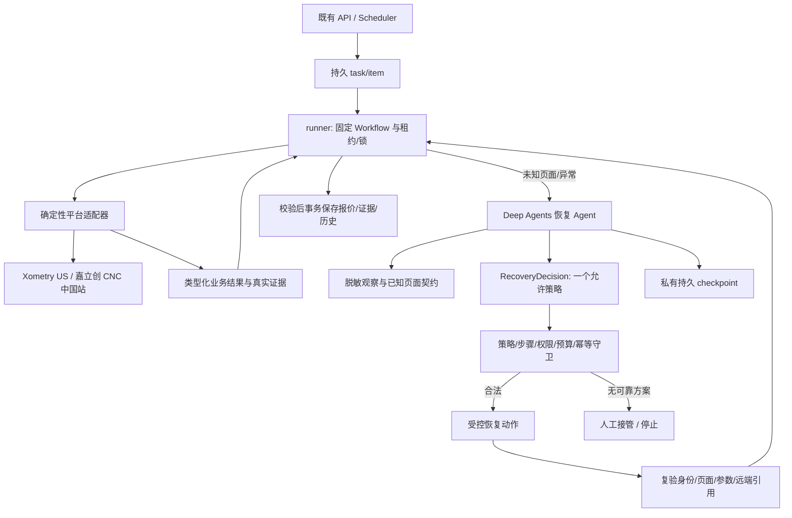

# CNC Workflow + Deep Agents 协同方案

状态：2026-10-21 规划修订，尚未实现。SDK 基线为已核验的 `deepagents==0.7.29`，来源见[版本/API 研究](research/deepagents-2026-10-21.md)。当前业务步骤、异常分支与策略条件以 [workflow-design.md](workflow-design.md)为准。

## 1. 当前决策与来源优先级

D-12 确认使用 Deep Agents；D-13 明确采用 **Workflow 固定业务流程 + Deep Agents 处理网页不确定性 + 代码守卫执行恢复**。正常步骤直接由确定性服务/Playwright adapter 执行；未知页面、异常原因或结构变化进入受限 Recovery Agent。Agent 可以观察、分析并选择允许的恢复策略，代码校验并执行后复验，回到服务端确定的步骤。

D-13 替代早期自主规划/按需 helper、每个正常步骤强制模型调用、模型缺配就停止全部报价、Agent 建议一律不能用于自动恢复等草案限定。正常成功报价可以没有模型调用；Deep Agents 必须通过真实异常分支中的观察/决策/受控恢复验收。它是正式恢复能力，不能用空壳或手写静态诊断冒充。

根 SRS 作为历史需求来源保留，D-12 的框架选型和 D-13 的协同边界优先；价格真实性、冻结参数、两平台、安全/权限、幂等和原 AC-01～11 继续适用。MVP-R10/R14/R15、AC-12/13 及本目录共同定义当前执行契约。

## 2. 边界与数据流



Workflow 是唯一业务状态推进者。模型输出只建立待校验 RecoveryDecision，不能写业务状态、价格、next_step 或请求参数。已知错误先走固定规则；无问题的正常步骤不调用模型决定顺序，不为规划/总结增加推理。

## 3. Agent 的工作和可用工具

Recovery Agent 在绑定的 owner/item/incident/step/version 下完成：识别页面类型、分析错误及页面结构差异、根据证据选择一个当前允许的恢复策略、说明依据与复验信号。所有观察是脱敏网页数据，不是系统指令。

| 注册能力 | 用途 | 限制 |
|---|---|---|
| `inspect_page_snapshot` | 读取本异常的受限 DOM/可访问性摘要，必要时读取已脱敏截图 | 仅当前账号/样件/页面引用；不返回 Cookie/密码、CAD 原文或全量页面秘密 |
| `read_known_page_contract` | 读取冻结配置中的已验证页面/定位/提取变体和参数依赖 | 只读且版本固定，不能注册新 selector、代码或参数映射 |
| `read_recovery_context` | 读取当前步骤、失败事实、远端引用摘要、剩余预算及 allowed_strategies | 身份/对象/策略集合由服务器绑定，模型不能替换 |

这些是拟实现工具名，不是 SDK 内置 API。Agent 不获得登录、上传、Apply、保存报价或任意 click/JS/HTTP/shell 工具；业务动作仍由 Workflow/策略执行器调用固定适配器。

RecoveryDecision 使用严格 Schema，包含 incident/step/version 引用、页面类型、原因分类、证据引用、一个 strategy、受限 strategy_args 和期望复验信号。策略集合为 OBSERVE_ONCE、SAFE_RELOAD、KNOWN_VARIANT、REAUTH_ONCE、READONLY_RECONCILE、RETRY_SAFE_STEP、HANDOFF、STOP；每一项的允许条件和恢复位置见 workflow-design.md。Agent 可以选择策略，无法自创动作或扩大 allowed_strategies。

例如页面配置按钮改版，Agent 可判断“已知变体 B 与当前页面一致”并选择 KNOWN_VARIANT；代码必须确认 variant_key 属于冻结配置、控件唯一、样件正确且请求参数不变，执行后回读通过才恢复。只有新定位建议而没有已验证变体时转工程待办，不直接点击。

默认关闭 general-purpose 与全部同步/异步子代理，以及 task/write_todos、动态工具发现、跨业务自主重规划。异常分析保留有限自主观察和策略选择，不能把“禁用开放规划”实现为只返回无用静态提示。

平台 Skills 保留在 agent/skills/{xometry-us-quote,jlc-cnc-cn-quote}/SKILL.md，带 name/description，描述已验证流程/异常含义/恢复边界。服务端按平台/异常类型提供固定只读内容；JSON/代码负责机器可校验事实。开发用 .agents/.codex、宿主机目录、凭据及源 CAD 不进入运行时。

## 4. SDK 接入形态

以下是待实现工厂接口示意，不是已运行代码：

```python
from deepagents import create_deep_agent


def build_recovery_agent(model, checkpoint, backend, observation_tools, policy, budget, context_type, decision_type):
    return create_deep_agent(
        name="cnc-recovery",
        model=model,
        tools=observation_tools,
        system_prompt=policy.system_prompt,
        subagents=[],
        backend=backend,
        permissions=policy.filesystem_permissions,
        middleware=[policy.tool_guard, budget],
        context_schema=context_type,
        checkpointer=checkpoint,
        response_format=decision_type,
    )
```

活动 harness profile 需明确禁用 GeneralPurposeSubagentProfile(enabled=False)，仅 subagents=[] 不足以关闭默认代理。按官方 Profiles 在 CNC consumer 初始化时注册匹配 provider/model 的受信 profile，检查预初始化模型实例实际匹配；不在 create_deep_agent 上传不存在的 harness_profile 参数，不排除受保护的 SubAgentMiddleware。该进程内固定策略，不能由请求动态改共享注册表。

模型/工具 middleware 对最终有效工具集合再次校验，禁止 task/write_todos/execute 及任何业务副作用工具；Schema 结果工具若由 SDK 注入，只允许返回 RecoveryDecision，不能映射成浏览器动作。一次分析可有限调用只读观察工具；结构化策略返回后结束，Workflow 执行/复验，不让 Agent 连续自主操作业务页面。

模型由服务端 provider 工厂构造；OpenAI 兼容网关按其协议显式配置模型实例，不能仅换 base_url 就假定兼容 SDK 默认 Responses API。冻结非敏感模型配置引用/版本，密钥仅运行时解析；定时任务不依赖聊天 Redis 的 7 天缓存或用户当前激活模型。缺配/不兼容记录 AGENT_UNAVAILABLE：正常确定性路径可继续，实际需要 Agent 的异常转人工/失败，不能计为 Agent 自动恢复成功。

## 5. 运行状态与恢复

- Workflow 保存 workflow_version/定义摘要、step/step_version、resume_step、StepResult、incident/version、RecoveryDecision、策略执行结果与复验依据；它是唯一推进者。观察过期、步骤改变、租约失效或取消时拒绝旧决策。
- 策略执行前用步骤版本/incident 版本和操作唯一键原子领取；同 item/execution_generation/step/request 指纹保持幂等，新 tool_call_id/重复决策/重启不产生新副作用。execution_generation 在逻辑 item 内冻结。
- 恢复分支每异常最多 2 轮策略选择，每轮最多 1 个动作；模型重试、策略执行和人工恢复不重置 item 的 attempt/预算。UPLOAD/SUBMIT_QUOTE 回执未知只允许只读协调/接管，不以模型置信度判断“应该没提交”。
- 线程由服务端生成并绑定 owner/item/incident；恢复同异常沿用 thread，不同 item/异常独立，预算仍归原 item。无异常时可不创建 Agent checkpoint。
- Agent checkpoint 保存脱敏观察、只读工具过程和决策进度，不保存浏览器对象/Cookie/密码/CAD，不替代业务 intent。MVP 单 CNC consumer 采用私有持久 AsyncSqliteSaver，内存 saver 仅离线测试；多机前改为经验证的共享 saver，已有 PostgreSQL 可用 AsyncPostgresSaver，不能直接套给 MySQL。
- 普通 WAITING_HUMAN 由业务 resume API 校验 owner/待办、复验身份和参数后回到确定步骤。只有 SDK 实际返回 interrupt 时才沿原 thread 调用 Command(resume=...)；不能把普通 workflow 暂停伪装成 SDK 中断。人工完成不扩大工具权限。
- 重新领取/重启先核对 workflow/配置版本、intent、远端引用，再重建账号 context。checkpoint 落后时以领域已确认结果协调，无法确认转人工，不重跑整条询价链路。

## 6. 文件、安全与预算

采用当前实例 API：CompositeBackend(default=StateBackend(), routes={"/skills/": skills_backend})；技能 backend 是只读发布快照，不挂载宿主机目录。文件权限具体规则优先、/** 兜底 deny；只读工具的 ACL/页面/版本限制独立生效，permissions 不能替代自定义工具守卫。不提供 shell、任意 HTTP/JS、写配置或跨 thread 可写长期记忆。

网页原文、按钮说明、异常描述均是不可信输入；不改变 system policy/allowed_strategies。截图无法脱敏时不发模型。模型不得补全价格/币种/数量或判断未知规格等价；报价只由同次真实页面的固定解析器与领域校验认定。

原自动重试≤2、总 attempt≤3、重登≤1、活跃≤600秒保持。异常分析每 item 所有执行/恢复累计拟上限：模型请求≤12、单次≤20秒、累计模型等待≤120秒、输入≤64,000/输出≤8,000 tokens、Agent 只读工具调用≤40、单次 graph recursion_limit≤64。每异常 2 轮策略是更直接的业务上限，graph 限额不是自主循环许可；各 incident/Schema/摘要/provider 重试全部计数，恢复不清零。正常链路模型调用可为 0。

事件关联 task/item/step/version/incident/strategy/run/tool，保存依据、策略接受/拒绝与复验结果、真实 Token/费用/等待；费用未知为 null。Web 显示业务步骤、异常摘要、自动恢复/人工待办与结果，正常报价成功率、Agent 恢复成功率和人工介入分别统计；不回传原始消息/推理/checkpoint/秘密。

## 7. 验收与分阶段交付

| 阶段 | 交付与追溯 |
|---|---|
| 01 | 核实真实正常步骤、停止点和已知/未知页面证据，列 SDK/provider/checkpoint 条件；V-07 |
| 02 | 固定 workflow/转移表、首家确定性闭环、Recovery Agent/策略守卫/复验/持久恢复；F-08，TC-DA-01～08、TC-WF-01～05 |
| 03 | 嘉立创 CNC 中国站独立 JSON/adapter/Skills/已验证变体，复用同一流程/恢复契约并回归首家；S-07 |
| 04 | 批量/定时的持久步骤、incident/thread/版本/预算与幂等隔离；M-08，TC-WF-03/05/06 |
| 05 | 业务进度/异常/恢复/用量、两站真价、真实 Agent 异常演示及运行说明；D-08，父 AC-12/13 |

| 用例 | 必须验证 |
|---|---|
| TC-DA-01 | 实际 create_deep_agent 工厂/锁文件和异常场景真实模型/只读工具/RecoveryDecision 事件；正常零模型调用也能通过 workflow |
| TC-DA-02 | 越权、任意动作/路径/selector、换参/交易/跨 owner 策略全部被拒，恢复不能改变真实报价校验 |
| TC-DA-03 | 文件/技能/观察引用越界和写入拒绝，不能读取宿主机秘密、其他用户/incident 或修改配置 |
| TC-DA-04 | 实际 profile 确已关闭默认子代理与自主业务规划；只读观察和允许策略选择可用，无业务副作用工具 |
| TC-DA-05 | 人工接管、跨 owner/过期待办/重复恢复及重启保持正确恢复位置；区分业务暂停与真正 SDK interrupt |
| TC-DA-06 | 模型缺配/协议错误/超时/超预算有明确人工/失败出口，无未经校验动作或秘密泄漏 |
| TC-DA-07 | 提交后/事务前/策略执行后崩溃恢复，不重复上传/询价/结果或策略动作；新 tool_call_id 仍幂等 |
| TC-DA-08 | 网页诱导泄密、改参数、付款或改流程不能扩展策略权限；新定位建议只进待办，不现场执行 |
| TC-DA-09 | 两平台/两轮/多个异常各自版本/观察/thread 隔离，账号锁、取消与累计预算有效 |
| TC-DA-10 | Web/报告与业务步骤和策略接受/拒绝/复验事件一致，区分 fixture、真实模型验证和平台 live 结果 |

离线 scripted model/fixture 保证规则可重复；真实 SDK/provider 调用、两站真价和性能分别验证，不把受控异常 fixture 称为站方实际变化已恢复。交付仍为原 5 天目标，记录模型/集成的实际偏差。回滚暂停新领取/策略/恢复，保留真实历史、intent 与匹配版本 checkpoint；不能用未验证的 Agent 恢复冒充自动成功。

## BR-2026-10-21 浏览器工具边界

借鉴 DeerFlow/WeKnora 的工具/作用域设计，[统一执行层](../../../docs/browser-implementation-design.md)不重建 Agent 工厂。Page/Context、storage_state、原始 DOM/Trace 不给模型；Agent 仅消费脱敏观察并选允许策略，不开放通用 click/evaluate/shell 充当正常 Workflow。
