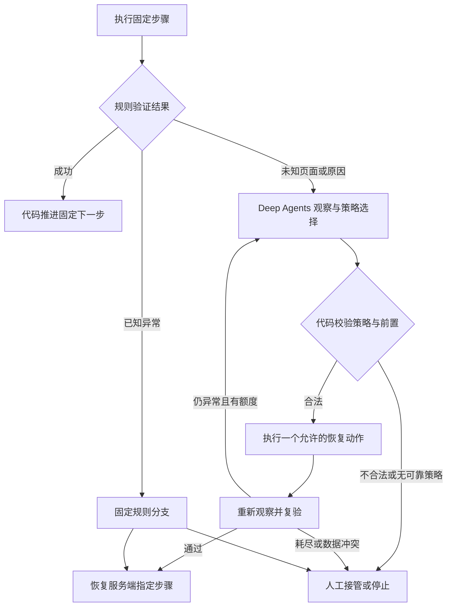

# CNC 业务 Workflow 与异常分支

状态：2026-10-21 规划修订，尚未实现。用户要求业务步骤固定、网页变化由 Agent 协同处理，记为 D-13。本文件与 [Agent 设计](agent-design.md)共同约束父子任务；SDK 基线沿用已核验的 deepagents==0.7.29，流程版本拟定为 `cnc-fixed-v1`。

## 1. 分工和范围

Workflow 负责登录、上传、参数配置、提交询价、提取报价、证据及结果保存。它决定步骤顺序、已知错误分支、重试/等待/取消、恢复位置和成功条件。正常链路由确定性代码和 Playwright 适配器执行，无需逐步请求 LLM 选择工具。

Deep Agents 负责未知页面识别、异常归因、页面结构变化分析和恢复策略选择。Agent 在当前异常及允许策略内分析，不能重排主链路、增添业务步骤、修改参数或生成价格。选出的策略经代码守卫校验执行，再由 Workflow 复验并回到指定步骤；模型文字、置信度或“完成”声明不能推进状态。

本轮覆盖早期“主 Agent 自主规划/按需 helper”和中间草案“每个正常动作必须经过模型”的设计。正常报价不要求模型调用；Deep Agents 的正式交付通过受控异常场景中的真实调用和有效恢复验证，不能只交付空接口或静态诊断文本。

## 2. 任务级业务步骤

1. 准备授权账号、STEP 和已核验的独立平台 JSON，明确地区/材料/处理/数量/商业口径。
2. 创建任务并冻结文件哈希、参数、平台配置/适配器/Workflow/模型策略版本；按文件 × 平台 × 数量展开 item，同键异参拒绝。
3. 持久入队；消费者按平台限流、账号锁和租约领取一个 item，检查取消/预算后执行下述固定链路。
4. 聚合所有 item 状态，追加报价历史，提供任务/证据/对比/CSV；定时任务只创建新轮次，复用同一链路。

按 D-17，Xometry US 与嘉立创 CNC 中国站共用 Workflow；RapidDirect 延期，只在固定平台配置与适配器内处理页面差异。两文件 × 两平台 × 数量 1/2/5 的 12 明细仍逐项独立核验。

## 3. 单明细固定主链路

| 步骤 | 固定动作和成功条件 | 下一步 / 失败出口 |
|---|---|---|
| S01 `PREFLIGHT` | 校验 owner/许可、文件类型/大小/哈希、精确参数映射和已验证配置，冻结版本，领取租约/账号锁 | S02；无权限/非法文件/未知映射动作前拒绝 |
| S02 `AUTH` | 复用加密会话或执行已验证登录流程，核对当前账号与业务页身份 | S03；失效走 E01，挑战走 E02 |
| S03 `UPLOAD` | 保存上传 intent，上传冻结 STEP，记录远端零件引用；已确认引用幂等复用 | S04；网络故障 E03，回执不明 E09 |
| S04 `WAIT_GEOMETRY` | 按固定条件/期限观察解析、单位、有效尺寸/预览和 DFM；0×0×0 不算通过 | S05；解析失败/单位歧义/多实体不符走 E04 |
| S05 `CONFIGURE` | 按 process→material→finish/roughness→dependent fields→quantity 的平台依赖顺序选择，使用精确 ID/语义 | S06；不支持项 E05，页面变化 E06 |
| S06 `VERIFY_PARAMS` | 重新读取数量、材料、公差、处理/颜色/粗糙度、附加项、交期档等，与 requested/effective 快照比对 | S07；不匹配 E05，不能带错参继续 |
| S07 `SUBMIT_QUOTE` | 保存 submit intent/操作唯一键/参数摘要，执行已核验 Apply/Save 询价动作，保存确认与远端引用 | S08；无回执/未知副作用 E09，禁止盲目重发 |
| S08 `WAIT_QUOTE` | 固定轮询频率/期限，区分 QUOTED、审核、估价、无价和失败，确认本次请求关联 | S09；审核/参考/无价 E07，超时 E03/E09 |
| S09 `EXTRACT` | 固定解析器读取真实金额、币种、单价/行价口径、交期和新鲜度；税运未知保留 null | S10；格式/币种/旧价歧义 E08，模型不补价格 |
| S10 `EVIDENCE` | 保存同次请求/有效参数/远端引用关联的脱敏截图与私有证据 | S11；存储失败 E10，只重试证据操作 |
| S11 `VERIFY_COMMIT` | 再验参数/真价/新鲜度/证据，以唯一事件键事务写入结果/历史，更新 item 并聚合父任务 | `SUCCEEDED`；事务失败 E10，重复提交返回既有结果 |

固定步骤是 item 内部执行位置；对外 task/item/quote_status/freshness 枚举继续使用稳定契约，不把内部步骤名当新业务状态。全部成功条件齐备才 SUCCEEDED；模型分析、页面出现价格、仅有截图或仅发出询价均不够。

## 4. 异常分支和恢复位置

| 分支 | 触发 | Workflow 的确定性处理 | Deep Agents 的能力 | 恢复 / 终止 |
|---|---|---|---|---|
| E01 会话失效 | 登录页回跳、身份失配、会话过期 | 账号锁内最多一次重登，记录原 resume_step，复验身份/远端对象 | 原因不明时识别页面类型，选择允许的重认证或转人工 | 返回记录的安全步骤；仍失败转 WAITING_HUMAN/FAILED |
| E02 认证挑战 | CAPTCHA/MFA/激活/资质验证 | WAITING_HUMAN，账号持有人在受控浏览器完成；不把验证码发给模型 | 识别挑战类型、说明人工处理点 | owner/待办/身份复验后恢复；到期停止 |
| E03 瞬时故障/限流 | 网络超时、5xx、429、加载未完成 | 尊重 Retry-After 和固定退避/期限，仅重试声明为安全的当前步骤 | 未知原因时选择再观察、符合条件的安全刷新、允许的重试或接管 | 原步骤，预算不重置；耗尽 TIMED_OUT/FAILED |
| E04 文件/几何/DFM | 解析失败、0 尺寸、单位歧义、不可加工 | 停止当前件并保留诊断；不自动缩放/换文件/换工艺 | 解释页面诊断，归类解析/DFM 原因，提出人工处理建议 | 非可报价或人工待办；换件/改工艺必须显式新建 item |
| E05 参数不支持/回读不符 | 选项缺失、依赖重置、有效规格不等价 | 拒绝提交；仅允许重读/同一冻结意图的安全重新应用一次 | 分析控件/依赖变化，选择已验证界面变体、再观察或人工 | 回 S05/S06 并完整复验；不能最近似替代 |
| E06 未知页面/定位变化 | 页面契约不匹配、元素歧义、新弹窗或布局 | 暂停当前动作并生成脱敏观察及当前可用恢复策略 | 识别页面、分析差异和原因，选择已验证备用定位/安全观察/接管 | 复验页面、样件及参数后回原步骤；无已验证方案转人工 |
| E07 审核/参考/无价 | PENDING_REVIEW/REFERENCE_ESTIMATE/NO_QUOTE | 分别记录，不计成功；审核等待有截止，P0 不承诺无限期回查 | 仅识别原因/解释人工要求，不把文字推算成价格 | WAITING_REVIEW 或 NON_QUOTED，明确待办/到期结果 |
| E08 报价数据异常 | 金额/币种/口径缺失、旧价、提取格式变化 | 只读确认远端请求/参数/价格口径；不补 0 或沿用旧价 | 分析页面字段变化，建议已验证提取变体或人工修订 | 复验后回 S09；无法确认转人工/失败 |
| E09 副作用回执不明 | 上传/Apply 后连接中断、远端是否接收未知 | 只读协调 intent/远端引用，锁住重复上传/提交 | 选择允许的只读远端回查、再观察或接管 | 已确认则进入对应后继步骤；证据不足转人工，不能再发 |
| E10 证据/数据库失败 | 截图/私有存储/结果事务失败 | 保留已确认远端结果，仅幂等重试 S10/S11 或已完成事务查询 | 必要时归类错误；没有重新询价权限 | 回 S10/S11；缺证据不记成功，不重跑 S07 |
| E11 进程重启/租约中断 | 过期租约、浏览器丢失、checkpoint 落后 | 核对步骤/流程版本、intent 和远端引用，重建 context、复验身份 | 仅在协调后页面仍未知时进入异常分析 | 恢复代码记录的位置；不可核实则人工 |
| E12 Agent/模型故障 | 缺配、协议错误、预算/模型超时、非法策略 | 记录 AGENT_UNAVAILABLE/策略拒绝，不执行未经校验动作 | 无有效决策时不自动扩大权限或改用开放规划 | 人工/失败；正常确定性链路不因无模型被改道 |
| E13 取消/总预算耗尽 | 取消标志、活跃时间或尝试次数耗尽 | 停止新动作；未决副作用仍保留协调记录 | 无权覆盖取消、重置预算或宣称成功 | CANCELLED/TIMED_OUT 或显式协调待办 |

已知且规则明确的错误直接走固定分支，不为每次错误调用模型。未知异常进入 Deep Agents 恢复分支；涉及身份/参数/报价准确性或副作用不明时采取保守出口。

## 5. Agent 允许选择的恢复策略

策略名称是本项目拟实现枚举，非 SDK 内置 API。Workflow 根据当前 step、失败事实、配置和预算生成 allowed_strategies；Agent 仅从此集合选择一个策略，返回依据和期望复验信号。

| 策略 | 允许条件 | 代码验证和范围 |
|---|---|---|
| `OBSERVE_ONCE` | 页面仍在加载或缺少关键状态证据 | 当前受信页面的有限只读观察，不延长原截止时间 |
| `SAFE_RELOAD` | 适配器证明是安全 GET 页面、无未保存编辑和未决提交 | 最多一次；不能重放表单、上传或 Apply |
| `KNOWN_VARIANT` | 冻结配置内存在已验证备用 UI/locator/extractor 变体 | 仅传 variant_key；校验唯一元素/样件范围/语义，不接受任意 selector/JS |
| `REAUTH_ONCE` | 已核实会话失效、仍有重登额度 | 原账号/受信登录域，最多一次，随后复验身份/远端对象 |
| `READONLY_RECONCILE` | 具有当前请求可核对的远端引用/intent | 使用固定适配器只读回查，不新增询价 |
| `RETRY_SAFE_STEP` | 当前步声明可重试，副作用不存在或已有可证明的幂等处理 | 保持参数、操作唯一键和总预算；未知提交不在此集合 |
| `HANDOFF` / `STOP` | 无可靠自动策略、数据冲突或能力不可用 | 创建受权限保护的待办/停止记录；不放开浏览器动作权限 |

Agent 可以提出新页面/定位修订建议，但新 locator、未知交互和新策略仅进入工程待办，不能当场执行。工程验证后发布新配置/适配器版本，显式创建关联重跑 item 并重新冻结版本；不热切换在途任务或覆写原历史。

## 6. 异常处理闭环

RecoveryDecision 至少包含 incident_id、workflow/step/version 引用、页面/原因分类、evidence_refs、strategy 和受限 strategy_args。服务端重新校验观察未过期、当前版本/租约/owner、策略合法性、幂等和交易守卫；置信度仅作参考。Agent 不写 next_step、价格或请求参数；恢复后由代码根据事实选择该分支允许的恢复位置。

每次异常最多 2 轮策略选择，每轮最多执行 1 个恢复动作；同 item 的自动重试≤2、总 attempt≤3、自动重登≤1、活跃时间≤600秒继续有效。模型请求、观察、退避和人工恢复共享原累计预算，不通过新 incident 重置 item 额度。正常已知步骤不消耗模型推理；异常 Agent 的模型/token 上限见 agent-design.md。

## 7. 持久化、人工恢复与验收

业务库记录 workflow_version/定义摘要、recovery_policy_version（拟定 cnc-recovery-v1）、step/step_version、resume_step、step_result_ref、incident_id/版本、选定策略/拒绝原因/复验结果和幂等键。只按版本比较更新推进；重复结果/重复恢复不发新动作。新监测轮次和改参创建新 item，固定原版本的重试不读取新默认配置。

Workflow 的 WAITING_HUMAN 由业务 resume API 校验 owner/待办、重建 context 并复验身份后恢复。只有 Deep Agents 实际存在 SDK interrupt 时才沿用该 thread 调用 Command(resume=...)；普通业务暂停不伪造 SDK resume。checkpoint 不恢复浏览器内存、不决定下一步、不覆盖业务 intent。

| 用例 | 必须验证的结果 |
|---|---|
| TC-WF-01 | 相同已核验输入与事件执行相同主步骤；正常确定性路径无需 LLM 决策或强制模型调用 |
| TC-WF-02 | Agent 只能选本事件的允许策略；任意 selector/换参/交易/跳步/多动作在副作用前拒绝 |
| TC-WF-03 | E01～E13 有逐分支测试；重登/退避/审核/取消/无模型均走明确出口，未决提交不重发 |
| TC-WF-04 | 未知页面/结构变化可实际调用 Deep Agents 观察、分析、选策略，经代码守卫和复验恢复；无可靠策略转人工 |
| TC-WF-05 | 旧步骤/过期观察、重启、重复结果/恢复和配置升级不跳步、不重复副作用、不重置累计预算 |
| TC-WF-06 | 两平台、改参、批量/定时共用流程并隔离版本；Web 进度来自业务步骤，正常报价与 Agent 恢复统计分开 |

父 MVP-R15、AC-13 及 V-07/F-08/S-07/M-08/D-08 负责追溯。TC-DA-01～10 继续核验真实 SDK、权限/注入/预算/持久恢复；Deep Agents 真实调用可用已授权脱敏页面或受控异常 fixture 验证，需明确环境，不能冒充站方实际异常已恢复。两站真实报价与价格/参数准确性仍须独立 live 验收。

## BR-2026-10-21 执行层归属

S01～S11/E01～E13 不变。[统一执行层](../../../docs/browser-implementation-design.md)提供官方 Playwright 薄适配；02/03 实现平台契约/持久 intent/远端协调。未知异常只给 Agent 脱敏字段和允许策略，禁止任意 URL/脚本/定位器/交易。取消/超时不自动重放副作用。
