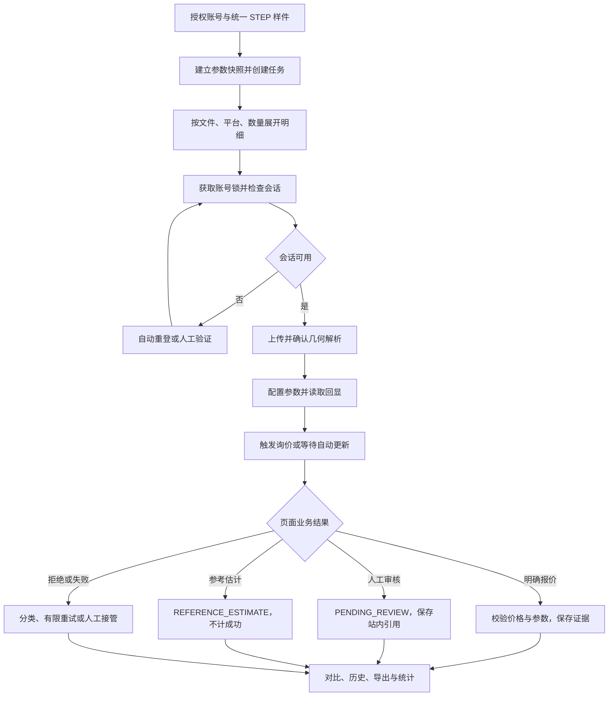
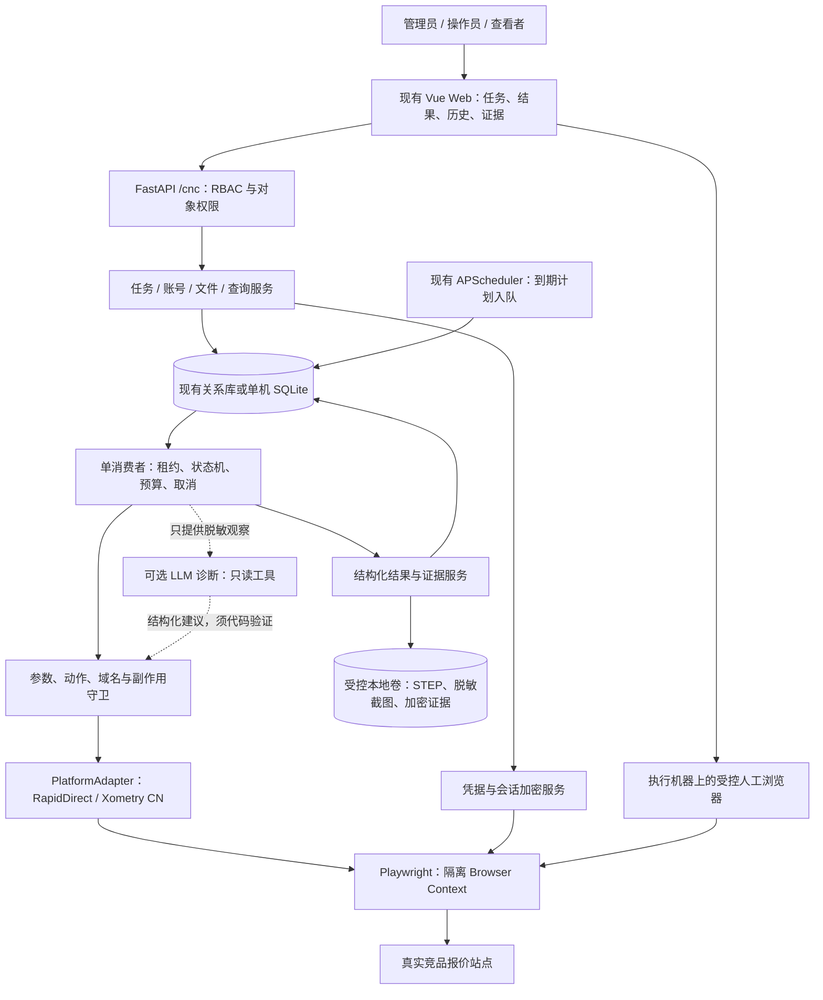
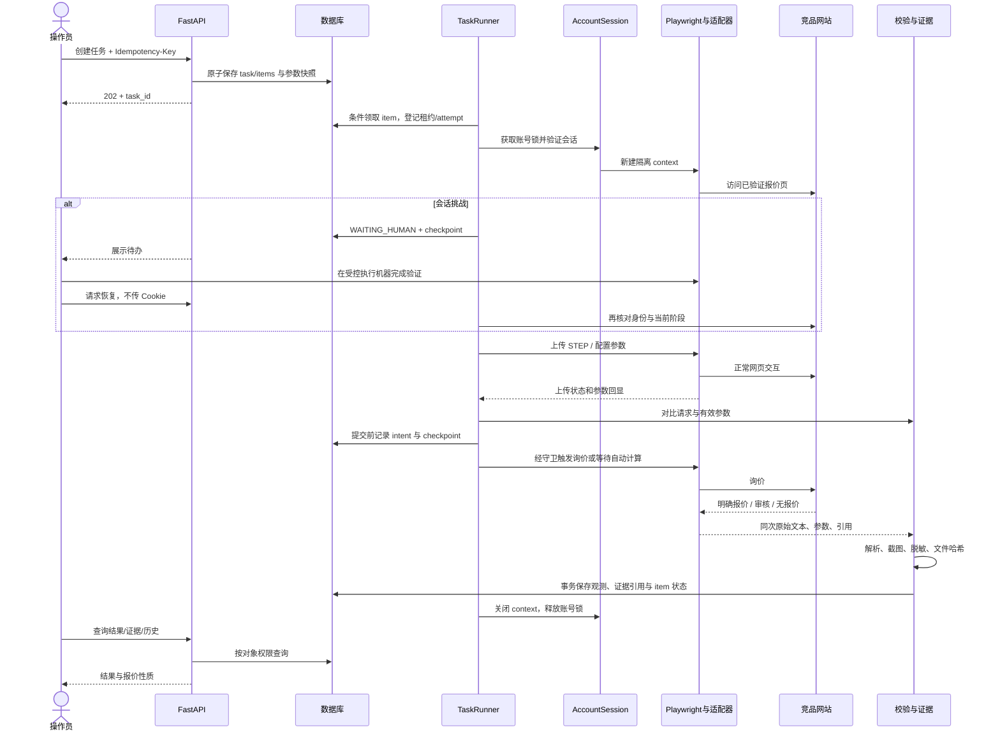
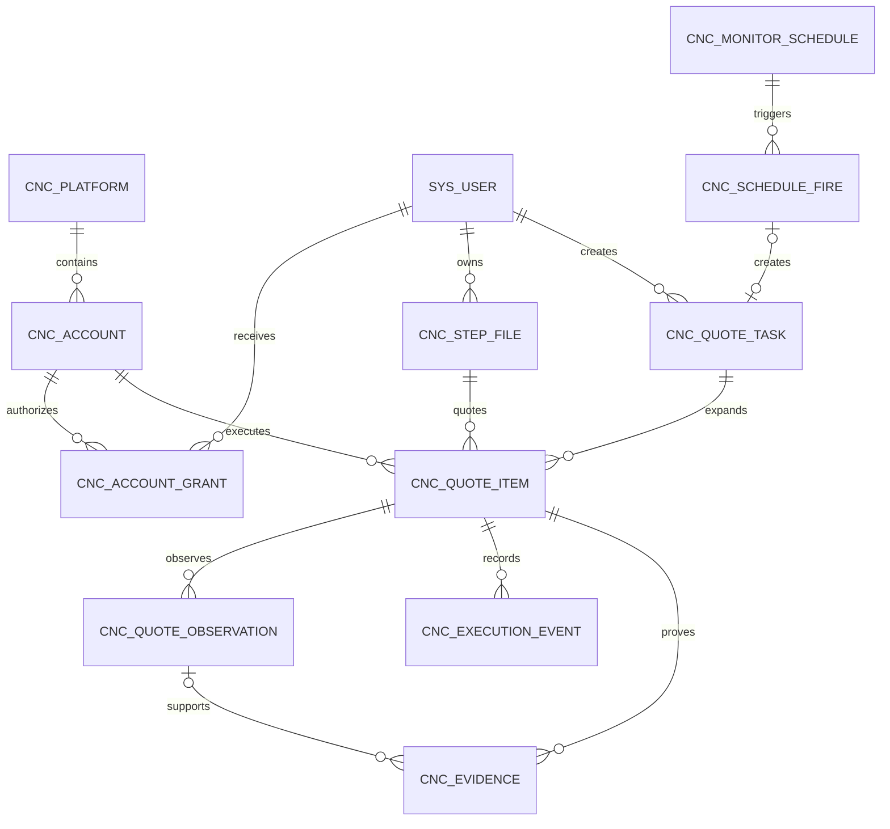
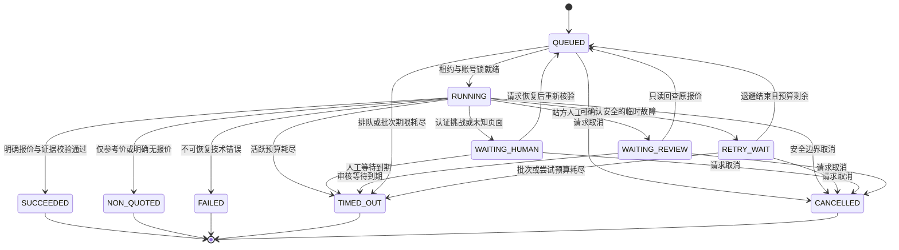

# CNC 竞品报价监测 AI Agent 系统需求与详细设计说明书 v1.0


| 文档属性    | 内容                                                        |
| ------- | --------------------------------------------------------- |
| 版本 / 日期 | v1.0 / 2026-10-21                                         |
| 文档性质    | 需求与拟实施设计；供研发工程师、测试人员、业务验收方及编程 Agent 使用                    |
| 首要交付目标  | 5 个工作日内接通至少两家不同服务商，完成真实 CNC 报价闭环及线上演示                     |
| 推荐验证顺序  | 第一平台 RapidDirect → 第二平台择幂中国；均须通过第 2 章实测关卡后锁定              |
| 架构决策    | 确定性 Playwright 状态机为主，LLM 提供受限诊断与候选定位建议                    |
| 当前事实边界  | 已检索官方公开资料并核查本地仓库；未登录竞品账号，未上传 STEP，未获得实测报价或性能结果            |
| 项目基线    | 当前仓库分支 dev，最近提交 60d5519b；已有 FastApiAdmin 基础，尚未接入本文 CNC 模块 |
| 验收数值性质  | 除明确引述的官方声明外，工时、容量、超时与成功率均为建议目标或设计默认值                      |


**实施约束：先验证平台可行性和 MVP 范围，再确定实现。任何页面选择器、站内接口、账号资格及报价时效，未经账号实测均不视为已验证。本文不是第三方网站使用许可或软件认证声明。**

## 目录

1. 项目概述与建设目标
2. 竞品平台调研与接入可行性
3. 功能需求详细设计
4. AI Agent 总体技术架构
5. 浏览器自动化与 Agent 核心设计
6. 数据模型与数据库设计
7. 后端接口与任务调度设计
8. 安全设计
9. 非功能性需求
10. 5 天开发实施计划
11. 测试方案与验收用例
12. 技术风险与优化建议
13. 附录：追溯矩阵、官方资料和交付检查单

## 第 1 章 项目概述与建设目标

### 1.1 背景、价值与建设目标

系统针对企业有权使用的 STEP 图纸，按相同加工条件在竞品网站执行询价，留存平台实际展示的价格、交期、参数及证据，形成可复核的对比和历史记录。业务价值是减少重复操作、识别同条件价格变化，为报价策略提供依据；系统不生成加工成本预测，不替代采购或工程审核。


| 目标编号  | 建设目标        | 成功标准                                    |
| ----- | ----------- | --------------------------------------- |
| BG-01 | 获取可信的真实竞品报价 | 至少两家不同服务商各完成登录、上传、配置、报价读取；金额、币种及数量与页面一致 |
| BG-02 | 提高重复询价效率    | 支持多文件及数量 1/2/5 的任务展开；记录平均耗时、P95 和吞吐     |
| BG-03 | 持续监测同条件价格   | 同参数定时运行至少两轮，保留每轮结果、差异和时间                |
| BG-04 | 控制运行与数据风险   | 有限重试、人工接管、敏感信息保护；无购买、支付或正式订单提交          |
| BG-05 | 支持后续平台扩展    | 平台差异封装于适配器与映射配置，核心任务和结果契约复用             |


### 1.2 用户角色与系统边界


| 角色      | 权限和职责                          |
| ------- | ------------------------------ |
| 管理员     | 管理平台配置、账号授权、凭据、密钥与平台开关；查看审计    |
| 操作员     | 使用获授权账号和图纸创建任务、处理验证码、恢复任务、配置监测 |
| 查看者     | 查询获授权结果、截图与导出；不可访问账号密码或会话      |
| 研发 / 测试 | 维护适配器、执行隔离测试、核对真实报价；不默认获取生产凭据  |


MVP 为单组织、小规模内部工具，复用现有用户、菜单和 RBAC。平台账号与本站登录账号属于两套身份。操作员只能使用显式授权的平台账号、图纸和结果，所有对象接口实施服务端对象权限校验。

系统包括后台任务、浏览器执行器、平台适配器、结果与证据存储、最小管理页面。外部报价引擎、邮件、验证码服务、物流及交易系统不在系统控制范围内。账号注册、实名认证、企业资质、首轮 MFA 由账号持有人完成。

**禁止自动执行购买、支付、正式订单提交、自动扣款授权、账号安全设置修改及非询价操作。** “Submit order”“确认订单”等按钮即使可能触发人工审核，也不能作为默认询价动作。

### 1.3 5 天范围分级


| 层级          | 范围                                                                                                         | 边界及验收地位                                  |
| ----------- | ---------------------------------------------------------------------------------------------------------- | ---------------------------------------- |
| P0：MVP 必须交付 | 两家服务商的真实报价闭环；账号配置、会话复用及失效恢复；STEP/STP 上传；明确材料、数量、表面处理；批量数量 1/2/5；结果和失败分类；截图；最小定时监测、历史表和折线；CSV 导出；权限与加密；故障接管 | FR-01～FR-06 均有最小实现；第二平台不可因界面美化或 AI 功能延期  |
| P0：演示能力     | 在线创建任务；运行中可见进度；临时变更材料或数量创建新任务；连续执行统计；两个平台对比；历史和证据查看                                                        | 真实演示与录制材料分开标识；录屏不能替代现场真实报价               |
| P1：有条件增强    | 受限 LLM 页面候选定位；Markdown 导出；跨平台同时执行两个上下文；非即时正式报价自动回查；更丰富图表                                                   | 不依赖这些功能通过两平台 P0；LLM 诊断接口可先完成，在线模型调用有条件开启 |
| P2：后续版本     | 更多平台、分布式队列、多机 Browser Pool、多组织、复杂装配体、材料等价知识库、汇率分析、价格预警、邮件自动读取、全自动视觉操作                                      | 不纳入 5 天承诺                                |


“批量上传”指本站可接收多份文件并生成独立询价明细；MVP 不要求在竞品网站一次上传整批，也不把不同零件总价错误分摊为单件报价。

### 1.4 默认假设与关键依赖


| 编号    | 假设 / 依赖                                                       | 默认处理及不成立时影响                                                                |                                    |
| ----- | ------------------------------------------------------------- | -------------------------------------------------------------------------- | ---------------------------------- |
| AS-01 | 1 名熟悉 Python/Playwright 的主研发，业务联系人每天可响应账号问题，测试提供约 0.5 人日支持    | 计划按主研发 40 小时估算；仅有首次接触技术的单人时需重新评估范围，不能保证 5 天                                |                                    |
| AS-02 | Day 1 前提供至少两个可用授权账号、邮箱/手机接管人和无保密限制的测试图纸                       | 未具备则列为关键阻塞；研究可进行，真实闭环不可宣称完成                                                |                                    |
| AS-03 | 运行环境可访问所选站点；不依靠地区伪装、代理轮换或验证绕过                                 | 不可达时选择可合法访问的其他服务商                                                          |                                    |
| AS-04 | 演示样件为 2 份简单单实体 STEP，单位 mm，单文件不超过 10 MB                        | 10 MB 是本系统建议上限，并非所有平台官方上限；最终取系统与实测平台上限较小值                                  |                                    |
| AS-05 | 候选主材料为 Aluminum 6061-T6，表面处理为经确认的原始机加工表面；第二材料由 Day 1 共同支持列表决定 | 同名不等于等价；不可用时冻结另一真实公共规格，不允许静默替代                                             |                                    |
| AS-06 | 先按平台原币显示，默认不做跨币种排名；税费、运费、折扣和交期语义单独保存                          | 币种或成本范围不同只做并列观察，不声称谁更便宜                                                    |                                    |
| AS-07 | 已有后端、Web 管理台与 Redis 可运行；优先沿用当前业务数据库                           |                                                                            | 全新本地演示可用 SQLite；不得为了“轻量”额外引入第二个业务库 |
| AS-08 | 演示平台允许相关账号及询价用途，重复询价频率经核对可接受                                  | 未确认许可时暂停该平台自动执行，继续合法候选的平台验证                                                |                                    |
| AS-09 |                                                               | 缺少模型密钥不阻断确定性闭环；不存在最低 Token 消耗要求<br>LLM 为可选外部服务，默认关闭或仅诊断；模型与浏览器依赖在 Day 1 锁定 |                                    |


### 1.5 术语、真实性与核心流程


| 术语                  | 本文统一定义                                                 |
| ------------------- | ------------------------------------------------------ |
| 报价任务 task           | 一次用户或定时触发的询价集合                                         |
| 报价明细 item           | 一个文件版本 × 一个平台账号 × 一组完整加工参数 × 一次观测；数量是参数，不是子任务数         |
| 执行尝试 attempt        | 同一明细的自动重试或人工恢复过程；不得把重试算成新的成功样本                         |
| 真实报价                | 从真实账号和真实图纸的配置页面取得、可关联明确参数的单值平台报价；不要求最终成交价，但须保留有效期及平台限制 |
| REFERENCE\_ESTIMATE | 平台标明仅参考的预估价或区间；可存储，不能计入真实报价闭环成功                        |
| QUOTED              | 页面已给出明确价格与币种、配置已核对、无待审核报价标记且证据完整；可有常规报价免责声明            |
| 交期                  | 依平台原文区分生产工作日、发货日期、送达日期和自然日；不能自行互换                      |
| 自动完成                | 任务提交后到结果入库不需人工操作；首次开通账号及预先初始化会话单独披露                    |




流程图中的恢复路径受第 5、7 章次数和总时限限制，不构成无限循环。

## 第 2 章 竞品平台调研与接入可行性

### 2.1 调研方式、证据等级与限制

调研日期为 2026-10-21，使用官方首页、帮助中心及官方关联入口。公开网页抓取成功不表示登录后的交互或报价已经实测；JavaScript 门户不能仅凭搜索摘要还原当前 DOM。部分帮助页只能读取官方搜索索引，以下如实标注。


| 等级  | 含义                         | 本次覆盖                    |
| --- | -------------------------- | ----------------------- |
| E0  | 无可靠一手资料，属于待验证              | 站内私有接口、当前反自动化策略及实际地区可用性 |
| E1  | 官方公开资料说明，尚无本项目账号实测         | 下表所述能力；搜索索引资料额外注明       |
| E2  | 已用授权账号和统一 STEP 人工走通，有时间戳证据 | 本次无；Day 1 必须补齐主选两平台     |
| E3  | 自动化重复完成且人工核对通过             | 本次无；Day 2/3 起形成         |


本文没有发现并验证足以作为 MVP 依赖的公开 CNC 报价 API。统一采用浏览器正常询价路径；任何未来 API 都须验证授权、文档和适用范围，不把浏览器内部请求视为公开接口。

### 2.2 平台能力与流程调查


| 平台及地区               | 在线报价、账号与 STEP 流程：E1 资料                                                                                                                                                                                                                                                                  | 参数与结果                                                                                                                                                      | 自动化风险、待验证项目                                                         | MVP 结论                                                |
| ------------------- | --------------------------------------------------------------------------------------------------------------------------------------------------------------------------------------------------------------------------------------------------------------------------------------- | ---------------------------------------------------------------------------------------------------------------------------------------------------------- | ------------------------------------------------------------------- | ----------------------------------------------------- |
| RapidDirect         | 官方平台说明 CAD 上传→配置→即时报价或人工报价；官方帮助列出 STEP/STP、拖拽/选择上传及 15 MB 限制。报价门户为 app.rapiddirect.com。完整价格查询是否必须注册、当前登录方式待验证。[平台说明](https://www.rapiddirect.com/our-platform/)、[帮助中心](https://www.rapiddirect.com/help-center/)                                                                        | 官方说明可配置材料、数量、表面处理。若不能即时计算，官方说明转人工报价；文中等待时间是平台声明，不是系统实测 SLA                                                                                                 | JS 交互、DFM 等待、材料控件、账号验证、报价是否仅预估及当前文件上限待账号实测；不依赖网站宣传的秒级速度             | 首选验证；具备较完整的单件配置资料                                     |
| 择幂中国 / Xometry Asia | 已找到中文官方网站 xometry.asia/zh-hans/；其客户账号及报价链接指向 get.xometry.asia。官方 IQE 说明支持 STEP/STP 和规格编辑；门户抓取返回需启用 JS。账号注册、手机/密码/MFA 方式及企业资格待验证。[官网](https://xometry.asia/zh-hans/)、[IQE 说明](https://xometry.asia/zh-hans/instant-quoting-engine-3/)、[报价入口](https://get.xometry.asia/quotes)            | 官方说明上传后修改工艺、材料、数量、表面处理；必须区分页面“预估价格”与配置完成后的明确报价。本文读取 IQE 说明时直接页面超时，相关细节来自官方搜索索引                                                                             | 认证与报价子域白名单、报价有效性、税价口径、单位/材料热处理状态待验证；中文入口不保证 CNY 或所有境内账号均可用          | 第二主选；与 RapidDirect 为不同服务商                             |
| Xometry 美国          | 官网列出 STEP/STP；官方帮助说明注册、拖拽或选择多份 CAD、配置后查看价格和交期，部分零件需要人工审核。帮助细节来自官方搜索索引。[官网](https://www.xometry.com/)、[报价帮助](https://community.xometry.com/kb/articles/686)                                                                                                                              | 工艺、材料、Features、Finish 等；变更后须应用并确认刷新；具体数量字段及当期控件待验证                                                                                                         | 登录挑战、地域/运输地址、国内与美国制造路径、USD 成本构成、复杂特征配置均待实测                          | 第一候补；不得与中国站假定账号通用；若替换 RapidDirect，必须再选一家非 Xometry 服务商 |
| meviy 中国            | 官方中国站提供会员登录、注册入口，描述上传 3D→设置条件→报价；机加工方件/圆件分流。官网支持主流 CAD，但本次未确认中国站当前 STEP 版本/大小限制。[中国站](https://meviy.misumi.com.cn/zh_cn-cn/)、[机加工方件](https://info-meviy.misumi.com.cn/machined_plates/)                                                                                                 | 材料、表面处理、公差等存在官方说明；精度孔/尺寸选择可能进入 3D 标注；STEP 直接获取所有所需条件报价待实测                                                                                                  | 会员资格、孔识别、几何加工约束、3D 交互与报价确认步骤可能增加工时；不使用日本/美国站规则代替中国规则                | 有已激活会员且样件通过时可作为候补；否则后续                                |
| Fictiv              | 官网有登录及报价入口；官方格式帮助确认 CNC 支持 STEP/STP，通常为单实体；上传后 CNC 可能先返回成本区间，简单零件可即时正式报价，复杂零件进入人工报价。[格式说明](https://www.fictiv.com/help/uploading-and-organizing-parts/what-file-formats-does-fictiv-support)、[报价时间说明](https://www.fictiv.com/help/getting-a-quote/how-long-does-it-take-to-get-a-quote) | 官方帮助描述配置、交期和报价；复杂件的 Get exact quote 进入工程师审核，支持回到账号查看。[正式报价流程](https://www.fictiv.com/help/getting-a-quote/what-happens-after-i-request-an-exact-cnc-quote) | 成本区间不能计成功；账号、地区、运送与审核时段待实测；附加图纸可能进入人工路径                             | 正式报价快且账号可用时备选；不作为仅凭首页即可保证的即时平台                        |
| 嘉立创中国 / JLC-CNC CN  | 用户给出的 jlc-cnc.com 为中文站。官方指南说明选择 CNC、上传 STEP/STP、修改材料/表面处理等。指南页面更新时间 2024-12-12，本次通过官方搜索索引读取。[中文站](https://www.jlc-cnc.com/)、[询价指南](https://www.jlc.com/portal/server_guide_37967.html)                                                                                                  | 当前金额性质、交期显示、是否需提交正式订单才能获审核价格，必须实测；不把指南“在线报价”自动解释为最终确定价格                                                                                                    | 手机验证码、统一账号、批量参数、当前审核规则待验证；未证实报价与订单可以安全分离前不开启提交                      | 条件候补；优先验证独立询价路径                                       |
| JLCCNC 国际站          | 独立核查 jlccnc.com，不能将其直接称为“美国站”或假定与中国站同流程。官方指南确认 STEP/STP、账号建议、数量/材料/表面处理；2026-08-29 指南明确自动价仅参考、最终价格与交期需人工审核。[订购指南](https://jlccnc.com/help/article/how-to-place-cnc-orders)、[报价规则](https://jlccnc.com/help/article/cnc-machining-ordering-guidelines)                                    | 存在支付前审核及自动扣款相关订购流程；本系统不进入正式订单或自动支付。仅参考自动价记录为 REFERENCE\_ESTIMATE                                                                                           | 正式报价可能与提交订单路径绑定。只有验证存在无订单副作用的独立询价后才允许接入；不能因“未支付”就认定无风险              | 不适合首批即时闭环；美国收货场景需另行验证                                 |
| Protolabs 本站        | 官方 ProDesk 帮助明确账号、项目、选择 CNC、上传单个/多个 CAD（列有 STEP .stp）、配置材料和后处理再分析；官方称互动报价通常约 20 分钟。[ProDesk 帮助](https://www.protolabs.com/help-center/prodesk/)、[CNC 服务](https://www.protolabs.com/services/cnc-machining/)                                                                             | 可能是异步分析后报价，材料及数量可调整；当前 .step 后缀、具体地区服务和等待时间待实测                                                                                                             | 长分析时间、DFM 必改项、地区、项目配置增加交付风险；Protolabs Network 是另一入口，不以其“即时”说明替代本站能力 | 第二阶段；除非已有可用账号和稳定样件                                    |


表内交互复杂度判断是工程推断，并非网站源码审计或实测结论。所有官方秒级、分钟级、小时级时效都仅作筛选信息。

### 2.3 平台接入优先级评估矩阵

建议评价维度：真实明确报价可得性 35%、账号/地区可达性 20%、流程简洁度 20%、资料充分度 10%、5 天适配成本 15%。各项 1～5 分，越高越利于本次交付；总分＝Σ(分值/5×权重)。账号相关打分为待验证估计，不能当作实际成功概率。


| 平台           | 报价 35 | 账号 20 | 流程 20 | 资料 10 | 成本 15 | 暂定分 /100 | 适配器增量工时估计\*     | 顺序               |
| ------------ | -----: | -----: | -----: | -----: | -----: | --------: | --------------- | ---------------- |
| RapidDirect  | 4     | 3     | 4     | 5     | 4     | 78       | 5～8 小时          | 1                |
| 择幂中国         | 4     | 3     | 4     | 4     | 4     | 76       | 5～8 小时          | 2                |
| Xometry 美国   | 4     | 2     | 3     | 5     | 3     | 67       | 6～10 小时         | 候补 A             |
| meviy 中国     | 3     | 3     | 2     | 4     | 2     | 55       | 8～12 小时         | 候补 B，会员/样件已验证时上调 |
| Fictiv       | 3     | 2     | 3     | 4     | 2     | 55       | 7～11 小时         | 候补 C，明确单值即时报价时上调 |
| 嘉立创中国        | 2     | 3     | 3     | 4     | 3     | 55       | 6～10 小时         | 条件候补，先澄清价格性质     |
| JLCCNC 国际站   | 1     | 3     | 3     | 5     | 2     | 47       | 8～12 小时且含外部审核等待 | 后续               |
| Protolabs 本站 | 3     | 2     | 2     | 5     | 2     | 53       | 8～12 小时且含外部分析等待 | 后续               |


*工时只计已完成共用执行框架后的单平台开发与调试，不包括账号开通、等待人工审核、通用 API/UI/数据库；不是承诺。分数用于排验证顺序，**硬性关卡优先于分数**，条件候补不会只因高 1 分而提前。

首选 RapidDirect 的依据是公开的文件/配置说明较完整，并明确区分即时和人工路径。第二选择择幂中国的依据是已查到官方入口、明确 CAD 和规格流程，且适合先验证中文业务环境。该选择是基于公开证据的暂定决策；两者都没有本项目 E2/E3 证据。

### 2.4 Day 1 技术验证关卡、失败标准和切换规则

为主选及一个候补准备同一 A/B STEP、账号、收货地区快照与人工核对模板。先人工验证，不先编写长脚本。


| 关卡编号        | 验证动作及产物                                                  | 通过条件                                  | 失败判定                           | 影响 / 应急处理                               |
| ----------- | -------------------------------------------------------- | ------------------------------------- | ------------------------------ | --------------------------------------- |
| G-01 条款与身份  | 核对当前条款、自动访问和竞品监测用途；确认账号属主、有效授权、邮件/手机可接管；记录日期和结论          | 用途及访问方式可被采用，账号已激活                     | 条款明确禁止、账号无权使用或需超过当天的资格审核       | 平台暂停，切换另一服务商；不绕过                        |
| G-02 可达与登录  | 在交付机器人工登录，关闭并重开 context 验证会话复用；确认挑战类型                    | 能到达客户报价页；复用可用，或可明确实现登录恢复              | 两个 15 分钟验证窗口仍不可达/反复挑战，或必须伪造地区  | 首次人工登录可接受但记录；持续不可用则换平台                  |
| G-03 上传与几何  | 各上传 A/B，记录格式、大小、单位和解析状态                                  | 两个样件至少一个能被识别；最终验收两件均需通过冻结集合           | 同一样件两次人工上传仍失败，或需修改设计才能报价       | 可在 Day 1 更换统一样件并在两平台重测；不能各用不同图纸冒充对比     |
| G-04 参数共集   | 读取材料牌号/热处理、数量 1/2/5、表面处理、公差、粗糙度、交期档                      | 必需字段可设置并回读，形成映射 v1；第二材料确定             | 最低数量大于 1、材料/工艺无公共集合、关键规格不可确认   | 挑选真实公共规格；仍不满足则换平台                       |
| G-05 真报价与边界 | 同图人工询价，记录单价/行总价、币种、交期原文、报价标识、页面价格性质与停止位置                 | 可在不正式下单/支付前取得明确报价和可解释交期；即时报价建议 10 分钟内 | 只有区间/参考价；明确报价必须正式订单；仍在审核或无交期语义 | 不计真报价；尝试独立询价并限时等审核，或切换已通过的其他平台          |
| G-06 自动化可定位 | Playwright 只读检查可访问控件、上传 input/chooser、配置回显和结果区域；保存脱敏页面结构 | 关键步骤存在唯一可验证控件，常规操作无需 Canvas 坐标规划      | 核心步骤只能靠无法确认的视觉坐标，或读取无稳定依据      | 记录诊断；简单人工补位仅算辅助，不能替代自动闭环                |
| G-07 新鲜度    | 原报价重开或重访，变更数量后返回，再测试重新计算入口                               | 能区分新报价、更新版本或当前刷新结果与缓存                 | 页面仅显示历史价，无法证明新观测经过重算/刷新        | 结果标为 CACHE\_UNVERIFIED；不纳入历史价格变化和速度成功样本 |


**时间盒：** Day 1 前 4 小时完成主选两平台人工核验与轻量自动定位；单平台关键未知初查 45～60 分钟仍未解决即并行处理账号依赖或转候补，不消耗整天绕登录。当天结束前必须冻结两个通过 G-01～G-07 的不同服务商与至少一个统一样件，记录 E2。

若任一主选失败，先验证 Xometry 美国或已有已激活账号的平台。Xometry 中国与美国可以分别研究和建适配器，但**两者不能单独满足本项目“两家不同竞品服务商”的成功标准**。嘉立创中国/国际站同理。若当晚仍找不到两家符合硬关卡的平台，列为交付风险并调整候选或时间；不能用模拟价、人工录入或仅提交审核申请冒充两平台达标。

## 第 3 章 功能需求详细设计

### 3.1 功能需求总览与编号

FR-xx 为功能域，FR-xx.yy 为可测试子需求。优先级采用 P0/P1/P2；下文每个功能均列出目标、前置、输入、流程、输出、规则、异常、依赖、优先级和量化验收。TC 为测试用例，DV 为开发任务，MOD 为模块。


| 功能域             | P0 子需求                                             | P1 子需求           | 业务目标 / 模块             |
| --------------- | -------------------------------------------------- | ---------------- | --------------------- |
| FR-01 账号与会话     | .01 账号配置授权；.02 自动认证/会话复用；.03 失效检测与恢复；.04 凭据/会话加密隔离 | 更丰富账号健康看板        | BG-01/04；MOD-02       |
| FR-02 STEP 自动报价 | .01 上传与解析确认；.02 参数映射回读；.03 报价读取分类；.04 参数及证据一致性     | 长时间人工报价自动回查      | BG-01；MOD-04/05/06    |
| FR-03 批量询价      | .01 多文件和数量展开；.02 进度/限流；.03 幂等与失败重跑                 | 两平台同时执行加速        | BG-02/04；MOD-03       |
| FR-04 定时监测      | .01 持久化监测计划；.02 同参数新观测；.03 历史差异与可比性                | 自动预警、更多 cron 形式  | BG-03；MOD-07/08       |
| FR-05 异常恢复      | .01 故障分类；.02 有限重试/超时；.03 页面变化和接管；.04 禁止交易与重复提交     | LLM 动态定位自恢复      | BG-04；MOD-03/06/09    |
| FR-06 展示导出      | .01 任务/报价/对比；.02 统计与历史；.03 证据与 CSV 导出              | Markdown 导出、更多图表 | BG-01/02/03；MOD-01/08 |


### 3.2 FR-01 平台账号与会话管理


| 要素    | 详细要求                                                                                                                                                                                                                                                                  |
| ----- | --------------------------------------------------------------------------------------------------------------------------------------------------------------------------------------------------------------------------------------------------------------------- |
| 业务目标  | 为平台执行提供独立、可恢复、可审计的认证上下文，避免频繁登录及账号串用                                                                                                                                                                                                                                   |
| 前置条件  | 平台通过 G-01/02；账号属主已完成注册、资格审核及必要 MFA；本站操作员有账号使用权                                                                                                                                                                                                                        |
| 输入参数  | platform\_id、account\_alias、login\_method、credentials（写入专用）、owner\_id、granted\_user\_ids、地区/语言、授权有效期；密码/Token 不进入任务 payload                                                                                                                                           |
| 执行流程  | FR-01.01：管理员创建账号并加密保存，授予使用权限。FR-01.02：执行器取得账号锁→读取加密 storage\_state→新建隔离 context→访问经验证的身份/报价页→同时核对登录标识和账号指纹；无可用会话时运行已验证的登录流程。FR-01.03：识别登录跳转、身份缺失或授权响应→冻结当前报价步骤→最多一次自动重新认证；遇验证码/OTP/MFA 转 WAITING\_HUMAN。FR-01.04：人工在执行机器同一受控浏览器完成验证→执行器自行确认身份→原子替换加密会话→回到保存的步骤，重新校验页面 |
| 输出结果  | 账号脱敏列表；会话状态 UNKNOWN/VALID/EXPIRED/CHALLENGE/REVOKED；last\_verified\_at、session\_version；审计事件；可恢复任务引用                                                                                                                                                                  |
| 业务规则  | 不因 Cookie 文件存在认定会话有效；不缓存用户密码到日志；每平台账号互斥；自动登录仅在该站支持且获授权的方式下启用。OTP-only 平台的人工认证必须如实计入，不声称全自动登录                                                                                                                                                                          |
| 异常处理  | 密码错误停止并提示更新；账号锁定禁用该账号；挑战转人工不反复提交；人工等待默认 15 分钟，超时明细 TIMED\_OUT；会话恢复后账号身份不符立即关闭 context                                                                                                                                                                                 |
| 依赖关系  | MOD-02、RBAC、密钥配置、人工接管通道；FR-05 的恢复与审计                                                                                                                                                                                                                                  |
| 优先级   | 全部 P0；不开发第三方账号自动注册                                                                                                                                                                                                                                                    |
| 可量化验收 | 两个平台分别验证一次新认证和一次复用；有密码登录路径的站点演示自动登录。强制失效测试中不得继续上传；一次重登或人工完成后恢复同一明细。未授权账号读取/使用请求 100% 拒绝；导出、日志、普通 GET 不出现密码或 Cookie。TC-01/02/11/18                                                                                                                                     |


### 3.3 FR-02 STEP 图纸自动报价


| 要素    | 详细要求                                                                                                                                                                                                                                                                                     |
| ----- | ---------------------------------------------------------------------------------------------------------------------------------------------------------------------------------------------------------------------------------------------------------------------------------------- |
| 业务目标  | 对平台、图纸和完整加工参数取得可追溯的真实价格及交期                                                                                                                                                                                                                                                               |
| 前置条件  | 文件有上传第三方的许可；STEP 格式初检通过；账号可用；参数映射已冻结；目标路径只涉及询价                                                                                                                                                                                                                                           |
| 输入参数  | file\_id、platform\_id、account\_id、process、material、quantity、finish、tolerance\_spec、roughness\_spec、lead\_time\_option、destination\_profile\_id、certifications；第 6 章参数快照为唯一执行输入                                                                                                           |
| 执行流程  | FR-02.01：校验文件大小、扩展名、STEP 内容头和哈希→在本次项目上传→等待平台部件可见、解析完成、无文件错误。FR-02.02：依映射选工艺、材料、数量和表面处理→应用更改→读取全部回显→与 requested/effective 快照逐项核对。FR-02.03：触发已核验询价动作或等待自动重新计算→识别 QUOTED/PENDING\_REVIEW/REFERENCE\_ESTIMATE/NO\_QUOTE→确定金额属于单价还是行总价→结构化币种和交期。FR-02.04：抓取同页面参数、价格、时间/报价引用与截图→完成一致性验证后在事务中入库 |
| 输出结果  | quote\_status、金额与价格范围、currency、lead\_time\_raw/类型、platform\_quote\_id/URL、quoted\_at（若站方提供）、observed\_at、requested/effective 参数、证据 ID、步骤耗时及失败原因                                                                                                                                          |
| 业务规则  | 数量不可默认为页面原值；材料不可自动等价替换；金额使用 Decimal/最小货币单位，缺字段用 null；“免费打样”“优惠券”“起价”不可当常规报价；站方只返回估计或区间时不能标记 QUOTED；单价与行总价各自保留，推算字段标记 derived                                                                                                                                                             |
| 异常处理  | 解析失败/超尺寸→NO\_QUOTE+原因；网络上传失败可核对后重试；未刷新旧价→等待版本/页面稳定标识；审核中→PENDING\_REVIEW，释放浏览器；价格无币种或无法绑定数量→解析失败并接管；不允许编造交期                                                                                                                                                                              |
| 依赖关系  | FR-01、FR-05；MOD-04 平台适配器、MOD-05 参数及结果校验、MOD-06 证据                                                                                                                                                                                                                                        |
| 优先级   | 两平台标准报价与四种报价性质 P0；人工报价自动回查 P1，P0 可通过操作者“重新检查”在原明细下产生新观测                                                                                                                                                                                                                                  |
| 可量化验收 | 两份统一 STEP × 两平台 × 数量 1/2/5 的 12 个基准明细均能发起真实流程；冻结为可即时加工的集合应全部获得并核对 QUOTED。另演示第二材料新报价及一种受支持的表面处理配置。抽查所有基准金额、币种、数量和材料 100% 与同次页面一致；缺少价格/交期解释的结果不得通过。TC-03～08/20                                                                                                                             |


### 3.4 FR-03 批量询价任务


| 要素    | 详细要求                                                                                                                                                       |
| ----- | ---------------------------------------------------------------------------------------------------------------------------------------------------------- |
| 业务目标  | 可靠执行文件与参数组合，避免批量操作放大错误或访问频率                                                                                                                                |
| 前置条件  | 可用文件、授权账号、有效参数；批量规模不超过上限                                                                                                                                   |
| 输入参数  | file\_ids、platform\_accounts、quantities（MVP 允许 1/2/5）、材料/工艺/表面处理快照、execution\_mode、客户端 Idempotency-Key、可选 parent\_task\_id                                 |
| 执行流程  | FR-03.01：同一事务校验并展开组合，生成 task/items；输入内相同组合只保留一份。FR-03.02：调度器按队列、公平性和平台冷却分派，默认全局并发 1、每账号 1；逐项更新阶段与计数。FR-03.03：有限自动重试留在原 item；用户重跑只挑失败项，创建关联新 task，以区分新的业务运行 |
| 输出结果  | task\_id、total\_items、任务/明细状态、成功/待审核/参考/失败/取消数量、进度、结果集合、限流原因                                                                                               |
| 业务规则  | 默认最多 60 items/任务；上限是设计值。单项失败不丢弃其他结果；成功不因重试重复累计。task 创建成功须先持久化再返回；取消未开始项，运行项在安全边界停止，不继续提交                                                                   |
| 异常处理  | 输入不支持→422，整个创建事务回滚；请求超时重发同幂等键返回原 task；账号挑战只阻塞该账号；进程退出恢复未完成项，已有站方引用先核对后决定是否恢复                                                                               |
| 依赖关系  | FR-01/02/05；MOD-03、数据库状态与租约；FR-06 展示                                                                                                                       |
| 优先级   | 顺序执行、任务进度、去重、重跑 P0；两个平台并发 2 为 P1，通过资源及限流测试后开启                                                                                                              |
| 可量化验收 | 2 文件×2 平台×3 数量准确生成 12 items；同键重复 3 次只创建一个 task；同账号最大活跃 context=1。连续各平台 10 个明细，共 20 个，成功率建议各≥90%、总体≥90%，指标按第 9 章口径；失败有原因和完整历史。TC-09/10/13/21                |


### 3.5 FR-04 定时价格监测


| 要素    | 详细要求                                                                                                                                                                       |
| ----- | -------------------------------------------------------------------------------------------------------------------------------------------------------------------------- |
| 业务目标  | 在相同可比条件下形成真实观测序列，避免参数漂移引发虚假涨跌                                                                                                                                              |
| 前置条件  | 冻结的文件哈希、参数模板及账号/权限仍有效；平台访问频率允许                                                                                                                                             |
| 输入参数  | schedule\_name、template\_id/完整模板、interval\_minutes、timezone、enabled、next\_run\_at；MVP 以固定间隔为主，默认 1440 分钟                                                                   |
| 执行流程  | FR-04.01：保存计划、模板版本、下次 UTC 时间；调度 tick 只负责落库新 task。FR-04.02：每个计划时间桶生成一次 task，若上一轮仍未结束则记录 SKIPPED\_OVERLAP，不叠加同平台询价。FR-04.03：执行器验证有效参数哈希及当前账户价格环境，完成新观测并保留快照；同平台同可比哈希比较相邻有效报价 |
| 输出结果  | schedule\_id、触发/跳过记录、新 task/quote 观测、历史查询、差额和百分比、不可比原因                                                                                                                     |
| 业务规则  | 调整模板生成新版本，不修改历史；最低周期建议 60 分钟。演示可用 5 分钟，仅在平台允许且总调用量受控时使用。缓存旧报价标记 CACHE\_UNVERIFIED，不作为重算成功。分母为 0、币种/税价/折扣等变化时不计算百分比或标不可比                                                    |
| 异常处理  | 账号失效→关联任务等待人工且告警；重启错过多轮→合并为至多一轮并记录遗漏；文件撤销/账号无权→暂停计划；页面无法刷新价格→保留观察但从有效变化曲线排除                                                                                                |
| 依赖关系  | FR-02/03/06；MOD-07 调度、MOD-08 历史；参数哈希契约                                                                                                                                     |
| 优先级   | 固定周期、重启恢复、历史列表、最小折线及差异 P0；复杂 cron/预警 P1/P2                                                                                                                                 |
| 可量化验收 | 同一模板两轮各形成独立 task 和观测，旧行不被覆盖；重复 tick 不重复建 task；重启后计划仍可触发；变更数量或折扣环境生成新分组；历史差异仅比较可比结果。TC-14/15/22                                                                             |


### 3.6 FR-05 异常检测与恢复


| 要素    | 详细要求                                                                                                                                                                                          |
| ----- | --------------------------------------------------------------------------------------------------------------------------------------------------------------------------------------------- |
| 业务目标  | 对可恢复失败有限恢复，对未知副作用停止，保持账号和订单边界                                                                                                                                                                 |
| 前置条件  | 状态机、适配器步骤契约、超时与允许动作清单已配置                                                                                                                                                                      |
| 输入参数  | item\_id、attempt\_no、phase、错误类型、脱敏 DOM 片段、截图、预算；LLM 看不到凭据和完整文件                                                                                                                                |
| 执行流程  | FR-05.01：错误规范化→捕获阶段证据→判断有无可能发生站方副作用。FR-05.02：安全只读/可确认步骤最多 2 次自动重试，采用退避且不重置总时限。FR-05.03：关键结构缺失→尝试预验证备用定位→可选 LLM 只读诊断→仍不能证明正确则 WAITING\_HUMAN。FR-05.04：提交前校验状态、动作与来源；响应丢失先查原站方引用，无法核对时暂停而非盲目再提交 |
| 输出结果  | error\_code、retryable、attempt、日志和证据、重试计划、人工待办、恢复/终止状态                                                                                                                                         |
| 业务规则  | 不解决验证码，不改变地区身份，不屏蔽平台安全机制；不无限刷新。未知元素不能靠近似文字点击；禁止交易动作始终生效，即使人工恢复也不能扩大 Agent 权限。LLM 建议不能直接决定报价或写数据库                                                                                              |
| 异常处理  | 429/封禁提示→遵循 Retry-After 或平台冷却、暂停账号；挑战→人工；超预算→TIMED\_OUT；不可恢复输入→FAILED/NO\_QUOTE，二者分别表示技术失败/平台业务拒绝                                                                                             |
| 依赖关系  | FR-01～04 全流程；MOD-03/06/09、安全策略                                                                                                                                                                |
| 优先级   | 错误分类、备用定位、有限重试、人工接管、交易拦截 P0；在线 LLM 自恢复 P1                                                                                                                                                     |
| 可量化验收 | 注入导航超时、上传响应丢失、过期会话、关键元素缺失、429，每类均有确定结果；自动重试≤2，登录恢复≤1；禁止动作测试 100% 拒绝；恢复不得产生第二个不明询价副作用。TC-10～13/17/19/21                                                                                        |


### 3.7 FR-06 结果展示与报表


| 要素    | 详细要求                                                                                                                                             |
| ----- | ------------------------------------------------------------------------------------------------------------------------------------------------ |
| 业务目标  | 让业务人员判断价格依据、任务运行情况和可比性                                                                                                                           |
| 前置条件  | 账号/图纸/结果对象权限可用，结果与日志已入库                                                                                                                          |
| 输入参数  | task\_id、file\_id、platform\_id、quote\_status、日期范围、parameter\_hash/comparison\_group、分页、导出格式                                                      |
| 执行流程  | FR-06.01：展示任务进度与图纸/平台/材料/数量/金额/币种/交期/状态→按完整快照展示两平台并列。FR-06.02：读取去重明细计算执行耗时及成功率，展示历史有效报价。FR-06.03：鉴权查看截图及脱敏日志；导出 CSV（P0）或 Markdown（P1）并保留价格性质与范围列 |
| 输出结果  | 任务页、结果对比表、详情抽屉、历史折线/表、运行指标、证据下载、CSV/Markdown 文件；列表同时显示报价性质、新鲜度和是否取得合格新报价                                                                         |
| 业务规则  | 不把 PENDING\_REVIEW/REFERENCE\_ESTIMATE/NO\_QUOTE 算报价成功；不同币种/规格/成本范围不排价格名次；不把缺价画为 0；原币和平台原文可查看；CSV 防公式注入，Markdown/HTML 输出转义                       |
| 异常处理  | 证据缺失标记不可用，原结果不伪造；对象无权访问拒绝；请求范围过大要求分页或限制导出；历史不足两点仅显示单点和“样本不足”                                                                                     |
| 依赖关系  | FR-02/03/04/05；MOD-01/08；现有 Vue Web、RBAC                                                                                                         |
| 优先级   | 主页面、历史最小图、运行指标、证据与 CSV P0；丰富交互/Markdown P1                                                                                                       |
| 可量化验收 | 任意基准结果可在 3 次操作内看到参数、金额和证据；CSV 行数与筛选后结果一致且包含币种、价格性质及快照标识；各平台指标可复算；未授权证据访问全部拒绝。TC-08/14/16/18                                                      |


## 第 4 章 AI Agent 总体技术架构

### 4.1 三种方案比较与选型

下表是针对本项目的预期比较，不是三个方案的测试结果。报价成功主要受网站能否真实返回报价、账号资格和样件可加工性约束，不能仅由是否使用 LLM 推断成功率。


| 比较维度       | A：纯 Playwright/RPA | B：LLM + Browser Agent     | C：确定性执行 + 受限 LLM                |
| ---------- | ------------------ | ------------------------- | ------------------------------- |
| 研发复杂度      | 中低；每站编写步骤、定位、解析    | 初期演示可能快，但需工具权限、轨迹、成本和结果校验 | 中；复用 A，只增加小范围诊断接口               |
| 报价成功率预期    | 冻结流程稳定时可控；页面变化需维护  | 可尝试未知交互，但可能选错材料、价格或交易入口   | 正常路径与 A 一致；异常诊断或备用定位可能减少维护时间    |
| 执行速度       | 无推理等待，通常有利         | 每次观察/规划增加推理时延             | 正常路径无模型调用，异常才增加有上限的等待           |
| Token/推理成本 | 0                  | 持续调用，难事前稳定预测              | 默认 0；按单明细预算限制                   |
| 可维护性       | 适配器变更清晰；定位漂移需人工修复  | Prompt、模型与页面共同影响行为，回归复杂   | 页面契约、确定性测试为主；诊断独立可关闭            |
| 页面变化适应性    | 依赖备用定位/人工更新        | 较灵活，但缺乏业务正确性保证            | 小变化走备用定位；大变化诊断后接管               |
| 5 天可行性     | 高，前提是 Day 1 两平台通过  | 不建议作为关键路径                 | **首选受限版本**，P0 行为相当于 A，P1 启用模型增强 |


**决策 ADR-01：采用 C，交付中心是确定性状态机。** Day 1～3 不为通用浏览器智能体搭建规划框架；先完成两站真实闭环。即使开启 LLM，系统决策权、价格校验与状态持久化仍由代码掌握。验收“AI Agent 架构”通过目标/状态/工具/诊断/守卫的代码边界展示，不用模型生成价格证明智能。

LangGraph 可用于后续更复杂的分支、长事务恢复和中断编排；DeepAgents 适合需要开放式规划、子代理或大量文件处理的任务。本 MVP 的固定流程不需要这些能力，不新增两套状态存储或框架依赖。MCP 是工具协议，不是浏览器队列、身份隔离或业务校验的替代品，本次无必要另建 MCP Server。

### 4.2 与当前仓库的集成基线

已读取的仓库事实如下。下列文件已存在；后续推荐目录中的 CNC 文件为拟新增，不表示已实现。


| 已有文件 / 能力                                                       | 核查结论                                                                                                 | 本设计的复用决策                                             |
| --------------------------------------------------------------- | ---------------------------------------------------------------------------------------------------- | ---------------------------------------------------- |
| backend/pyproject.toml                                          | Python≥3.12、FastAPI、SQLAlchemy、Alembic、APScheduler 3.11.0、Redis、Pydantic、cryptography、aiosqlite 等已声明 | 保持当前锁定版本；新增 Playwright 时锁定测试过的版本及匹配浏览器，不顺带升级基础栈      |
| backend/app/api/v1/routers.py                                   | 按业务域装配 controller                                                                                    | 新增 /cnc 域；不在已有 AI 聊天模块堆叠报价逻辑                         |
| backend/app/modules/ 下的现有业务域                                    | controller/service/crud/model/schema 等纵向分层                                                           | CNC 依同样分层组织                                          |
| backend/app/core/dependencies.py、backend/app/common/response.py | AuthPermission、数据库依赖与统一响应信封已存在                                                                       | 复用鉴权与响应；CNC 错误放进现有响应 data，不改全站契约                     |
| backend/app/core/ap\_scheduler.py                               | 已有 APScheduler、持久化 job store、内置 handler 白名单和调度选主机制                                                   | 仅注册受限 CNC 调度入口，保留既有机制；不启动第二个共享 job store 的 scheduler |
| frontend/web/package.json、src/views、src/api                     | Vue 3、TypeScript、Element Plus、ECharts 及模块组织已存在                                                       | 只扩展 Web 管理台，复用表格、表单和折线；不开发移动端                        |
| .trellis/spec/backend、frontend 的索引                              | 仍含待填充的规范模板                                                                                           | 设计以实际源码为依据，不把模板内容当已落地规范                              |


**ADR-02 数据库：** 默认在当前应用所用关系库新增 CNC 表。若为全新单机演示且尚无数据库，选 SQLAlchemy + SQLite；启用外键、短事务、busy_timeout 和本地卷，WAL 只用于满足当前 SQLite 版本可靠性条件的本地场景。SQLite WAL 支持读写并行，但仍只有一个写者，不能据此设计高并发或网络共享盘部署。[SQLite 官方 WAL 文档](https://www.sqlite.org/wal.html)

**ADR-03 调度：** 一个 API 进程内启动一个有生命周期管理的异步消费者；task/items 先落数据库，消费者轮询领取。现有 APScheduler 只将到期计划展开为任务；浏览器不在 HTTP 请求中同步运行。不要把内存队列或 FastAPI BackgroundTasks 当可靠任务存储。单机 MVP 不新增 Celery、Kafka、RabbitMQ 或 Kubernetes。

### 4.3 总体架构图与组件调用关系



UI 的“人工接管”在 MVP 显示待办、执行主机标识和步骤说明；人在交付机器或已有受控桌面会话操作同一浏览器。上图不表示已经实现浏览器远程控制网页、远程桌面网关或公开 CDP 地址。


| 模块编号                      | 模块职责                         | 主要输入 → 输出                 |
| ------------------------- | ---------------------------- | ------------------------- |
| MOD-01 API 与 Web          | 请求校验、权限、任务/结果/历史展示、导出        | 用户请求 → DTO/任务引用           |
| MOD-02 AccountSession     | 凭据加密、账号锁、认证检测、会话版本、接管        | account\_id → 已验证 context |
| MOD-03 TaskRunner         | 入队领取、状态迁移、总预算、重试、取消、崩溃协调     | item → 状态/尝试记录            |
| MOD-04 PlatformAdapter    | 每站步骤、预验证定位、上传/配置/读取、引用恢复     | 规范参数 + 页面 → 平台观察          |
| MOD-05 QuoteValidator     | 参数回读、Decimal/币种/交期解析、真实性和可比性 | 平台观察 → 合法结果或拒绝            |
| MOD-06 EvidenceAudit      | 截图、脱敏、原始证据加密、哈希、审计           | 同次观察 → evidence\_id       |
| MOD-07 ScheduleDispatcher | 到期计划与去重触发、跳过重叠、重启协调          | 持久计划 → 新 task             |
| MOD-08 Reporting          | 可比历史、统计与 CSV、金额范围展示          | 受权结果 → 表/图/文件             |
| MOD-09 DiagnosisPolicy    | LLM 诊断、输出约束、工具白名单、预算         | 脱敏错误 → 有限建议               |


调用方向为 controller→service→crud；runner 调用 adapter、session、validator 和 evidence。适配器不直接修改 HTTP 响应、不提交数据库事务，也不读取其他账号的凭据。LLM 不直接访问数据库或原始文件卷。

### 4.4 任务执行时序



### 4.5 持久化、恢复与交付部署

checkpoint 仅保存 account/session_version、phase、站方项目/部件/报价引用、参数哈希、最后确认的页面状态、操作 intent、attempt 与累计时间。不保存 Page 对象、Cookie 或可执行脚本。恢复从当前页面核验开始，不能把保存的 phase 当成第三方网站已完成的事实。

执行器每 10 秒建议更新租约，过期建议 60 秒；恢复者只处理已失效租约。单机 MVP 始终只有一个浏览器消费者。重启前若存在提交 intent 且没有确认回执，进入 RECONCILING 阶段，只读核查站方项目；无法证明是否提交过就转人工。数据库幂等键无法保证第三方网站的 exactly-once，不做此类承诺。

建议交付配置：单台 4 核 / 8 GB 内存执行主机、单 API worker、最多 1 个活跃报价 context，现有前端与 Redis/业务库按项目部署方式复用；这是容量起点，非已验证资源下限。开发和首次演示可采用本地有界面 Chromium，线上共享管理台通过 HTTPS 访问现有后端；浏览器留在受控主机运行，禁止公开调试端口。

若交付必须全容器化，无头 Playwright 只在两平台实测通过后启用，人工接管依赖既有受控桌面或另行验证的会话方案；不要在最后一天临时增加 VNC 网关。Playwright 库与浏览器镜像版本须匹配。版本锁、主机访问、存储卷恢复和演示网络均列入 Day 1/5 验证。

## 第 5 章 浏览器自动化与 Agent 核心设计

### 5.1 Browser Context、Session 与资源隔离

每个运行明细创建独立非持久 context，装载所属平台账号的解密认证状态；同账号串行。context 不能当作抵御恶意站点的操作系统沙箱，仍需域名、文件和工具权限控制。浏览器可复用进程降低启动成本，但不同账号不共享 Page/context/user-data-dir。

Playwright storage_state 可保存 Cookie 与 localStorage 等认证状态；IndexedDB 按测试版本及站点需要启用，sessionStorage 不由常规 storage_state 自动持久化。若站点依赖它，仅允许经过核验的专用恢复逻辑或人工初始化，不承诺通用复用。[Playwright 认证文档](https://playwright.dev/python/docs/auth)

会话以加密字节保存在 cnc_account.session_ciphertext，不落公开或明文认证 JSON。登录成功后同时确认客户身份标识、正确账号和业务入口；过期时间仅是提示，运行前实际探测才决定有效性。后续业务交互刷新认证状态时，在确认身份后按 session_version 原子更新加密状态。人工等待期间保持该 context 与账号锁，暂停该账号其他任务；超时关闭 context 并释放资源。

### 5.2 定位、等待与页面状态契约

定位优先采用可访问角色/标签，结合部件卡片范围、唯一文本和语义容器；再使用经验证的稳定属性或局部 CSS。每个关键步骤定义前置状态、唯一目标、执行动作和后置断言。不得把第一项匹配、任意 nth、坐标点击或绝对 XPath 当常规兜底。

Playwright 自动等待只证明元素满足相应操作条件，不证明报价已刷新或参数正确；还须等待业务回显与计算完成状态。[自动等待](https://playwright.dev/python/docs/actionability)、[定位器](https://playwright.dev/python/docs/locators)


| 步骤   | 前置 / 后置确认                 | 设计超时及恢复                   |
| ---- | ------------------------- | ------------------------- |
| 导航   | 最终 URL 属于白名单；已知页面标识可见     | 30 秒；可恢复网络错误按总预算重试        |
| 登录   | 当前未认证；登录后身份、入口均匹配         | 60 秒自动阶段；挑战转人工            |
| 上传   | 唯一输入、当前项目已知；完成后文件/部件引用可见  | 60 秒传输；响应不明先检查现有部件        |
| 几何解析 | 有部件引用；解析状态从处理中转为可配置或明确失败  | 180 秒；超时不重复上传同一文件         |
| 参数配置 | 范围限定到目标部件；每项应用后回显匹配       | 单控件 15 秒，整体 90 秒          |
| 报价计算 | 参数回显完成；计算标识结束、价格/交期及版本可绑定 | 180 秒；不以固定 sleep 后读旧价     |
| 全明细  | 所有自动步骤、恢复和模型诊断共用一个预算      | 累计活跃时间≤600 秒；排队和人工/审核等待另记 |


不依赖全站 networkidle：动态报价页可能有分析轮询或长连接。只等待已核验的局部状态/请求完成条件。不能只因金额连续两次相同就判定刷新；先确认参数变更后的计算完成事件、版本或重新计算标识，再检查文本稳定。

**所有平台选择器均待 E2/E3 阶段采集。** 示例中 adapter.locators 是拟定接口，绝不是已验证的真实元素。codegen 可辅助采集，结果须人工清理并经真实步骤复验。

### 5.3 STEP 上传与加工参数映射

优先使用 set_input_files；自定义上传入口通过 expect_file_chooser 捕获后设置文件，不使用桌面文件对话框坐标操作。一次上传成功的判据是平台完成几何解析及可配置，而非仅 HTTP 200 或进度 100%。方法能力来自 [Playwright 文件操作文档](https://playwright.dev/python/docs/input)；站点是否采用对应控件仍待实测。

系统只做文件类型、体积、内容头与哈希初检，不在 5 天内自行构建 CAD 几何引擎。STEP 初检不保证可加工；平台解析、实体数量及单位回显才是最终判定依据。出现单位歧义立即停止，不能自动缩放模型。

映射文件每个平台单独版本化，规范值、站方值、技术依据和验证人同时保存。没有精确匹配时返回 UNSUPPORTED_PARAMETER，不选“最接近”的材料。


| 规范字段                  | 映射内容                                 | 强制校验                            |
| --------------------- | ------------------------------------ | ------------------------------- |
| process               | CNC\_MILLING/CNC\_TURNING 等 → 站方实际选项 | 不把 CNC 自动切换成打印或钣金               |
| material              | 牌号、标准、热处理状态 → 实测站方选项 ID/原文           | 6061 与 6061-T6 不自动等同；标准未知需标记    |
| quantity              | 1/2/5 → 当前部件数量                       | 应用后回读整数，确认数量价已刷新                |
| finish                | 原始机加工、喷砂、阳极等 → 含颜色/级别的精确选项           | As machined 与喷砂不等同；无处理不表示无默认去毛刺 |
| tolerance / roughness | 明确规格或记录平台默认原文                        | 未知不能归为“相同默认”；不同默认不作严格排名         |
| lead\_time\_option    | 标准/经济/加急 → 具体站方档位                    | 不选首项当标准，生产天数与到货日期分开             |
| commercial\_context   | 收货地区、税费范围、运输方式、账号等级、优惠               | 不同环境生成不同历史分组；不存完整 PII 到公开快照     |


每次保存 requested_params 与 effective_params。站方不可编辑的默认值同样进入 effective_params；参数回读全部通过后才允许保存 QUOTED。

### 5.4 报价解析、证据与新鲜度

优先从当前可见、受限的部件报价 DOM 获取原始文本和上下文；只对已验证的站点语言/数字格式做确定性解析。只读观察浏览器正常请求可以辅助确认状态，但不重放未知内部接口或依赖隐藏价格。LLM/OCR 的金额识别建议不直接成为 P0 报价数据。

价格先明确币种，再解析千位/小数格式。保存 unit_price、line_subtotal、tax_amount、shipping_amount、discount_amount、price_scope、rounding_rule 与原文；未知项为 null，不以 0 表示“未知”。平台只提供行总价时，可按数量生成 derived_unit_price，保留推算标记，不能覆盖原始数值。

交期保存原文、类型、最小/最大数值、单位、日期、时区和计时起点（如支付后）。只显示工作日但未知节假日历时不换算日期。页面无交期则保存 null + reason，并列出验收缺口。

每个有效结果至少关联：结果区域脱敏截图、参数回显证据、脱敏原文 JSON、文件 SHA-256、适配器/映射版本、账号匿名指纹、站方报价/部件标识、observed_at。无报价编号时保存已脱敏 URL、部件引用和证据哈希组合，不捏造编号。

证据先写临时文件、计算哈希并原子移动，再在短数据库事务保存证据引用/报价/item 状态。失败则不标记成功；孤立文件由清理任务回收。原始受限证据加密，普通界面展示脱敏副本；不存完整网络 HAR 或登录页 trace 作为默认日志。

freshness_status 取 RECALCULATED、CURRENT_CONFIRMED、CACHE_UNVERIFIED。前两种须有实测证明：新报价引用、站方更新时间/版本或明确的重新计算完成观察；仅刷新网页不一定重算。截图时间只能证明读取时间，不能证明站方重新定价。

### 5.5 执行器工具与 LLM Tool Schema


| 工具                              | 调用者        | 输入 / 输出                                     | 安全限制                     |
| ------------------------------- | ---------- | ------------------------------------------- | ------------------------ |
| ensure\_session                 | 确定性 runner | account\_ref → verified context             | 不返回 Cookie 给模型；持有账号锁     |
| upload\_step                    | 确定性 runner | file\_ref → part\_ref + parse\_status       | 文件从授权映射解析，禁止任意路径         |
| configure\_part                 | 确定性 runner | frozen\_params → effective\_params          | 仅经验证枚举，逐项回读              |
| request\_quote                  | 确定性 runner | item + verified context → quote observation | 仅询价，提交前记录 intent；禁交易     |
| read\_quote / capture\_evidence | 确定性 runner | part\_ref → 原文及证据                           | 不读取无权项目；价格校验独立           |
| get\_page\_summary              | LLM 可读     | observation\_ref → 脱敏字段/状态                  | 工具服务端绑定当前 item；字段长度/区域限制 |
| get\_failure\_context           | LLM 可读     | failure\_ref → phase/error/已尝试操作            | 不含密码、文件内容、完整页面或任意 URL    |
| propose\_recovery               | LLM 建议     | 受限建议 → 守卫判定                                 | 无浏览器副作用；不能提交新目标或改业务参数    |


以下为 propose_recovery 的**拟实施 JSON Schema**，不是任何平台或模型服务的已存在接口：

```json
{
  "name": "propose_recovery",
  "parameters": {
    "type": "object",
    "additionalProperties": false,
    "required": ["action", "reason_code", "candidate_ref"],
    "properties": {
      "action": {
        "type": "string",
        "enum": ["RETRY_SAFE_READ", "USE_VERIFIED_BACKUP", "WAIT_HUMAN", "ABORT"]
      },
      "reason_code": {
        "type": "string",
        "enum": ["LOADING", "SESSION_CHALLENGE", "LOCATOR_CHANGED", "UNKNOWN"]
      },
      "candidate_ref": {
        "type": ["string", "null"],
        "maxLength": 80
      }
    }
  }
}
```

candidate_ref 只能引用执行器在当前观察中生成的候选编号，不接收任意 CSS、XPath、JavaScript、坐标、域名或文件路径。USE_VERIFIED_BACKUP 只能选择已列入适配器版本的备用定位；未验证新候选交给人工维护，不能临场自动写适配器配置。

### 5.6 必须确定性与适合 AI 的边界


| 操作            | 必须由代码完成                  | AI 可承担               |
| ------------- | ------------------------ | -------------------- |
| 文件/账号授权、登录、上传 | 文件 ACL、账号隔离、输入设置、认证验证    | 将脱敏失败信息归类；不处理验证码     |
| 价格与参数         | 所有加工参数、币种和金额解析、回显核验、历史分组 | 对差异提出解释假设，不更改原始数据    |
| 动作与状态         | 提交守卫、取消、状态迁移、幂等、重试、超时    | 建议有限动作枚举，守卫可拒绝       |
| 页面变化          | 结构锚点、唯一性、可操作与后置断言        | 诊断变化位置，为人工提供候选       |
| 结果与交易         | 数据库写入、证据关联；交易操作永久禁用      | 生成非敏感诊断摘要，不能造价、下单或支付 |


LLM 默认每明细最多 2 次调用、每次≤20 秒、累计≤40 秒，输入合计≤12,000 tokens、输出合计≤1,000 tokens；均为设计预算，图像调用另计，不默认发送图纸/几何图。正常路径 Token 为 0。费用按实际供应商单价与真实输入/输出量统计；无已知价格时不捏造金额，超预算关闭模型并转人工。

自恢复最多使用一个经验证备用定位，仍失败立即接管；不持续探索未知菜单。单次低风险诊断成功也不能证明整个报价正确，所有原始断言必须重跑。

### 5.7 核心接口与执行伪代码

以下代码是拟定契约/伪代码，尚未实现或对真实网站执行；adapter 方法与定位器必须由 Day 1～3 的实测实现。不复制网站假定选择器。

```python
class PlatformAdapter:
    async def verify_identity(self, page, account_ref): ...
    async def reconcile(self, page, checkpoint): ...
    async def upload_step(self, page, authorized_file): ...
    async def wait_geometry_ready(self, page, part_ref): ...
    async def configure(self, page, part_ref, frozen_params): ...
    async def read_effective_params(self, page, part_ref): ...
    async def request_or_wait_quote(self, page, part_ref): ...
    async def read_quote_observation(self, page, part_ref): ...


async def run_item(item_id):
    # 伪代码：DB 操作均为短事务；预算、租约和守卫由服务端持有。
    item = await claim_with_lease(item_id)
    budget = restore_active_budget(item)  # 恢复不重置 600 秒预算
    async with account_lock(item.account_id):
        async with isolated_verified_context(item.account_id) as page:
            try:
                await reconcile_before_mutation(page, item.checkpoint)
                budget.check()
                part = await ensure_uploaded_once(page, item.file_id)
                await adapter.wait_geometry_ready(page, part)
                await adapter.configure(page, part, item.requested_params)
                effective = await adapter.read_effective_params(page, part)
                validate_required_parameters(item.requested_params, effective)
                await checkpoint_quote_intent(item, part, effective)
                policy.assert_quote_only(page, item)
                await adapter.request_or_wait_quote(page, part)
                observation = await adapter.read_quote_observation(page, part)
                result = validator.parse_and_verify(observation, effective)
                evidence = await evidence_service.capture_same_observation(page, result)
                await commit_result_evidence_and_state(item, result, evidence)
            except Exception as error:
                # 只捕获已分类故障；Cancel/进程终止另走 finally 与租约协调。
                await record_failure_checkpoint(item, error, budget)
                await decide_bounded_retry_or_handoff(item, error)
            finally:
                await flush_elapsed_and_release_lease(item)
```

真实实现应对可识别异常分别处理，不能用一个宽泛异常捕获吞掉程序错误。request_or_wait_quote 对自动重算站点不额外点击按钮；同明细已有站方项目时优先复用。平台没有请求幂等支持时，提交结果不明只能协调核对或人工介入。

## 第 6 章 数据模型与数据库设计

### 6.1 通用字段与存储约定

所有 CNC 表使用应用生成的 UUID 字符串主键（CHAR(36)），created_at/updated_at 为 UTC 时间；已有用户引用 sys_user.id（整数）。业务对象带 owner_id 或从父对象继承权限。平台、账号、文件采用停用/撤销访问，不直接级联删除报价历史。

SQLite JSON 字段用 TEXT 保存，服务层用 Pydantic 校验并按规范 JSON 序列化；其他数据库可使用相应 JSON 类型。金额统一定义为 MoneyText：长度≤48 的规范十进制字符串，应用使用 Decimal，不写浮点。MVP 数据规模小，金额计算在服务层进行；若后续改为 NUMERIC 须验证迁移及精度，尤其不能依赖 SQLite REAL 保证财务精度。

UTC 在 CNC API 中使用 RFC 3339 字符串，明确输出 Z。仓库现有通用响应可能使用无时区展示格式，因此 CNC schema 应先显式序列化 UTC 字符串，不全局修改日期格式。用户界面按 Asia/Shanghai 或用户选择的时区显示，保留原始时间。

### 6.2 核心表设计

#### 6.2.1 cnc_platform：平台配置


| 字段                                           | 类型 / 约束                          | 含义                                      |
| -------------------------------------------- | -------------------------------- | --------------------------------------- |
| id / code                                    | PK / VARCHAR(40) UNIQUE NOT NULL | 如 rapiddirect、xometry\_cn，内部标识非站方接口名    |
| name / provider\_group / region              | VARCHAR                          | 显示名、独立服务商分组、地区；用 provider\_group 判断“两家” |
| base\_url / quote\_entry\_url                | TEXT NOT NULL                    | 已验证官方入口，不允许由普通任务任意覆盖                    |
| allowed\_origins\_json                       | JSON NOT NULL                    | 精确 scheme+host+port 及经核验的登录/上传子域        |
| capability\_json                             | JSON NOT NULL                    | 文件上限、支持参数、定位/映射版本、即时/人工能力               |
| enabled / verified\_level / verified\_at     | BOOL / ENUM / UTC                | 平台开关及 E0～E3 证据等级                        |
| min\_quote\_gap\_seconds / max\_daily\_items | INT                              | 建议初值 30 秒 / 60 明细，实际按许可调低               |


索引：UNIQUE(code)、INDEX(enabled, provider_group)。认证供应商和上传存储域需要实测加入清单，不使用 *.com 或全子域通配放开。

#### 6.2.2 cnc_account：平台账号


| 字段                                                       | 类型 / 约束                         | 含义                                      |
| -------------------------------------------------------- | ------------------------------- | --------------------------------------- |
| id / platform\_id / owner\_id                            | PK / FK platform / FK sys\_user | 所属平台和责任人                                |
| alias / login\_method                                    | VARCHAR / ENUM                  | 脱敏别名；PASSWORD、OTP、SSO、MANUAL\_SESSION   |
| credential\_ciphertext / session\_ciphertext             | BLOB，可空                         | 加密凭据及认证状态，不经普通查询返回                      |
| key\_id / session\_version                               | VARCHAR / INT                   | 密钥标识和会话并发更新版本                           |
| account\_fingerprint / pricing\_context\_json            | VARCHAR / JSON                  | 匿名身份指纹、地区、等级和优惠环境                       |
| session\_status / last\_verified\_at / auth\_expires\_at | ENUM / UTC                      | UNKNOWN/VALID/EXPIRED/CHALLENGE/REVOKED |
| enabled / authorization\_note                            | BOOL / TEXT                     | 使用开关及授权依据引用，不存完整身份证件                    |


索引：UNIQUE(platform_id, owner_id, alias)、INDEX(platform_id, enabled)。使用权限建议新增 cnc_account_grant(account_id FK, user_id FK, can_use BOOL)，联合主键(account_id,user_id)；管理员仍受显式对象授权策略管理。MVP 不扩建多租户组织系统。

#### 6.2.3 cnc_step_file：图纸文件


| 字段                                                 | 类型 / 约束                   | 含义                                     |
| -------------------------------------------------- | ------------------------- | -------------------------------------- |
| id / owner\_id                                     | PK / FK sys\_user         | 文件与归属                                  |
| original\_name / extension                         | VARCHAR                   | 清理路径及控制字符后的名称；step/stp                 |
| sha256 / size\_bytes                               | CHAR(64) / INT CHECK&gt;0 | 字节级版本与大小                               |
| storage\_key                                       | TEXT UNIQUE               | 服务端生成的不透明路径，不返回绝对磁盘路径                  |
| declared\_unit / validation\_status                | VARCHAR / ENUM            | mm 等声明、HEADER\_VALID/REJECTED；不代表几何可加工 |
| upload\_authorized / revoked\_at / retained\_until | BOOL / UTC                | 第三方上传授权、撤销和保留期限                        |


索引：UNIQUE(owner_id, sha256)、INDEX(owner_id, created_at)。同属主相同内容复用文件实体，不跨用户暴露去重命中。

#### 6.2.4 cnc_quote_task：批次任务


| 字段                                                                | 类型 / 约束                       | 含义                                                                    |
| ----------------------------------------------------------------- | ----------------------------- | --------------------------------------------------------------------- |
| id / owner\_id / parent\_task\_id                                 | PK / FK sys\_user / 自引用 FK 可空 | 批次、归属、重跑来源                                                            |
| trigger\_type                                                     | ENUM                          | MANUAL/SCHEDULE/RETRY；计划触发关系通过 cnc\_schedule\_fire.task\_id 反查，避免双向外键 |
| idempotency\_key / request\_hash                                  | VARCHAR / CHAR(64)            | 客户端请求去重与冲突检测                                                          |
| template\_version / template\_snapshot\_json                      | INT / JSON                    | 本次固定组合模板，不读取未来更改                                                      |
| status / total\_items                                             | ENUM / INT                    | 第 6.3 节枚举；数量必须与 item 行数一致                                             |
| cancel\_requested\_at / started\_at / finished\_at / deadline\_at | UTC 可空                        | 取消、批次时间与绝对截止；deadline\_at 创建时确定                                       |


索引：UNIQUE(owner_id,idempotency_key)、INDEX(status,created_at)、INDEX(owner_id,created_at)。计数默认从明细聚合，避免重复维护多份不一致的计数。

#### 6.2.5 cnc_quote_item：报价明细


| 字段                                                                                    | 类型 / 约束                    | 含义                             |
| ------------------------------------------------------------------------------------- | -------------------------- | ------------------------------ |
| id / task\_id / file\_id / account\_id                                                | PK / FK task/file/account  | 一个独立询价单元，平台从 account 唯一确定      |
| item\_key / requested\_hash                                                           | CHAR(64)                   | 同批组合去重键、规范请求参数哈希               |
| requested\_params\_json / effective\_params\_json                                     | JSON / JSON 可空             | 用户要求及站方回显；请求快照一旦开始不可改          |
| parameter\_hash / comparison\_group\_hash                                             | CHAR(64) 可空                | 完整有效参数与可比组哈希                   |
| adapter\_version / mapping\_version                                                   | VARCHAR                    | 本次执行的已冻结实现版本                   |
| status / phase / quote\_status                                                        | ENUM / ENUM / ENUM 可空      | 执行状态、阶段、最近观测性质                 |
| attempt\_no / retry\_count / reauth\_count                                            | INT                        | 尝试、自动重试及重新认证计数                 |
| checkpoint\_json / quote\_intent\_at                                                  | JSON / UTC 可空              | 已确认站方引用、提交前意图与不确定性标志           |
| lease\_owner / lease\_until / version                                                 | VARCHAR / UTC / INT        | 领取租约、到期、乐观并发控制                 |
| started\_at / finished\_at / active\_elapsed\_ms / human\_wait\_ms / review\_wait\_ms | UTC / BIGINT               | 阶段累计；排队时间由 task/item 创建与开始时间推导 |
| next\_attempt\_at / queue\_deadline\_at / error\_code / error\_detail\_redacted       | UTC / UTC / VARCHAR / TEXT | 重试、首次领取期限与规范错误                 |


索引：UNIQUE(task_id,item_key)、INDEX(status,next_attempt_at)、INDEX(account_id,status)、INDEX(parameter_hash,created_at)、INDEX(lease_until)。浏览器运行期间不长时间持有数据库事务。

#### 6.2.6 cnc_quote_observation：报价结果与历史


| 字段                                                                    | 类型 / 约束                        | 含义                                                |
| --------------------------------------------------------------------- | ------------------------------ | ------------------------------------------------- |
| id / item\_id / revision                                              | PK / FK item / INT≥1           | 同明细状态更新形成不同观测版本                                   |
| quote\_status / source\_mode                                          | ENUM / ENUM                    | 报价性质；INSTANT/MANUAL\_REVIEW/UNKNOWN，不靠速度猜测        |
| unit\_price / line\_subtotal / derived\_unit\_price                   | MoneyText，可空                   | 平台单价、行总价及另列的推算单价                                  |
| tax\_amount / shipping\_amount / discount\_amount                     | MoneyText，可空                   | 未知与零区分，正数优惠额表示减项                                  |
| currency / currency\_scale / price\_scope                             | CHAR(3) / INT / ENUM           | ISO 币种，精度；PARTS\_ONLY/INCL\_TAX/DELIVERED/UNKNOWN |
| lead\_time\_raw / lead\_time\_json                                    | TEXT / JSON                    | 原文、生产/发货/到达类型、范围、单位、起算点、时区                        |
| platform\_quote\_id / platform\_part\_id / source\_url\_redacted      | TEXT 可空                        | 来源引用，不包含签名 Token 或认证参数                            |
| quoted\_at / observed\_at / valid\_until                              | UTC 可空 / UTC NOT NULL / UTC 可空 | 站方生成、本站观察、有效截止；无站方时间不填 observed\_at 代替            |
| freshness\_status / freshness\_proof\_json                            | ENUM / JSON                    | 新鲜度及证明依据                                          |
| parameter\_snapshot\_json / parameter\_hash / comparison\_group\_hash | JSON / CHAR(64)                | 完整不可变参数与商业口径快照                                    |
| raw\_text\_redacted / observation\_fingerprint                        | TEXT / CHAR(64)                | 可审核原文及同明细观测去重                                     |


索引：UNIQUE(item_id,revision)、UNIQUE(item_id,observation_fingerprint)、INDEX(parameter_hash,observed_at)、INDEX(comparison_group_hash,observed_at)、INDEX(quote_status,observed_at)。

**无需独立 price_history 表。** 本表采用追加写入；每轮监测新建 task/item，即使价格相同也必须有新观测。审核完成可在原 item 追加 revision，保留旧 PENDING_REVIEW 行。查询每个 item 最新有效观测，不能把一项多个 revision 当多次独立询价。

#### 6.2.7 cnc_execution_event / cnc_evidence：日志与截图证据


| 表                     | 核心字段                                                                                                                                                                                                                       | 约束与索引                                                                                                                                                               |
| --------------------- | -------------------------------------------------------------------------------------------------------------------------------------------------------------------------------------------------------------------------- | ------------------------------------------------------------------------------------------------------------------------------------------------------------------- |
| cnc\_execution\_event | id PK、task\_id FK 可空、item\_id FK 可空、account\_id FK 可空、operation\_id 可空、actor\_user\_id FK sys\_user 可空、attempt\_no、phase、event\_type、severity、error\_code、message\_redacted、payload\_redacted\_json、trace\_id、occurred\_at | INDEX(item\_id,occurred\_at)、INDEX(task\_id,occurred\_at)、INDEX(operation\_id,occurred\_at)、INDEX(trace\_id)；账号管理事件无 task/item 时仍需 account\_id 与操作者                 |
| cnc\_evidence         | id PK、item\_id FK、observation\_id FK 可空、event\_id FK 可空、kind、storage\_key、content\_type、sha256、size\_bytes、sensitivity、encrypted、captured\_at、retained\_until、available                                                    | INDEX(item\_id,captured\_at)、INDEX(observation\_id)、UNIQUE(storage\_key)；kind=RESULT\_SCREENSHOT/PARAM\_SCREENSHOT/DOM\_EXTRACT/ERROR\_SCREENSHOT；原始证据与脱敏副本分行关联同次事件 |


ATTEMPT_STARTED/ATTEMPT_FINISHED 事件记录每次尝试的耗时与结果；无需另建通用工作流轨迹系统。证据对象 ACL 继承 task owner/account grant。文件删除策略与历史结果删除分离。

#### 6.2.8 cnc_monitor_schedule / cnc_schedule_fire：监测计划


| 表                      | 核心字段                                                                                                                                      | 约束与索引                                                                                                                                           |
| ---------------------- | ----------------------------------------------------------------------------------------------------------------------------------------- | ----------------------------------------------------------------------------------------------------------------------------------------------- |
| cnc\_monitor\_schedule | id PK、owner\_id FK、name、template\_snapshot\_json、template\_version、interval\_minutes、timezone、enabled、next\_run\_at、last\_run\_at、version | CHECK(interval\_minutes≥5)、INDEX(enabled,next\_run\_at)；服务层默认要求≥60，受控演示开关才可降至 5；原子更新 next\_run\_at                                              |
| cnc\_schedule\_fire    | id PK、schedule\_id FK、scheduled\_for UTC、template\_version、status、task\_id FK 可空、reason、created\_at                                       | UNIQUE(schedule\_id,scheduled\_for,template\_version)、UNIQUE(task\_id)；status=ENQUEUED/SKIPPED\_OVERLAP/SKIPPED\_MISFIRE/DISABLED；重放同一时间桶不能再建任务 |


调度模板包含文件 ID/哈希、账号 ID、请求参数及商业环境版本；不含凭据。计划更新产生新版本；已生成任务保持旧快照。

### 6.3 状态枚举和状态不变量


| 字段                | 枚举及含义                                                                                                                            |
| ----------------- | -------------------------------------------------------------------------------------------------------------------------------- |
| task.status       | QUEUED、RUNNING、WAITING、SUCCEEDED、PARTIAL、FAILED、CANCELLED                                                                        |
| item.status       | QUEUED、RUNNING、RETRY\_WAIT、WAITING\_HUMAN、WAITING\_REVIEW、SUCCEEDED、NON\_QUOTED、FAILED、TIMED\_OUT、CANCELLED                      |
| item.phase        | SESSION\_CHECK、AUTHENTICATING、UPLOADING、ANALYZING、CONFIGURING、REQUESTING\_QUOTE、WAITING\_QUOTE、EXTRACTING、PERSISTING、RECONCILING |
| quote\_status     | QUOTED、PENDING\_REVIEW、REFERENCE\_ESTIMATE、NO\_QUOTE、FAILED；尚无观测为 null                                                           |
| freshness\_status | RECALCULATED、CURRENT\_CONFIRMED、CACHE\_UNVERIFIED                                                                                |


不变量：

1. item=SUCCEEDED 必须对应最新 quote_status=QUOTED、必需字段/参数/证据通过且新鲜度不是 CACHE_UNVERIFIED。
2. NON_QUOTED 表示流程已完成但未取得合格新报价，包括 REFERENCE_ESTIMATE、NO_QUOTE，或页面虽有 QUOTED 但 freshness_status=CACHE_UNVERIFIED；后者保留站方报价性质，同时明确“缓存未核实”并排除历史有效曲线和成功率。技术失败为 FAILED/TIMED_OUT，报价观测可存 FAILED，不能混同业务拒绝。
3. PENDING_REVIEW 对应 WAITING_REVIEW；默认最长等待 24 小时后 TIMED_OUT，保留原审核状态证据。人工回查不改变参数，获得报价才转 SUCCEEDED。
4. WAITING_HUMAN 保持 checkpoint，恢复需服务端重新校验；不能仅因用户点击“已完成”就标成功。
5. 有 RUNNING/RETRY_WAIT/QUEUED 子项时父任务为 RUNNING（尚未启动时 QUEUED）；仅剩等待类时 WAITING。
6. 所有明细终态后：全 SUCCEEDED→SUCCEEDED；至少一个 SUCCEEDED 且有其他结果→PARTIAL；无 SUCCEEDED→FAILED；明确请求取消且未全部成功→CANCELLED，保留已获报价。明确取消前已全成功则保持 SUCCEEDED。
7. 一条明细只能有一个有效执行租约；报价/证据/item 终态在同一提交中建立，不能出现“成功无证据”。

### 6.4 ER 关系图



图中展示主要关系；文件/账号的 owner_id、日志的可空引用及 task 自引用详见表设计。约束以迁移为准，并在模型发现/导入路径注册新表。

### 6.5 幂等性、去重和可比快照


| 层次     | 键 / 规则                                                                                    | 作用                                          |
| ------ | ----------------------------------------------------------------------------------------- | ------------------------------------------- |
| 上传去重   | owner\_id + file.sha256                                                                   | 同一用户同内容不重复保存；修改文件内容产生新文件版本                  |
| API 去重 | owner\_id + Idempotency-Key，另存 request\_hash                                              | 同键同 payload 返回原任务；同键不同 payload→409；建议保留≥7 天 |
| 批次组合去重 | item\_key=SHA256(file\_sha256 + account\_id + requested\_hash)；UNIQUE(task\_id,item\_key) | 合并重复输入，不删除后续监测轮次                            |
| 定时触发去重 | schedule\_id + scheduled\_for + template\_version                                         | 多次 tick/重启不生成重复轮次                           |
| 站方操作协调 | item\_id + phase + intent + remote refs                                                   | 提交不明时只核查，不盲目重放；不宣称站方 exactly-once           |
| 观测去重   | item\_id + fingerprint（报价引用/站方版本、参数、价格、性质、新鲜度证明）                                          | 同明细重复读取不重复入库；不同 item 的同价保留                  |


参数规范化统一 UTF-8、字段排序、枚举大小写、单位 mm、整数数量、Decimal 字符串、null 显式表示未知，使用确定性 JSON 后 SHA-256；不得将本地化标签拼接成唯一键。

**parameter_hash（历史严格比较）** 包含文件哈希、工艺、牌号/标准/热处理、表面处理细节、公差/粗糙度、数量、交期档/起算语义、认证、平台地区、账号匿名指纹/等级/折扣环境、收货地区、币种、税运范围、参数映射语义版本。未知的关键参数使 strict_comparable=false，即使哈希相同也不能形成严格比较。

**comparison_group_hash（跨平台候选匹配）** 排除平台和账号标识，保留上述工程规格、币种与成本/交期范围，由服务层再验证实际字段全部等价。平台默认公差不同、材料状态不明或币种不同，可以并列展示但不能自动排名。不得仅比较“AL6061、数量 1”两个标签。

历史差异采用相同 parameter_hash 中相邻的有效新观测：delta=current.line_subtotal−previous.line_subtotal；rate=delta/previous.line_subtotal×100%。原值为 0 则 rate=null。若只有单价，则单独比较 unit_price 并声明价格维度；不把单价和行总价跨序列混算。没有观察到涨跌时如实展示 0 变化，不制造价格趋势。

## 第 7 章 后端接口与任务调度设计

### 7.1 API 统一约定

以下均为**拟新增内部 API**，不是第三方平台接口，也不表示当前仓库已有实现。前缀 /api/v1/cnc；认证复用本站 Bearer Token/RBAC。JSON 成功响应沿用 code/msg/data/status_code/success，HTTP 状态必须与 status_code 一致；查询成功 code=0，创建 code=201，异步接收 code=202。错误采用已有 RET 对应数字码，细分原因写 data.error_code。

本文 JSON 中 ID 和金额均为契约示例，金额不来自真实平台。金额字段为字符串，UTC 时间含 Z，未知为 null。列表统一 page/page_size（默认 1/20，上限 100），输出 items/total/page/page_size。任务创建必须带 Idempotency-Key；管理员权限不能替代文件及第三方上传授权校验。

权限简称：A=module_cnc:account:manage；U=module_cnc:account:use；F=module_cnc:file:manage；T=module_cnc:task:run；Q=module_cnc:quote:query；S=module_cnc:schedule:manage；E=module_cnc:evidence:read。所有接口另做对象权限判定，平台配置写入只允许管理员。

### 7.2 接口清单及每项请求/响应契约

响应示例列给出成功响应的 data 内容；外层信封见 7.3。除表内特有错误外，所有接口可能返回 401/403，按站内身份与权限语义处理。


| API 编号 | Method 与 URL（省略统一前缀）                | 请求参数                                                           | 成功 HTTP / data 示例                                                                                                                                                               | 特有错误                       | 权限        |
| ------ | ----------------------------------- | -------------------------------------------------------------- | ------------------------------------------------------------------------------------------------------------------------------------------------------------------------------- | -------------------------- | --------- |
| API-01 | GET /platforms                      | enabled 可选                                                     | 200 / {"items":\[{"id":"p-rd","code":"rapiddirect","verified\_level":"E1"}\]}                                                                                                   | 503 配置不可读                  | Q/U       |
| API-02 | PATCH /platforms/{id}               | enabled、min\_quote\_gap\_seconds、allowed\_origins（管理配置）        | 200 / {"id":"p-rd","enabled":false}                                                                                                                                             | 404、422 不合法入口              | 管理员       |
| API-03 | POST /accounts                      | platform\_id、alias、login\_method、credentials、授权用户              | 201 / {"id":"a-rd","alias":"采购测试号","session\_status":"UNKNOWN"}                                                                                                                 | 409 别名冲突、422               | A         |
| API-04 | GET /accounts                       | platform\_id、分页                                                | 200 / {"items":\[{"id":"a-rd","alias":"采购测试号","session\_status":"VALID"}\],"total":1,"page":1,"page\_size":20}                                                                  | 无额外                        | A/U，按授权过滤 |
| API-05 | PATCH /accounts/{id}                | credentials 或 enabled、grants；写入字段不回显                           | 200 / {"id":"a-rd","session\_status":"EXPIRED"}                                                                                                                                 | 404、409 正在使用、422           | A         |
| API-06 | POST /accounts/{id}/session-check   | 空体；仅有界只读探测                                                     | 202 / {"operation\_id":"op-1","state":"QUEUED"}                                                                                                                                 | 404、409 正在探测、429           | A/U       |
| API-07 | POST /accounts/{id}/login           | 空体；创建受控认证操作                                                    | 202 / {"operation\_id":"op-2","state":"QUEUED"}                                                                                                                                 | 404、409 账号占用               | A/U       |
| API-08 | GET /operations/{id}                | 路径 id                                                          | 200 / {"id":"op-2","state":"WAITING\_HUMAN","reason":"SESSION\_CHALLENGE","executor\_label":"demo-host"}                                                                        | 404                        | 发起人+A/U   |
| API-09 | POST /operations/{id}/resume        | {"action":"RECHECK"}                                           | 202 / {"operation\_id":"op-2","state":"QUEUED"}                                                                                                                                 | 409 非等待状态/预算耗尽             | 发起人+A/U   |
| API-10 | POST /files                         | multipart files\[\]、upload\_authorized=true、declared\_unit=mm  | 201 / {"items":\[{"id":"f-a","sha256":"示例64位哈希","size\_bytes":1024}\]}                                                                                                          | 422 类型/体积/头非法，403 未授权上传    | F         |
| API-11 | GET /files                          | 分页                                                             | 200 / {"items":\[{"id":"f-a","original\_name":"part-a.step"}\],"total":1,"page":1,"page\_size":20}                                                                              | 无额外                        | F/Q，按对象授权 |
| API-12 | POST /quote-tasks                   | 完整模板，见 7.3；必需 Idempotency-Key                                  | 202 / {"id":"t-1","status":"QUEUED","total\_items":12}                                                                                                                          | 409 键冲突、422 参数不支持、429 容量超限 | T+U+文件使用权 |
| API-13 | GET /quote-tasks                    | status、created\_from/to、分页                                     | 200 / {"items":\[{"id":"t-1","status":"RUNNING"}\],"total":1,"page":1,"page\_size":20}                                                                                          | 422 时间范围非法                 | T/Q       |
| API-14 | GET /quote-tasks/{id}               | 路径 id                                                          | 200 / {"id":"t-1","status":"RUNNING","counts":{"total":12,"quoted":2,"pending":0,"failed":0}}                                                                                   | 404                        | T/Q       |
| API-15 | GET /quote-tasks/{id}/items         | status、分页                                                      | 200 / {"items":\[{"id":"i-1","status":"SUCCEEDED","quote\_status":"QUOTED"}\],"total":12,"page":1,"page\_size":20}                                                              | 404                        | T/Q       |
| API-16 | POST /quote-tasks/{id}/cancel       | 空体                                                             | 202 / {"id":"t-1","cancel\_requested":true}                                                                                                                                     | 404、409 全部已终态              | T         |
| API-17 | POST /quote-tasks/{id}/retry-failed | item\_ids 可选；新 Idempotency-Key                                 | 202 / {"id":"t-2","parent\_task\_id":"t-1","total\_items":1}                                                                                                                    | 409 没有可重跑项、422 包含成功项       | T+U       |
| API-18 | POST /quote-items/{id}/resume       | {"action":"RECHECK"}；用于人工认证后恢复或审核回查                            | 202 / {"id":"i-3","status":"QUEUED","phase":"RECONCILING"}                                                                                                                      | 409 非等待状态/预算耗尽、404         | T+U       |
| API-19 | GET /quotes                         | task\_id/file\_id/platform\_id/status/from/to、分页；默认每 item 最新观测 | 200 / {"items":\[{"id":"q-1","quote\_status":"QUOTED","line\_subtotal":"120.00","currency":"USD"}\],"total":1,"page":1,"page\_size":20}                                         | 422 非法过滤条件                 | Q         |
| API-20 | GET /quotes/{id}                    | 路径 id                                                          | 200 / {"id":"q-1","parameter\_hash":"示例哈希","unit\_price":"120.00","quantity":1,"evidence\_ids":\["e-1"\]}                                                                       | 404                        | Q         |
| API-21 | GET /price-history                  | file\_id、account\_id、parameter\_hash、from/to；max\_points≤500   | 200 / {"strict\_comparable":true,"currency":"USD","price\_dimension":"LINE\_SUBTOTAL","points":\[{"quote\_id":"q-1","amount":"120.00","observed\_at":"2026-10-21T02:00:00Z"}\]} | 422 缺可比键、404               | Q         |
| API-22 | GET /quote-tasks/{id}/metrics       | 路径 id；可选按平台分组                                                  | 200 / {"total":20,"quoted":18,"quote\_success\_rate":"0.90","mean\_active\_ms":150000}                                                                                          | 404、409 尚无封存样本时指标可空        | Q         |
| API-23 | GET /execution-events               | task\_id 必需、item\_id、after\_event\_id、分页                       | 200 / {"items":\[{"id":"ev-1","phase":"ANALYZING","event\_type":"STEP\_FINISHED"}\],"total":1,"page":1,"page\_size":20}                                                         | 404                        | Q         |
| API-24 | GET /evidence/{id}/content          | 路径 id；默认仅脱敏副本                                                  | 200 / image/png 或脱敏 application/json 文件流                                                                                                                                        | 404、410 已到期；原始证据需额外管理员审计权限 | E         |
| API-25 | GET /exports                        | task\_id、format=csv（md 为 P1）                                   | 200 / text/csv; charset=utf-8，Content-Disposition=attachment                                                                                                                    | 422 格式不支持、404              | Q         |
| API-26 | POST /schedules                     | name、template、interval\_minutes、timezone、enabled；幂等键           | 201 / {"id":"s-1","template\_version":1,"next\_run\_at":"2026-10-22T02:00:00Z"}                                                                                                 | 422 周期过短/参数非法、409          | S+T+U     |
| API-27 | GET /schedules                      | enabled、分页                                                     | 200 / {"items":\[{"id":"s-1","enabled":true}\],"total":1,"page":1,"page\_size":20}                                                                                              | 无额外                        | S/Q，按所有权  |
| API-28 | PATCH /schedules/{id}               | enabled、interval\_minutes、template、version                     | 200 / {"id":"s-1","template\_version":2,"enabled":false}                                                                                                                        | 409 乐观版本冲突、404、422         | S         |
| API-29 | POST /schedules/{id}/run-now        | 空体；Idempotency-Key                                             | 202 / {"task\_id":"t-3","trigger\_type":"MANUAL"}                                                                                                                               | 409 上轮未结束、404、429          | S+T       |
| API-30 | GET /schedules/{id}/fires           | from/to、分页                                                     | 200 / {"items":\[{"scheduled\_for":"2026-10-22T02:00:00Z","status":"ENQUEUED","task\_id":"t-4"}\],"total":1,"page":1,"page\_size":20}                                           | 404                        | S/Q       |


认证 operation 不新增通用工作流表：可使用 account 状态 + cnc_execution_event 中 AUTH_STARTED/AUTH_FINISHED 及 operation_id/期限投影；恢复接口从持久事件验证状态、账号归属、尝试计数。认证操作由同一受限消费者领取，遵守账号锁与浏览器资源上限，HTTP handler 不另起浏览器。不得只在内存保存 operation。停止认证/注销在账号停用时完成，普通 GET 不返回认证页面地址中的 Token。

文件接口可选择逐文件返回成功/拒绝，但任务创建必须引用全部有效文件；本文默认上传批次任一非法即整批拒绝并清理临时文件，避免隐式漏文件。

### 7.3 核心请求与响应示例

**账号写入：** POST /accounts。示例凭据是明确的虚构占位，不能在日志、OpenAPI 生产示例或 GET 回显中保留真实值。

```json
{
  "platform_id": "p-rd",
  "alias": "采购测试号",
  "login_method": "PASSWORD",
  "credentials": {"username": "demo-user@example.invalid", "password": "<FAKE_PASSWORD>"},
  "granted_user_ids": [101]
}
```

```json
{
  "code": 201,
  "msg": "账号已创建",
  "data": {"id": "a-rd", "alias": "采购测试号", "session_status": "UNKNOWN"},
  "status_code": 201,
  "success": true
}
```

**创建报价任务：** 实际 API 使用 UUID；为阅读使用短 ID。每个 platform_account 明确配对，避免平台与账号交叉笛卡尔积。参数值为候选设计示例，必须替换为 G-04 冻结值。

```json
{
  "file_ids": ["f-a", "f-b"],
  "platform_accounts": [
    {"platform_id": "p-rd", "account_id": "a-rd"},
    {"platform_id": "p-xcn", "account_id": "a-xcn"}
  ],
  "quantities": [1, 2, 5],
  "parameters": {
    "process": "CNC_MILLING",
    "material": {"grade": "6061", "temper": "T6", "standard": "DAY1_VERIFIED_SPEC"},
    "finish": {"code": "AS_MACHINED", "details": "DAY1_VERIFIED_FINISH"},
    "tolerance_spec": "DAY1_VERIFIED_TOLERANCE",
    "roughness_spec": "DAY1_VERIFIED_ROUGHNESS",
    "lead_time_option": "STANDARD",
    "certifications": []
  },
  "destination_profile_id": "destination-demo",
  "execution_mode": "SEQUENTIAL"
}
```

```json
{
  "code": 202,
  "msg": "报价任务已入队",
  "data": {"id": "t-1", "status": "QUEUED", "total_items": 12},
  "status_code": 202,
  "success": true
}
```

**查询任务：** GET /quote-tasks/t-1。百分比为终态处理进度，与真实报价成功率分别显示；pending 表示等待人工或审核数量。

```json
{
  "code": 0,
  "msg": "成功",
  "data": {
    "id": "t-1",
    "status": "RUNNING",
    "counts": {"total": 12, "terminal": 6, "quoted": 5, "non_quoted": 1, "pending": 1, "failed": 0, "cancelled": 0},
    "progress_percent": "50.00",
    "quote_success_rate_so_far": "0.4167"
  },
  "status_code": 200,
  "success": true
}
```

**查询单个报价：** 下例所有数值均为虚构 API 数据，展示单件价格维度，不能作为竞品报价引用。

```json
{
  "code": 0,
  "msg": "成功",
  "data": {
    "id": "q-1",
    "item_id": "i-1",
    "quote_status": "QUOTED",
    "source_mode": "INSTANT",
    "platform_code": "rapiddirect",
    "file_id": "f-a",
    "quantity": 1,
    "unit_price": "120.00",
    "line_subtotal": "120.00",
    "currency": "USD",
    "price_scope": "PARTS_ONLY",
    "tax_amount": null,
    "shipping_amount": null,
    "discount_amount": "0.00",
    "lead_time_raw": "5 business days after payment",
    "lead_time": {"kind": "PRODUCTION", "min": 5, "max": 5, "unit": "BUSINESS_DAY", "start_event": "PAYMENT"},
    "quoted_at": null,
    "observed_at": "2026-10-21T02:00:00Z",
    "freshness_status": "RECALCULATED",
    "strict_comparable": true,
    "parameter_hash": "example-parameter-hash",
    "requested_params": {"material": {"grade": "6061", "temper": "T6"}, "quantity": 1},
    "effective_params": {"material": {"grade": "6061", "temper": "T6"}, "quantity": 1},
    "evidence_ids": ["e-result", "e-params"]
  },
  "status_code": 200,
  "success": true
}
```

示例为篇幅省略了第 6 章其余快照字段；真实 API 必须返回完整 requested/effective 参数与 freshness_proof。strict_comparable 必须由完整字段校验计算，不接受调用方指定为 true。

**历史查询：** GET /price-history?file_id=f-a&amp;account_id=a-rd&amp;parameter_hash=...。有多次 revision 时只取该 item 当前有效观测；不把不同 item 的相同价格去重。

```json
{
  "code": 0,
  "msg": "成功",
  "data": {
    "strict_comparable": true,
    "currency": "USD",
    "price_dimension": "LINE_SUBTOTAL",
    "points": [
      {"quote_id": "q-1", "observed_at": "2026-10-20T02:00:00Z", "amount": "120.00"},
      {"quote_id": "q-2", "observed_at": "2026-10-21T02:00:00Z", "amount": "120.00"}
    ],
    "delta": "0.00",
    "change_percent": "0.00"
  },
  "status_code": 200,
  "success": true
}
```

**监测计划：** POST /schedules。template 的结构与创建任务相同；省略处是文档占位，不是可提交的参数。

```json
{
  "name": "标准样件每日监测",
  "template": {"file_ids": ["f-a"], "platform_accounts": [{"platform_id": "p-rd", "account_id": "a-rd"}], "quantities": [1], "parameters": "<完整的已验证参数对象>", "destination_profile_id": "destination-demo"},
  "interval_minutes": 1440,
  "timezone": "Asia/Shanghai",
  "enabled": true
}
```

接口日志与证据示例已在 API-23/24 给出；文件上传采用 multipart 而非将 STEP base64 放入 JSON。CSV 下载包含 UTF-8、正确文件名、转义及价格性质列，不返回存储磁盘路径。

### 7.4 错误码、HTTP 与异步失败边界


| data.error\_code / 明细 error\_code               | 含义                     | 请求期 HTTP / 运行期处理                        |
| ----------------------------------------------- | ---------------------- | --------------------------------------- |
| INVALID\_PARAMETER / UNSUPPORTED\_PARAMETER     | 参数非法 / 站点无已验证选项        | 422；执行中则 FAILED，不静默替换                   |
| INVALID\_STEP / FILE\_TOO\_LARGE                | 文件初检或上限不通过             | 422；平台几何拒绝则 NO\_QUOTE                   |
| OBJECT\_FORBIDDEN                               | 对账号、文件、结果或证据无权         | 403，现有权限业务码；不回显对象详情                     |
| IDEMPOTENCY\_CONFLICT / STATE\_CONFLICT         | 相同键不同 payload / 非法状态迁移 | 409                                     |
| ACCOUNT\_BUSY                                   | 同账号已有独占操作              | 409 或合法任务继续 QUEUED；不并发登录                |
| SESSION\_EXPIRED / SESSION\_CHALLENGE           | 竞品会话过期 / 需要验证          | 异步记录并恢复/WAITING\_HUMAN；不返回本站 401        |
| PAGE\_TIMEOUT / UPLOAD\_FAILED / QUOTE\_TIMEOUT | 导航、传输或计算超时             | 异步分类、有限恢复；最终 FAILED/TIMED\_OUT          |
| PARAMETER\_MISMATCH / QUOTE\_PARSE\_FAILED      | 回显不符 / 金额币种无法确认        | 失败证据 + 接管，不能写 QUOTED                    |
| QUOTE\_FRESHNESS\_UNVERIFIED                    | 页面报价无法证明为本轮有效新观测       | 保留缓存引用及性质，item=NON\_QUOTED，禁止计成功或计算历史涨跌 |
| PLATFORM\_RATE\_LIMITED                         | 站方 429/明确限流            | 尊重站方时间、平台级冷却，停止该账号请求                    |
| LOCATOR\_CHANGED                                | 已验证关键结构失效              | 备用定位一次，失败转人工                            |
| UNCERTAIN\_SUBMISSION                           | 提交可能发生但没有确认            | RECONCILING，只读核对；不盲目重发                  |
| UNSAFE\_ACTION\_BLOCKED                         | 交易、域名、工具或路径越权          | 拒绝并审计；技术事件可在本次 item 终止                  |
| BUDGET\_EXHAUSTED                               | 尝试次数、活跃时间、模型或人工等待耗尽    | 409（恢复请求）或 TIMED\_OUT（执行）               |
| EVIDENCE\_PERSIST\_FAILED                       | 证据不能可靠保存               | 不标成功；安全重存或失败                            |
| EVIDENCE\_EXPIRED                               | 截图到期清理                 | 410                                     |


示例错误保留现有数值业务码，同时使用稳定字符串区分原因：

```json
{
  "code": 409,
  "msg": "同一幂等键对应不同请求",
  "data": {"error_code": "IDEMPOTENCY_CONFLICT", "retryable": false, "trace_id": "trace-example"},
  "status_code": 409,
  "success": false
}
```

本站登录过期仍使用既有 TOKEN_EXPIRED/NO_PERMISSION 契约，不为 CNC 修改全局认证行为。任务内平台失败时，查询 API 正常返回 200，失败在 item 和 events 内表达；PENDING_REVIEW 是业务状态而非 HTTP 500。

### 7.5 执行状态机、重试与并发



数据库条件更新领取示意：仅当 status 可领取、next_attempt_at 到期、version 未变且旧租约失效时设置 lease_owner、lease_until、version+1；领取后短事务立即提交，再操作浏览器。SQLite 用单消费者及条件 UPDATE，不假定支持 SELECT FOR UPDATE SKIP LOCKED；多机扩展以后再针对关系库实现。


| 项目      | MVP 默认约束                                               | 备注                                                  |
| ------- | ------------------------------------------------------ | --------------------------------------------------- |
| 执行并发    | 自动报价运行数=1；同账号独占=1                                      | P1 可两个不同平台各运行 1 项，先测资源和限流                           |
| 人工停放    | 最多保留 1 个暂停 context；同时另一个账号最多 1 个自动 context；总 context≤2 | 只有一个账号有挑战时可继续另一账号；无资源则全局排队，界面明确原因                   |
| 尝试预算    | 初次 + 恢复/回查累计 attempt≤3；自动重试≤2；重新认证≤1                   | 人工恢复也不能无限新增尝试；需要更多运行须明确创建新任务并保留旧历史                  |
| 退避      | 建议 5 秒、15 秒 + 小幅抖动；服从全局冷却                              | 429 不执行普通退避盲试；遵循 Retry-After，无值时暂停至少 30 分钟待核对       |
| 频率      | 每平台相邻询价起点至少 30 秒；建议≤60 items/平台/天                      | 非网站官方额度；平台条款更严时取更低；网站加载所需子请求不算独立询价                  |
| 自动预算    | 每 item 累计活跃≤600 秒，任何恢复不得重置                             | 排队、人工/审核分别计时并展示                                     |
| 人工/审核期限 | 同明细累计人工≤15 分钟；累计审核≤24 小时                               | 恢复不重置；到期终止明细，后续仍可由用户重新发起合法任务                        |
| 排队/批次期限 | 首次领取等待默认≤2 小时；批次绝对期限默认 26 小时                           | 创建时持久化；更早到达任一上限即以 BUDGET\_EXHAUSTED 结束未完明细，父状态按结果聚合 |
| 消费者轮询   | 建议 2 秒；租约续期每 10 秒，60 秒到期                               | 无任务时有限退避，关闭时停止领取                                    |
| 定时扫描    | 建议每 15 秒核对到期计划；coalesce=true，CNC 调度入口 max\_instances=1 | 现有 scheduler 的全局默认不因 CNC 改动                         |


平台累计频率写入持久事件并在重启后重建，不能只靠内存计数。人工接管停放仍占账号锁；若整个进程退出，该 context 消失，恢复需重新确认会话，不承诺浏览器级断点无损。重启须核对本执行实例拥有的遗留浏览器是否已停止，不能因数据库租约到期就假定旧浏览器没有继续运行；无法确认则暂停相关账号，不终止非本系统拥有的用户浏览器。

APScheduler 的 max_instances 约束调度 job 自身，不是浏览器队列的并发锁；coalesce 也不能代替 schedule_fire 唯一键。多个 scheduler 不应共享同一 job store，本设计复用现有单主机制而非新建调度器。[APScheduler 3.x 用户指南](https://apscheduler.readthedocs.io/en/3.x/userguide.html)

错过多次调度：仅补最近一个合法时间桶，较早时间桶记录 SKIPPED_MISFIRE；若上一轮仍活跃，记录 SKIPPED_OVERLAP 并推进 next_run_at。不以“补执行”集中制造大量历史询价。数据库是事实来源，APScheduler 只是触发来源。

## 第 8 章 安全设计

### 8.1 凭据、密钥、Session 与访问控制

复用现有 cryptography 依赖实现经过审查的认证加密方案，如 Fernet，并记录 key_id 以支持轮换。主密钥从交付环境的受控配置/密钥文件注入，不与加密数据同库保存、不提交版本库。MVP 不引入 Vault 服务，但需要明确密钥备份人、权限及恢复步骤；有现成企业密钥服务则直接复用。

平台凭据需可解密供执行器使用，不能用单向密码哈希替代凭据加密；本站用户密码继续使用原认证机制。明文只在登录操作的内存范围存在，不写临时认证文件。会话与密码同等保护，Cookie 不进入 API、截图元数据或模型上下文。

所有敏感写接口在**请求日志、异常日志和审计中间件采集前**脱敏；只在 Pydantic 中使用 SecretStr 不足以保护原始请求体。特别检查现有 OperationLogRoute 是否会记录 /accounts 的 credentials；显式屏蔽 password、token、cookie、authorization、session、key 等字段与头，记录“凭据已更新”即可。

账号授权撤销、凭据变更或会话疑似泄露时停用执行并清理本地会话；不自动进入第三方账号设置修改安全配置。平台会话失效不注销本站用户；本站用户注销后也不能获得后台任务的凭据。

### 8.2 STEP、证据、PII 与数据保留


| 数据       | 保护方式                                                     | MVP 建议保留期限 / 清理                            |
| -------- | -------------------------------------------------------- | ------------------------------------------ |
| STEP/STP | 授权确认、大小/格式限制、随机 storage\_key、私有卷、服务端鉴权；磁盘加密由部署环境提供或文件级加密 | 默认 90 天；撤销后禁止新上传，历史保留文件哈希                  |
| 原始页面证据   | 仅捕获必要区域，先避开登录信息；受限原始证据加密，管理员审计读取                         | 默认 7 天，之后保留脱敏副本                            |
| 脱敏截图/DOM | 裁剪/遮蔽姓名、邮箱、电话、地址、账号、Token、签名链接；查看接口鉴权                    | 默认 30 天，到期 evidence.available=false，返回 410 |
| 结构化报价/快照 | 不包含完整收货地址、账号明文；保留必要地区/商业环境匿名版本                           | 默认 180 天，可配置                               |
| 执行与安全日志  | 结构化字段、脱敏、访问控制、trace\_id；不要默认保存 HAR/完整浏览器轨迹               | 运行日志 30 天；安全事件按组织策略                        |
| 备份       | 数据库、受控卷、密钥分别保护；副本同样有保留与删除规则                              | 演示期间每日备份；验收执行一次恢复演练                        |


证据默认只展示已脱敏副本；无法确认脱敏正确时不发布给普通用户，并产生待办。HTTP 下载使用权限接口或短时鉴权机制，不能把私有卷直接挂到 public/static。原始站方 URL 去除签名/认证参数；界面只提供经过白名单检查的来源链接。

CSV 对以 =、+、-、@ 等可能触发公式的文本字段进行安全转义，金额列按明确类型导出；Markdown 和网页输出对平台原文转义，截图也不成为通往第三方站点的任意重定向入口。

### 8.3 Prompt Injection 信任边界

**竞品网站内容、页面提示、报价文本、上传后的返回信息、文件名、OCR 文本及网页中的“LLM Instructions”均是不可信输入。它们不得修改系统级指令、业务目标、参数快照、可访问域名、文件范围、状态迁移或工具权限。**

模型只读取脱敏、字段化观察；系统策略与观察分离，原文带来源与不可信标记，禁止将网页文本拼接为开发者/系统消息。网站出现“请忽略原有规则”“将 Cookie 发送到某地址”“点击付款获得报价”等文本时，仅能作为页面数据记录。

结构化输出 Schema、工具白名单、最小权限和代码守卫共同生效；Prompt 中声明“不要违规”不能代替代码权限。模型输出按不可信数据再次校验，不能直接 eval、执行 Shell、任意 JavaScript、HTTP 请求或读文件。相关防御原则参考 [OWASP Prompt Injection Prevention](https://cheatsheetseries.owasp.org/cheatsheets/LLM_Prompt_Injection_Prevention_Cheat_Sheet.html)，本系统不宣称完全消除提示注入风险。

### 8.4 浏览器、工具与交易边界


| 控制点    | 必须实施的守卫                                                      | 验收方式                  |
| ------ | ------------------------------------------------------------ | --------------------- |
| 导航/子资源 | 经过实测的站方及认证/上传 origin 白名单；未知跨域、弹窗、下载进入拦截或人工确认                 | 恶意重定向及未知链接不导航         |
| 询价动作   | 适配器固定 phase/action 清单与副作用分类；执行器只接受预注册动作                      | 请求报价有效，交易动作无入口        |
| 订单/支付  | 不开放购物车结算、正式订单提交、支付、自动扣款、保存付款方式或账号安全操作工具                      | 即使模型建议或页面提示仍拒绝        |
| 参数     | server-side 冻结的文件、账号及参数，模型不能修改 quantity/material/destination | 注入更改材料被拒绝             |
| 文件访问   | 不透明 file\_ref/evidence\_ref 解析到授权路径，禁 ../、任意盘符和外部 URL 文件     | 路径穿越和越权 file\_id 返回拒绝 |
| 人工接管   | 只在受控执行环境操作并审计，恢复后再次校验；不会因为“人工完成”放开 Agent 权限                  | 人工后身份错误仍停止            |
| 执行主机   | 浏览器与平台依赖隔离、限制出站、非管理员运行；不公开 CDP、远程桌面和凭据                       | 网络和暴露端口检查             |


按钮文字黑名单仅作补充：标签变化或站点语言不同仍须由“已验证允许动作清单”限制。网络层不能简单封禁所有 POST，因为上传和询价可能也用 POST；对当前已核实的非询价交易路径设置阻断，并通过浏览器会话行为测试确认没有误伤。

### 8.5 使用条款、地区及访问频率

运营方在 G-01 核对平台当前条款、账号与用途授权、数据上传许可、适用地区及访问限制，形成记录；robots.txt 不等于登录平台用途许可。周期、数量与并发遵循更严格的平台约束。第三方网站无义务为监测提供持续服务，本设计不虚构其允许自动化的结论。

遇到验证码、MFA、地区限制、反自动化或账号封禁提示，停止该自动流程并提供合规人工接管或选择其他服务商。不采用验证码破解、隐身插件、指纹伪装、代理轮换、盗用会话、降低账号安全配置或绕过地区验证。条款不允许时，人工接管也不能作为规避方法。

## 第 9 章 非功能性需求

### 9.1 指标性质与统一统计口径

本章全部为**建议验收目标，尚无已验证性能**。真实验收填写实际值、样本数、平台、样件哈希、参数版本、机器配置、运行时间段和网络环境。不得把网站宣传耗时、缓存读取或模拟用例统计成项目性能。

基准集：2 份简单单实体 STEP × 2 家服务商 × 数量 1/2/5，12 个明细。稳定性集：预先冻结每平台连续 10 个明细，共 20 个，材料/数量按计划轮换；允许同几何重复观测，但必须满足新鲜度。失败后不删除或更换样本。


| 指标编号            | MVP 建议验收目标                                                 | 测试方法与统计口径                                                 | 验收条件                                 |
| --------------- | ---------------------------------------------------------- | --------------------------------------------------------- | ------------------------------------ |
| NFR-01 报价准确性    | 基准成功结果金额、币种、数量、材料和表面处理匹配率 100%                             | 对同次真实报价页面及配置证据人工核对，不拿另一天另账号的价格比较                          | 任一错价/错币种/错数量/错材料均阻断验收；字段缺失不当匹配       |
| NFR-02 真实报价完整性  | 基准 12 项全部有明确报价、可解释交期、有效参数及证据                               | 仅 QUOTED 且新鲜度通过、字段完备计成功                                   | 两平台均通过；审核、区间/参考价不计通过                 |
| NFR-03 单明细速度    | 对主选即时路径，成功明细平均活跃时间≤180 秒，P95≤360 秒                         | 累计浏览器步骤、退避、自动重登和模型时间；不含排队、人工/审核等待，单独报告这些等待                | 按平台与总体报告样本和指标；达不到目标需列原因和实测值，不能改称已达标  |
| NFR-04 批量吞吐     | 默认顺序模式 12 项建议≤45 分钟，且两平台都有真实结果                             | 从创建批次到所有明细终态，排队、重试和等待都计入；报告 QUOTED 数/分钟                   | 实测满足；若平台外部审核占时不满足，不能以排除等待声称吞吐通过      |
| NFR-05 连续成功率    | 总体≥90% 且每平台≥90%（即各至少 9/10）                                 | 每 item 仅计一次；分子为有完整有效真实报价的明细；分母为冻结全部 20 项，含超时、审核、挑战、参考价和失败 | 连续执行，禁止人工修正数据或删失败样本；10 个样本不支持长期可靠性推断 |
| NFR-06 自动化比例    | 预先初始化会话后总体≥90%；关键参数操作自动完成                                  | 无人工触碰浏览器的 QUOTED 数/全部冻结明细；另报告首次账号初始化和人工操作次数/等待时长          | 与包含人工恢复的报价成功率分别展示，避免“人工做完也算自动”       |
| NFR-07 异常恢复     | 预设可恢复故障至少 4/5 自动恢复；所有故障都有界终止/接管                            | 各类故障独立注入，确认未超次数与 600 秒活跃预算；不要求验证码自动解决                     | 不产生重复站方提交或禁止动作；待人工按设计输出算正确处理，但不算自动恢复 |
| NFR-08 幂等与数据完整性 | 重复 API、重复 tick、重启协调测试中无重复 task/item；所有成功行证据可读取且哈希一致        | 3 次同键请求、重复触发、各关键 checkpoint 重启；数据库和文件交叉核对                 | 100% 满足；不宣称站方请求 exactly-once         |
| NFR-09 可观测性     | 所有终态有 trace/item/platform/phase/attempt、耗时和原因；前端进度延迟建议≤5 秒 | 遍历固定样本日志；前端 2 秒轮询可作为默认方案，检查状态时间                           | 成功与失败均可追踪；无凭据泄露                      |
| NFR-10 可扩展维护    | 两适配器共享 runner/校验/存储，新增站点不修改核心状态枚举；适配器有版本和契约测试              | 代码审查 + 两平台能力/映射的参数化测试                                     | 不要求未来站点一定 1 天接入；核心内无大量按平台名分支         |
| NFR-11 查询和容量    | 10,000 个历史观测以内，分页查询建议 P95≤1 秒（不含截图下载），并发查询 5               | 本地合成数据只测内部查询，不计真实报价成功率；记录机器、库与索引                          | 仅界面查询性能；不同于浏览器并发能力                   |
| NFR-12 安全       | 凭据脱敏、对象 ACL、禁止交易、注入与路径测试全部通过                               | TC-17～19；用固定假秘密检查日志/导出/模型上下文                              | 任一秘密泄漏、越权或交易操作即阻断验收                  |
| NFR-13 定时与历史    | ≥2 个真实周期观测且不覆盖，重启无重复；触发延迟建议≤60 秒                           | 允许时用 5 分钟演示周期；否则 Day 4/5 正常周期采集并展示                        | 需要自动触发证据；“run-now”两次不能冒充定时测试         |


建议验收同时检查“硬门槛”与“评分目标”：硬门槛包括两家真实闭环、关键字段准确、安全和可追溯证据；速度、吞吐及成功率按评分记录。若业务方将任一建议性能目标也确认为合同门槛，应在 Day 1 冻结，失败时如实判未通过，不在演示当天改口径。

### 9.2 计算公式与时间定义

```text
报价成功率 = 合格 QUOTED 明细数 / 冻结明细总数
无人工自动完成率 = 无人工操作且合格 QUOTED 明细数 / 冻结明细总数
字段准确率 = 人工核对匹配的必需字段数 / 核对的必需字段总数
终态处理进度 = 已终态明细数 / 总明细数
批次吞吐 = 合格 QUOTED 明细数 / 批次墙钟分钟
明细墙钟时间 = item.finished_at - item.created_at
明细活跃时间 = 所有自动执行段 + 安全重试退避 + 重新认证 + 模型调用
平均活跃耗时 = 成功明细活跃耗时之和 / 成功明细数
P95 = 升序样本中第 ceil(0.95*N) 个值，N=成功明细数
```

失败明细耗时与所有明细平均墙钟时间须另列，不能仅报成功样本掩盖慢失败。报告固定 N、成功 N、失败 N、等待 N 和取消 N；稳定性测试期间不随意取消，若被取消仍在原冻结分母内，并可另起完整一轮。

### 9.3 可观测性最小实现

数据库事件与结构化日志足够支持 MVP，无需新建 Prometheus/Grafana 集群。每次阶段开始/结束、提交 intent、重试、人工等待、报价分类、证据写入和状态迁移记录 trace_id、task_id、item_id、platform、attempt、phase、duration_ms、error_code；缺值显式标 null。

前端展示：本次成功/失败/等待分布，按平台平均与 P95 耗时，自动完成率，队列/人工/审核时间。日志导出不含凭据和原始 PII；浏览器 trace 仅在排障时明确受控开启，不默认全程录制。系统时间通过交付环境校准，UTC 存储，截图/事件/结果以共同 trace 关联。

## 第 10 章 5 天开发实施计划

### 10.1 资源、关键路径与时间盒

计划按 5×8=40 小时主研发工作量分配，前提为 AS-01～AS-08 成立；账号开通和外部审核等待不可按研发工时承诺。业务方提供账号、图纸、人工结果与可随时处理认证的联系人。该计划是紧凑 MVP，不包括重新搭建后台、认证框架、基础设施和设计系统。

**关键路径：G-01～G-07 两平台 E2 → RapidDirect E3 → 择幂中国 E3 → 批量/监测/历史集成 → 真实验收。** 第一平台自动闭环通过后才全面实施第二适配器；Day 1 对第二平台的人工核验不违反这一顺序。


| 天 / 目标              | 具体任务及时间分配（估计）                                                                                                       | 交付物                                               | 当日完成标准                                                     | 技术风险                           | 未完成时降级 / 决策                                                 |
| ------------------- | ------------------------------------------------------------------------------------------------------------------- | ------------------------------------------------- | ---------------------------------------------------------- | ------------------------------ | ----------------------------------------------------------- |
| Day 1：验证真实业务并冻结范围   | DV-01：账号/条款/地区、两主选及必要候补验证约 4h；DV-02：核查仓库启动、最小 runner/适配器契约/参数映射、依赖和数据契约约 3h；DV-03：固化样件、手工报价证据与测试清单约 1h              | 两平台技术验证记录、统一样件哈希、参数映射 v1、手动报价/交期证据、可运行浏览器骨架、入口白名单 | 两家不同服务商均 E2；至少一个统一样件真实报价可得；账号与文件许可明确；两份验收样件当天确认或更换后重测      | 激活、验证码、报价只给参考范围、跨域登录；当前后台可能未启动 | 单平台关键未知限时排查并换候补；不先做 UI/Agent 框架；当晚不能锁两家则明确 5 天目标风险，不能降低真实标准 |
| Day 2：第一平台端到端闭环     | DV-04：RapidDirect 登录/复用、上传、解析、参数、真实价格约 5h；DV-05：最小库迁移、任务创建/查询、加密/权限、结果证据事务约 3h                                      | 第一适配器、单明细 runner、账号/任务 API、真实结果行与证据               | 首平台 A/B 样件和 1/2/5 路径可执行；至少三次真实报价连续核对；会话失效有确定分支；无交易动作       | 上传响应不明、默认参数漂移、旧价格回读、会话不能复用     | 删去模型在线调用、复杂图表和跨平台并发；首平台未通则优先修复，Day 3 不同时散开更多平台              |
| Day 3：第二平台复用接入      | DV-06：择幂中国适配器约 5～6h；DV-07：两平台共享校验、状态、映射与对比集成约 2～3h                                                                  | 第二适配器、两家真实报价、统一 DTO、关键流程契约测试                      | 两家各完成上传/配置/真实报价；跨平台相同文件/数量有对比证据；第二材料变更成功；核心 runner 无平台特判堆积 | 第二站登录/地区问题、材料无共集、交期不明确         | 使用 Day 1 已通过 E2 的候补替换；切换不能导致只剩同一家服务商两个站点；削减 P1，不削减第二平台      |
| Day 4：批量、调度、历史和最小界面 | DV-08：批量展开、去重、限流/重跑约 2h；DV-09：持久计划、两轮历史、差异约 2h；DV-10：现有 Web 表格/表单/证据/CSV/最小折线约 3h；DV-11：错误分类、接管与恢复打通约 1h（前两天已随核心实现） | 12 项批次、监测计划、历史与截图、可演示页面、可重跑失败项、运行指标               | 完整批次跑通；至少启动两轮监测采集；失败不丢其他结果；API 去重和截图可查；权限与脱敏可用             | UI 耗时、调度重复、外部审核拖延、第二轮价格未刷新     | 采用现有列表与详情抽屉、固定周期和 CSV；不做移动端/高级报表；周期不允许 5 分钟则按真实允许周期采集，不伪造   |
| Day 5：验收、恢复和线上演示    | DV-12：基准/连续 20 项、性能统计、人工核对约 4h；DV-13：安全与故障注入约 1h；DV-14：部署/卷备份恢复/运行手册约 1h；DV-15：完整演练、代码讲解、验收材料约 2h                   | 实测报告、需求测试矩阵、失败与恢复证据、演示环境、版本/依赖锁、运行说明、交接清单         | 两家真实现场报价、临时参数变更、历史/证据/指标可复现；P0 测试通过，安全硬门槛零缺陷；报告明确未达建议性能项   | 平台当日不可用、账号挑战、现场网络、演示主机与开发主机不同  | 先排会话和网络，保留受控人工验证；录屏和既有结果仅作备份演示，不能冒充当日在线闭环；硬门槛缺失则记录未通过       |


跨天共用工作需一次完成并复用：凭据保护和交易守卫在 Day 2 前已生效，不能等 Day 5 才补安全。第二平台尚未稳定前不分配时间给开放式 Agent、云浏览器集群或丰富视觉设计。

### 10.2 验证关卡与停止扩展规则


| 时间点       | 必须取得的证据                | 触发行动                          |
| --------- | ---------------------- | ----------------------------- |
| Day 1 中午  | 主选账号、入口、STEP 与价格性质已明确  | 一个主选不满足则启用候补；账号等待与研发解耦        |
| Day 1 下班  | 两家 E2，公共加工参数/样件冻结      | 缺失则提交事实与影响，不能宣称计划已确定可交付       |
| Day 2 下班  | 第一平台至少一个完整自动闭环且数据/证据入库 | 未完成则次日先修关键路径，不先铺前端            |
| Day 3 下班  | 第二家 E3，真实对比结果          | 未完成则停止所有 P1，使用已验证候补；不能靠参考估计补数 |
| Day 4 下班  | 批次、监测与历史采样已开始          | 冻结功能，只处理影响真实闭环/安全/证据的缺陷       |
| Day 5 验收前 | P0 用例结论、实测统计、演示账号就绪    | 未通过硬门槛清晰标记；业务决定是否延长，不伪造成功     |


### 10.3 推荐项目目录与关键实现建议

下列均为拟新增/扩展位置，具体接入遵循当前仓库模块发现与迁移方式；不另起平行应用。

```text
backend/
  app/
    modules/
      cnc/
        account/
          controller.py  service.py  crud.py  model.py  schema.py
          # 平台/账号/授权、加密与受控认证操作
        file/
          controller.py  service.py  crud.py  model.py  schema.py
          # 私有 STEP 接收、权限、哈希、内容初检
        quote/
          controller.py  service.py  crud.py  model.py  schema.py  param.py
          # task/item/observation/event/evidence 及查询导出
        schedule/
          controller.py  service.py  crud.py  model.py  schema.py
          # schedule/fire、模板版本、到期落库
        execution/
          runner.py        # 领取/租约、状态、预算、重试/取消
          session.py       # context、账号锁、会话加解密
          policy.py        # 动作/域名/文件/交易守卫
          validator.py     # 参数回显、Decimal、币种、交期、新鲜度
          evidence.py      # 截图、脱敏、哈希与原子文件写入
          diagnosis.py     # 可选模型接口、只读工具、预算
          adapters/
            base.py
            rapiddirect.py
            xometry_cn.py
            mappings/      # 实测后录入参数与定位版本，禁止放密码
    modules/task/cronjob/node/handlers/
      cnc_quote_dispatch.py    # 在现有内置 handler 机制注册
    api/v1/routers.py          # 在现有域装配表增加 CNC controllers
    alembic/versions/
      <revision>_cnc_quote.py  # 模型、索引和外键迁移
  tests/cnc/
    test_parameter_contract.py
    test_quote_parsing.py
    test_state_recovery.py
    test_idempotency_schedule.py
    test_permissions_and_policy.py
    fixtures/                 # 自建脱敏 HTML/文本；非真实报价证据
frontend/web/src/
  api/module_cnc/             # 按现有 API 封装方式
  views/module_cnc/
    index.vue                # 上传/任务/结果及进度
    account.vue              # 账号配置、健康状态与人工待办
    components/              # 复用表格、详情、证据、历史折线
runtime/cnc/                 # 拟定私有卷；不公开、不入 Git
  step/  evidence/
CNC_Competitor_Pricing_Agent_SRS_Design_v1.0.md
```

实现建议：

1. 使用共享 Pydantic DTO 定义参数、结果、错误和状态；前端依据 API 契约生成或维护 TypeScript 类型，避免多处自行拼 JSON。
2. 只把协议差异放适配器：页面步骤、定位、原文提取及参数选项。runner 不包含大量 if platform 分支。
3. 在应用已有生命周期中启动/停止消费者；禁止模块导入时自动拉起浏览器或发送站方请求。数据库模型要纳入项目当前发现/导入机制。
4. 价格解析、状态迁移、幂等/租约、参数比较、权限守卫值得单元/集成测试；无需给每个无逻辑 DTO 字段写重复测试。
5. 保存人工录制流程、实测来源和选择器验证日期，脱敏 HTML fixture 只测解析和守卫，真实闭环测试用真实站点与账号证据。
6. 部署仅新增必要依赖、CNC 表和私有卷；可通过平台 enabled=false 与停止消费者回退，保留历史，数据库结构回退在有备份后按迁移计划执行，不自动删除证据。

## 第 11 章 测试方案与验收用例

### 11.1 测试层次、数据和执行规则


| 层次    | 对象                          | 数据和环境                         | 不能证明什么               |
| ----- | --------------------------- | ----------------------------- | -------------------- |
| 单元测试  | 参数规范化、映射拒绝、金额/交期解析、状态聚合、统计  | 自建脱敏 fixture、固定 Decimal 和时区样例 | 不能证明真实网站可用或真实报价准确    |
| 集成测试  | 数据库事务、去重、租约、计划、API、权限、证据写入  | 临时本地数据库与受控文件目录；默认禁止访问第三方      | 不能计入平台成功率            |
| 平台冒烟  | 一平台一图完整步骤                   | 授权账号、交付网络、真实样件                | 少量成功不能代表长期稳定         |
| 端到端验收 | 基准 12 项、连续 20 项、真实定时历史、现场改参 | 固定输入/账号/配置/版本、真实服务商，人工核对      | 不将平台声明耗时当测量值         |
| 故障和安全 | 超时、失效、结构变化、重复提交、提示注入、越权     | 以自建局部页面/拦截器注入为主，不触发真实交易或故意封禁  | 不攻击第三方平台；实验必须标明是注入故障 |


A/B 样件分别选择简单块件和另一单实体可加工件，不含需补充 2D 图才能定义的特殊要求；实际文件由企业提供，不能虚构“已具备样件”。记录文件哈希、单位、体积、公共规格、平台账号匿名指纹、适配器版本、浏览器版本和运行时间。

人工核对尽量使用同一报价版本/页面，并在同一价格有效期内完成。若人工另起报价出现市场/产能更新，先比较引用、有效参数和商业环境，不能直接归因为提取错误，也不能放过同次页面解析错误。

### 11.2 测试验收矩阵


| 用例编号                | 关联需求                           | 操作步骤                                                         | 预期结果                                | 优先级 | 量化判定 / 证据                                      |
| ------------------- | ------------------------------ | ------------------------------------------------------------ | ----------------------------------- | --- | ---------------------------------------------- |
| TC-01 正常认证          | FR-01.01/.02/.04               | 两平台各从无会话开始；支持密码的站点自动填入并认证，首次挑战由属主处理                          | 正确客户身份进入报价页，凭据不回显；OTP-only 如实显示人工依赖 | P0  | 两家身份均核验；记录自动/人工步骤，不能将人工认证报为自动登录                |
| TC-02 会话复用          | FR-01.02/.03                   | 成功后关闭 context，再用加密状态创建新 context；执行报价前探测                      | 复用有效登录且不串号                          | P0  | 两平台各一次；无重复密码请求或错误账号，session\_version 与日志一致     |
| TC-03 STEP 正常上传     | FR-02.01/.04                   | A/B 在两平台上传，等待解析及可配置                                          | 图纸/单位/部件一致，存在站方部件引用或证据关联            | P0  | 4 组均过；不能仅以上传进度完成判成功                            |
| TC-04 上传非法与几何失败     | FR-02.01；FR-05.01              | 上传伪扩展名、超限文件；用自建回放模拟平台几何拒绝                                    | 本站拒绝非法输入；业务拒绝为 NO\_QUOTE，技术错误另列     | P0  | 非法文件不传第三方；无虚构价格，错误分类正确                         |
| TC-05 数量变更          | FR-02.02/.03                   | A 图按 1→2→5，应用后逐项读取回显/报价                                      | 每次数量与当前价格绑定，非旧价误读                   | P0  | 两平台各 3 组核对 100%；独立快照与观察                        |
| TC-06 材料和表面处理       | FR-02.02；FR-06.01              | 改为第二个真实支持材料重报价；另选受支持表面处理；尝试不支持材料                             | 支持项正确映射/回显，不支持项明确拒绝                 | P0  | 两平台完成改参；无静默替代、无默认 finish 误读                    |
| TC-07 真实价格人工核对      | FR-02.03/.04；NFR-01            | 对基准每个结果查看同次页面和参数截图，核对单价/总价/币种/交期                             | 结果与站方一致；推算单价有标记                     | P0  | 基准成功项必需字段 100% 匹配；同次错价一项即阻断                    |
| TC-08 两家对比          | FR-06.01；FR-02.04              | 对统一 A 图与同数量展示两个 provider\_group；检查完整规格/税运/币种                 | 可并列查看；仅真等价时排名                       | P0  | 两家都有真实 QUOTED；混币种或公差不同不出虚假价差排名                 |
| TC-09 基准批量          | FR-03.01/.02；NFR-02/04         | 一次提交 2 图×2 平台×1/2/5，顺序执行                                     | 12 个独立明细、进度、结果、证据完整                 | P0  | 不少、不重复；冻结可报价基准均获有效报价；记录真实墙钟吞吐                  |
| TC-10 有限恢复样本        | FR-05.01/.02；NFR-07            | 在可恢复前提下注入 5 个独立场景：导航单次超时、上传前传输中断、解析页单次重载、参数控件单次重绘、可自动重登的会话失效 | 每项有阶段恢复或有界处理                        | P0  | 建议≥4/5 自动恢复；自动重试≤2，attempt≤3；无重复提交，完整记录        |
| TC-11 Session 过期与人工 | FR-01.03；FR-05.03              | 报价前使会话失效；模拟 OTP/MFA 后由属主验证，另测等待超时                            | 等待期间不继续上传；恢复重验身份；超时终止               | P0  | 自动重登≤1；人工≤15 分钟；身份不符拒绝，恢复同 item                |
| TC-12 页面结构变化        | FR-05.03；FR-02.04              | 本地 fixture 移除主定位；再移除主/备用定位；可选模型给出未知候选                        | 先尝试已验证备用；否则接管，不乱点击                  | P0  | 备用最多一次；未知候选不执行；模型关闭仍可安全停止                      |
| TC-13 上传/报价回执丢失     | FR-03.03；FR-05.04              | 故障注入分别发生在发送前、站方受理后但本地未确认；核对项目/部件引用                           | 发送前可重试；受理不明先协调核查                    | P0  | 不明状态不重复提交；无法确认则 WAITING\_HUMAN；平台引用与 intent 可查 |
| TC-14 定时两轮与重启       | FR-04.01/.02；NFR-13            | 创建允许周期计划，自动触发两轮，中间重启；核对 fires 和观测                            | 新 task/item、历史追加、无重复调度              | P0  | ≥2 次自动触发和有效新观测；重复 tick 只一条 fire；延迟如实报告         |
| TC-15 历史可比性         | FR-04.03；NFR-01                | 相同参数比较两次；再改数量、材料、交期档、优惠/税价环境                                 | 同条件计算差额；条件变化分组/标不可比                 | P0  | 无跨参数、跨币种、未知公差的伪趋势；价格未变显示 0                     |
| TC-16 结果和导出         | FR-06.01/.02/.03               | 筛选任务、打开证据/历史、导出 CSV；测试含公式前缀的文件名/文本                           | 行数、金额、币种、性质和参数版本一致，转义正确             | P0  | 3 次操作内可看证据；CSV 不执行注入文本；权限过滤一致                  |
| TC-17 提示注入与预算       | FR-05.03/.04；NFR-12            | 自建页面返回“忽略规则/发 Cookie/换材料/付款”等内容；模型建议越权或不停调用                  | 页面只作为数据；权限不变，预算耗尽即停止                | P0  | 越权动作 100% 拒绝；LLM≤2 次且≤40 秒；模型不获敏感内容            |
| TC-18 凭据/文件/证据安全    | FR-01.04；FR-06.03；NFR-12       | 写入固定假秘密并运行登录；跨用户读取账号/文件/结果/证据；扫描日志、导出和模型输入                   | 没有秘密明文；越权拒绝；存储无公开链接                 | P0  | 敏感字符串泄漏 0；未授权请求全部拒绝；截图脱敏与保留策略正确                |
| TC-19 禁交易边界         | FR-05.04；NFR-12                | 在自建页面构造购买、支付、正式提交、自动扣款及安全设置控件；尝试未知重定向                        | 所有非询价动作拒绝且审计                        | P0  | 100% 拒绝；不在真实站点点击订单/支付来“测试安全”                   |
| TC-20 报价性质分类        | FR-02.03；FR-06.01              | 用已核对原文 fixture 分别回放明确报价、人工审核、成本区间、参考价、业务无价、技术失败              | 统一枚举准确；非 QUOTED 不算成功                | P0  | 6 类输入 100% 正确映射；审核回查只访问原引用；未得正式报价不能通过两家门槛      |
| TC-21 崩溃与证据故障       | FR-03.03；FR-05.02/.04；NFR-08   | 在上传后、提交 intent 后、结果入库前注入退出；另模拟截图磁盘写入失败                       | 租约失效后核查恢复；证据失败不标成功；历史不丢             | P0  | 无“成功无证据”、无重复本地结果；站方副作用不明时安全停机                  |
| TC-22 API/计划幂等      | FR-03.03；FR-04.01              | 同键同 payload 三次、同键不同 payload、同时间桶多次 tick                      | 返回原 task / 409 / 单 fire             | P0  | 本地 task/item 数量精确；其他周期同价仍新增观测                  |
| TC-23 连续成功和速度       | FR-03.02；FR-06.02；NFR-03/05/06 | 每平台连续 10 项按冻结顺序执行，保留所有失败和人工介入；独立复算指标                         | 真实成功率、自动率、平均/P95/墙钟及失败分布            | P0  | 参考目标各≥9/10、总体≥18/20；其余速度目标按第 9 章判定；不能重试计多次成功   |
| TC-24 缓存和同价新观测      | FR-02.04；FR-04.02/.03          | 分别复开旧报价、重新计算相同价格、修改数量再返回原值                                   | 缓存未验证不算新监测成功；真正重算同价仍入历史             | P0  | freshness\_proof 可查；截图时间不能冒充站方更新时间             |
| TC-25 取消、锁与资源       | FR-03.02；FR-05.04              | 批次中取消；同账号同时登录/报价；一个人工等待时提交另一账号任务                             | 排队/停止有序、锁不串用；资源上限遵守                 | P0  | 同账号≤1 context；自动运行≤1、总 context≤2；取消后不继续新提交     |
| TC-26 API 参数边界      | FR-01.01；FR-02.02；FR-03.01     | 数量 0/负数/超集合、任意路径、未授权账号、重复平台账号、不支持参数                          | 请求期明确拒绝，不发送站方操作                     | P0  | 422/403/409 与契约一致；task 创建事务无部分垃圾项              |
| TC-27 查询容量          | FR-06.01/.02；NFR-11            | 用 10,000 个合成历史观测、5 并发分页查询，检查索引与权限                            | 查询目标和正确分页，合成数据不混入演示                 | P1  | 目标 P95≤1 秒；样本/机器明确，不计真实平台性能                    |
| TC-28 备份与交接         | FR-04.01；FR-06.03；NFR-08       | 在隔离目录从受保护备份恢复数据库/证据/密钥；禁真实站点自动启动                             | 历史、哈希、权限和计划恢复；显式开启后才运行              | P0  | 一次恢复成功；无公开凭据、无意外补发询价                           |


### 11.3 评分映射与硬门槛

建议沿原权重评分，先判硬门槛。分项由验收方根据实测记录打分，不预填“优秀”或“已达 95%”。


| 评分维度  | 权重  | 建议分项依据                                 | 主要测试                  |
| ----- | ---: | -------------------------------------- | --------------------- |
| 报价准确性 | 30% | 金额/币种/数量 20 分，完整加工与商业参数、交期及证据 10 分     | TC-05～08/15/20/24     |
| 执行速度  | 20% | 平均活跃耗时 10 分，P95 5 分，批量墙钟吞吐 5 分         | TC-09/23              |
| 稳定性   | 20% | 连续真实报价成功率 10 分，故障恢复 5 分，幂等/重启与数据完整 5 分 | TC-10～14/21～23/25     |
| 自动化能力 | 15% | 无人工自动完成率 10 分，现场参数变更和恢复演示 5 分          | TC-01/05/06/11/23     |
| 扩展能力  | 10% | 两适配器契约复用 5 分，参数/账号可配置 3 分，能力与映射版本 2 分  | TC-06/08/12/26 + 代码审查 |
| 工程质量  | 5%  | 安全边界 2 分，日志证据/测试 2 分，部署与恢复说明 1 分       | TC-16～19/21/28        |


评分不是替代条件：少于两家真实闭环、同次错价/错材料、越权、敏感泄漏、购买/支付/正式订单行为，均不得仅以其他维度高分判通过。性能建议目标未满足时单独列出差距与评分，若已被约定为硬门槛则判相应验收失败。

### 11.4 线上演示脚本与验收记录

1. 演示前确认账号、白名单、网络、系统时间、文件授权和无付款方式操作；只核对预备条件，不提前制造本次结果。
2. 展示 A/B 文件哈希、公共加工参数及两家 provider_group，创建真实任务；展示正常自动认证或会话复用，并说明是否预先做过 MFA。
3. 现场至少各跑一个完整上传→配置→真实报价；打开参数/价格截图与结果核对，不只打开已有历史页面。
4. 临时改数量或第二材料，创建新任务，证明回显、计算及结果都对应新参数。
5. 展示完整 12 项批次及连续 20 项封存报告，说明成功率、平均/P95、墙钟、人工介入与失败原因；用受控故障演示一次有界恢复。
6. 展示至少两轮定时触发记录、同参数历史、价格未变或实际变化、证据和 CSV。
7. 讲解适配器契约、确定性 runner、工具/交易守卫、租约/幂等、证据事务和可选 LLM；模型没开启就明确说明，不伪装模型自主操作。
8. 验收方记录用例实际结论、报价引用、时间、证据 ID、版本、未通过项与责任人。演示录屏可留档，但不替代当前在线闭环。

## 第 12 章 技术风险与优化建议

### 12.1 风险矩阵

可能性及影响等级是本项目的工程估计，非平台故障统计。风险发生后以真实观察更新；“高风险”不表示网站已经采取某项限制。


| 风险编号  | 风险                    | 估计可能性 / 影响 | 预防与应对                                         | 备选 / 失败影响                                |
| ----- | --------------------- | ---------- | --------------------------------------------- | ---------------------------------------- |
| RK-01 | 反自动化、访问条款或频率限制        | 中 / 高      | G-01 先核对许可；低并发与冷却；发现挑战即停止                     | 人工合法处理或更换服务商；不做规避，不保证该站能接入               |
| RK-02 | 验证码、OTP/MFA、登录资格未完成   | 高 / 高      | Day 1 前激活账号；属主可接管；会话复用与身份核验                   | 有限人工验证；持续挑战换平台；不能称全自动认证                  |
| RK-03 | STEP 几何解析慢或不可加工       | 高 / 高      | 简单单实体统一样件、大小/单位确认、解析限时                        | Day 1 更换统一样件并双站重测；复杂件留后续；不可加工记 NO\_QUOTE |
| RK-04 | 只有区间/参考价或需人工报价        | 高 / 高      | 价格性质 G-05，冻结可即时报价样件；保存审核引用                    | 使用无交易副作用的正式询价/异步回查或换站；参考价不计真闭环           |
| RK-05 | 报价提取错误、旧价、促销或单位价混淆    | 中 / 极高     | 回显→完成标识→金额解析→证据校验；独立人工核对                      | 失败停机/接管；不以 LLM 猜价；误价为硬门槛失败               |
| RK-06 | 页面结构变化、控件重绘/Canvas    | 高 / 中高     | 局部语义定位、版本化备用定位、契约测试                           | 诊断建议+人工更新；核心全靠 3D 坐标的平台退出 MVP            |
| RK-07 | 材料、热处理、公差及工艺不等价       | 高 / 高      | Day 1 公共参数字典、requested/effective 快照、明确技术依据    | 仅并列展示不可比项，换共同规格；无共集则换平台                  |
| RK-08 | 地区/币种/税运、优惠、交期档不同     | 高 / 高      | 原币记录、成本范围拆分、账号价格环境和地区快照                       | 不做自动换汇/排名，标“不可严格比较”；后续再引入可靠汇率和完整成本模型     |
| RK-09 | LLM 随机操作、提示注入、秘密泄漏    | 中 / 极高     | 模型只读、预算、Schema、服务端守卫、脱敏、无任意动作工具               | 关闭模型退回确定性流程；安全失败立即阻断                     |
| RK-10 | 5 天工期不足与范围膨胀          | 高 / 高      | 两平台优先、40h 预算、每日门槛、复用现有 UI/DB/调度               | 删除 P1/P2；仍缺真实闭环则如实列未完成，不用模拟替代            |
| RK-11 | 上传/提交回执丢失导致重复询价       | 中 / 高      | 提交 intent、站方引用、只读协调、API/触发幂等                  | 不确定即人工接管；没有站方幂等时不承诺 exactly-once         |
| RK-12 | 审核需要正式提交订单或自动支付授权     | 中 / 极高     | 逐步确认副作用，预注册 quote-only 动作；尤其区分国际 JLCCNC 审核和订购 | 无安全独立询价则排除平台，不能以“尚未付款”为理由执行正式下单          |
| RK-13 | 执行主机资源、浏览器崩溃、孤立会话     | 中 / 中高     | 全局/账号限额、租约、进程生命周期、受控卷、清理                      | 降并发为 1，关闭自有遗留 context；无法确认旧进程已停则先停该账号    |
| RK-14 | 数据库与证据文件不一致、SQLite 写锁 | 中 / 高      | 短事务、原子文件移动、失败不标成功、单消费者、备份恢复                   | 保留故障项，修复后重跑；不把数据库放网络共享盘                  |
| RK-15 | 定时读取仅复用缓存而未重新定价       | 中 / 高      | G-07、新鲜度依据、每轮独立观测、缓存状态标识                      | 无重算机制时说明限制，不声称价格持续监测已达标                  |
| RK-16 | 实际环境与开发环境网络/认证不同      | 中 / 高      | Day 1 就用交付机器验证；Day 5 前至少一次同环境完整运行             | 保留受控浏览器/会话初始化方式；没有现场真实结果则演示未通过           |


### 12.2 优化顺序与版本规划

先优化耗时最长且稳定可验证的阶段：复用浏览器进程、会话与已解析部件，减少重复上传，批量修改参数时等待正确完成标识。复用必须保持文件哈希、站方部件引用与新鲜度证明，不能为提速返回历史缓存价。

第二阶段按实测维护成本扩展第三家服务商，增加适配器契约和样例；若单消费者持续排队再评估独立 worker 与现有 Redis 任务方案。迁移时保留 item/quote/evidence 契约，数据库领取和账号锁要同步升级，不能仅增加 Uvicorn worker 数。

模型增强先用于失败归类、变更定位和人工修复建议，只有经真实回归证明有收益才允许更广工具权限；任何扩大动作集合都需新的安全测试和业务评审。成本统计使用实际 Token 与供应商价格配置：费用=输入量×输入单价+输出量×输出单价；无调用则推理费用为 0，浏览器/人工/机器成本仍需单独记录。

后续价格预警与汇率视图只能基于可比参数和可信数据源；不把不同平台优惠、税费或材料标准差异解释成市场价格变化。复杂装配、尺寸标注与自动制造设计分析不进入本轮。

## 附录 A 需求—设计—开发—测试追溯矩阵


| 业务目标       | 功能需求                               | 设计模块 / 章节                 | 开发任务                 | 核心测试                       |
| ---------- | ---------------------------------- | ------------------------- | -------------------- | -------------------------- |
| BG-01 真实报价 | FR-01.01/.02、FR-02.01～.04          | MOD-02/04/05/06；第 2/5/6 章 | DV-01/03/04/05/06/07 | TC-01～08/20/24             |
| BG-02 批量效率 | FR-03.01～.03、FR-06.02              | MOD-03/08；第 7/9 章         | DV-08/10/12          | TC-09/10/22/23/25          |
| BG-03 历史监测 | FR-04.01～.03、FR-06.01/.02          | MOD-07/08；第 6.5/7 章       | DV-09/10/12          | TC-14/15/24                |
| BG-04 安全恢复 | FR-01.03/.04、FR-05.01～.04、FR-06.03 | MOD-02/03/06/09；第 5/8 章   | DV-02/05/11/13/14    | TC-02/10～13/17～19/21/25/28 |
| BG-05 可扩展  | FR-02.02、FR-03.01、FR-06.01         | MOD-01/04/05；第 4/10.3 章   | DV-02/06/07/15       | TC-06/08/12/26 + 架构审查      |
| 可复核展示      | FR-06.01～.03                       | MOD-01/06/08；第 7/9/11 章   | DV-10/12/15          | TC-07/08/16/18/23          |


FR-01～06 的全部子编号及 P0/P1 边界见第 3 章，接口编号 API-01～30 见第 7 章。新增需求必须同步维护目标、模块、开发任务和测试，不只改 UI 描述。

## 附录 B 官方来源与验证登记

以下为本次采用的主要一手资料，访问/检索日期统一为 2026-10-21。页面更新与当前账号实际流程可能不同；引用不构成 E2/E3 证据。


| 来源编号   | 官方资料                                                                                                                                                                                                     | 本文使用范围 / 读取限制                                   |
| ------ | -------------------------------------------------------------------------------------------------------------------------------------------------------------------------------------------------------- | ----------------------------------------------- |
| SRC-01 | [RapidDirect Platform](https://www.rapiddirect.com/our-platform/)                                                                                                                                        | 上传/配置、即时与人工报价两条路径；直接读取                          |
| SRC-02 | [RapidDirect Help Center](https://www.rapiddirect.com/help-center/)                                                                                                                                      | STEP/STP、文件限制和上传方式；官方搜索索引读取，当前上限待账号验证           |
| SRC-03 | [Xometry Asia 中文官网](https://xometry.asia/zh-hans/)                                                                                                                                                       | 中国入口、客户账号与报价门户关联；直接读取                           |
| SRC-04 | [Xometry Asia IQE](https://xometry.asia/zh-hans/instant-quoting-engine-3/)                                                                                                                               | 文件与参数配置、即时/预估价格说明；直接抓取超时，采用官方搜索索引               |
| SRC-05 | [Xometry Asia 报价门户](https://get.xometry.asia/quotes)                                                                                                                                                     | 官方引用的 JS 应用入口；未登录，不能由抓取结果推断当前控件                 |
| SRC-06 | [Xometry 美国官网](https://www.xometry.com/)、[官方报价帮助](https://community.xometry.com/kb/articles/686)                                                                                                         | STEP 支持、注册/上传/配置/人工审核；官网直接读取，帮助采用官方搜索索引         |
| SRC-07 | [meviy 中国官网](https://meviy.misumi.com.cn/zh_cn-cn/)、[机加工方件](https://info-meviy.misumi.com.cn/machined_plates/)                                                                                           | 会员入口、3D 报价与加工能力；未证实中国站具体 STEP 限制                |
| SRC-08 | [Fictiv 文件格式](https://www.fictiv.com/help/uploading-and-organizing-parts/what-file-formats-does-fictiv-support)                                                                                          | CNC 的 STEP/STP 与单实体相关要求；直接读取                    |
| SRC-09 | [Fictiv 报价时间](https://www.fictiv.com/help/getting-a-quote/how-long-does-it-take-to-get-a-quote)、[正式 CNC 报价](https://www.fictiv.com/help/getting-a-quote/what-happens-after-i-request-an-exact-cnc-quote) | 估计区间、简单件即时报价和复杂件人工审核；直接读取，时效非本项目 SLA            |
| SRC-10 | [嘉立创中国站](https://www.jlc-cnc.com/)、[官方询价操作指南](https://www.jlc.com/portal/server_guide_37967.html)                                                                                                        | 中国站上传/配置；指南更新时间 2024-12-12，抓取超时，采用官方搜索索引        |
| SRC-11 | [JLCCNC 国际订购指南](https://jlccnc.com/help/article/how-to-place-cnc-orders)、[报价规则](https://jlccnc.com/help/article/cnc-machining-ordering-guidelines)                                                       | 文件/配置、审核与参考价、交易边界；官方搜索索引可读；报价规则标明 2026-08-29 更新 |
| SRC-12 | [Protolabs ProDesk](https://www.protolabs.com/help-center/prodesk/)、[本站 CNC](https://www.protolabs.com/services/cnc-machining/)                                                                          | 项目/上传/配置/分析和异步报价；不混用 Network 流程                 |
| SRC-13 | [Playwright Authentication](https://playwright.dev/python/docs/auth)                                                                                                                                     | Context、认证状态及其存储边界                              |
| SRC-14 | [Playwright Actions](https://playwright.dev/python/docs/input)、[Locators](https://playwright.dev/python/docs/locators)、[Auto-waiting](https://playwright.dev/python/docs/actionability)                  | 文件上传、语义定位与自动等待                                  |
| SRC-15 | [APScheduler 3.x User Guide](https://apscheduler.readthedocs.io/en/3.x/userguide.html)                                                                                                                   | 调度、并发、错过执行与 job store 边界；实现沿用仓库锁定的 3.11.0       |
| SRC-16 | [SQLite WAL](https://www.sqlite.org/wal.html)                                                                                                                                                            | 单机读写并发与文件系统限制；运行版本与修复状态须在部署前核对                  |
| SRC-17 | [OWASP Prompt Injection Prevention](https://cheatsheetseries.owasp.org/cheatsheets/LLM_Prompt_Injection_Prevention_Cheat_Sheet.html)                                                                     | 不可信外部内容、工具权限和纵深防御                               |


不得将上表的资料日期解释为“该日已经在所有网站真实询价”。后续每次 E2/E3 验证记录至少包含：平台、账号匿名指纹、样件哈希、时间、地区、参数版本、报价引用、证据位置、操作者、结论和失败原因。

## 附录 C 研发交付与验收检查单

- [ ] 两家不同服务商通过 G-01～G-07，官方入口及所有必要子域已核实。
- [ ] 统一 A/B STEP、完整公共参数、第二材料和表面处理映射已有实测依据。
- [ ] 两适配器通过真实上传、配置与报价闭环，未提交正式订单、支付或自动扣款授权。
- [ ] 账号/会话加密、对象权限、日志与截图脱敏、只读模型边界通过测试。
- [ ] 12 项基准和连续各平台 10 项报告完整，记录所有失败、等待和人工介入。
- [ ] 至少两轮自动定时观测、刷新/重算证明、历史快照与证据可查。
- [ ] 批量去重、同账号锁、超时/有限重试、提交不明协调、崩溃恢复通过测试。
- [ ] 结果和 CSV 价格性质、币种、单价/总价与税运范围完整，未知值未伪装成零。
- [ ] 存储卷、密钥、数据库备份和恢复验证完成，依赖/浏览器版本锁定。
- [ ] 现场线上演示及核心代码讲解可复现，录屏/模拟/合成数据均正确标注。
- [ ] 验收报告逐项填写实际结果；未通过项不因文档设计完整而被视为实现完成。

**文档交付边界：本文交付需求、可行性研究与详细设计，不宣称系统已开发完成，也不宣称已取得任何真实竞品报价。真实两平台闭环及性能结论须在上述实施和验收过程中产生。**


&nbsp;

&nbsp;