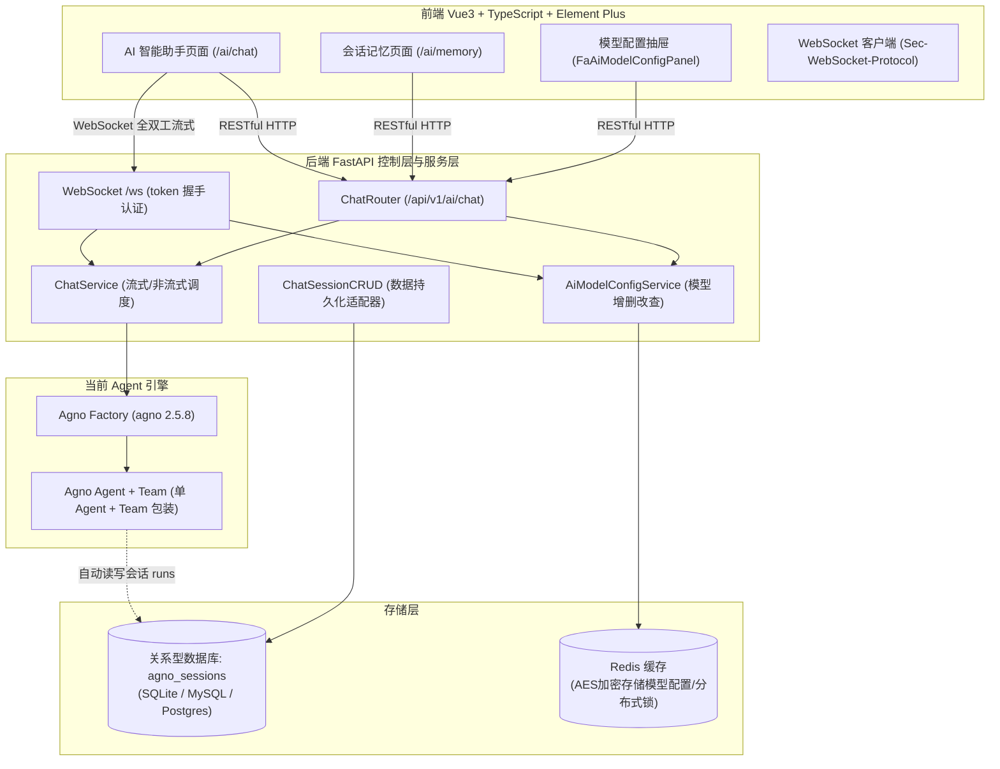
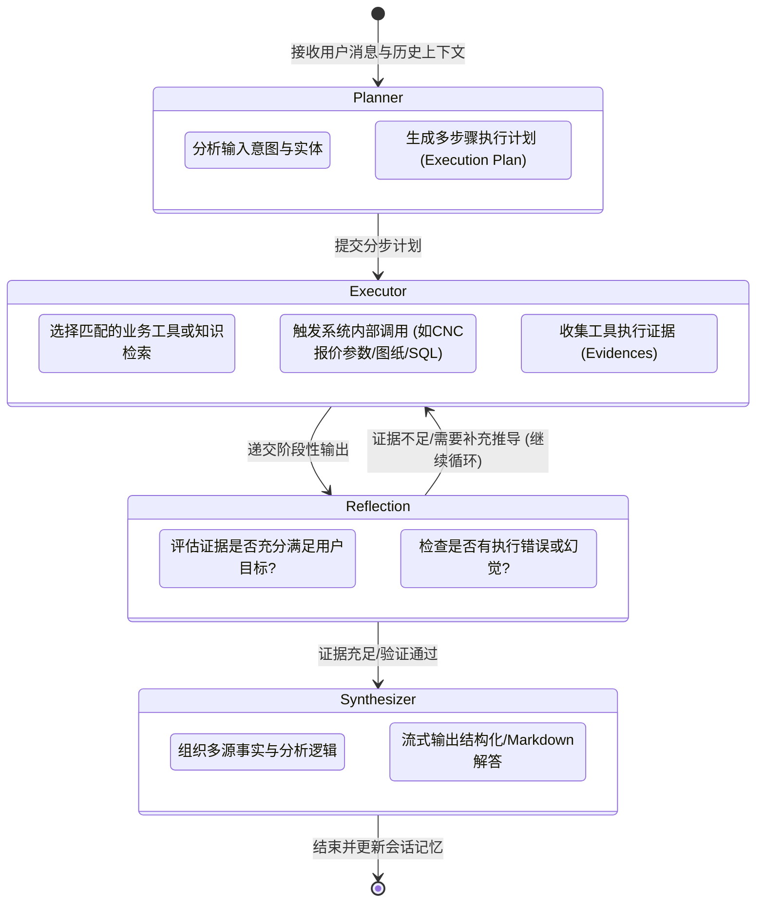
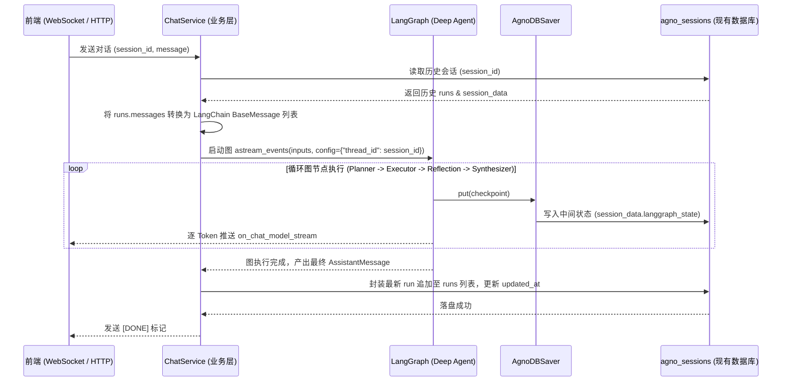
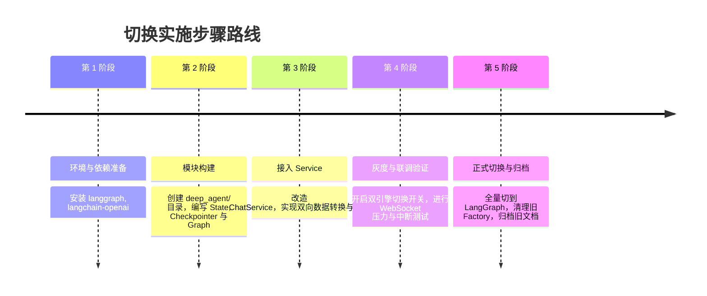

# CNC Quote Pilot - AI 管理模块现状分析与 Deep Agents + LangGraph 迁移落地指南

本文档全面梳理并剖析了本项目中 **“AI 管理”** 模块下 **“AI 智能助手”** 与 **“会话记忆”** 的功能实现与底层机制，并针对架构升级需求，提供了一套**在完全保留并复用原有 AI 对话数据库（`agno_sessions` 及历史会话数据）的前提下**，将 Agent 底层平滑切换为 **Deep Agents**（深度规划、工具调用、反思评估多阶段智能体）和 **LangGraph** 状态图调度引擎的完整落地指南。

---

## 目录

1. [项目 AI 管理模块现状剖析](#一项目-ai-管理模块现状剖析)
   - [1.1 核心技术栈与架构概览](#11-核心技术栈与架构概览)
   - [1.2 “AI 智能助手” 功能实现详解](#12-ai-智能助手-功能实现详解)
   - [1.3 “会话记忆” 功能实现详解](#13-会话记忆-功能实现详解)
   - [1.4 底层数据库结构与存储协议透视](#14-底层数据库结构与存储协议透视)
2. [为什么切换到 Deep Agents 与 LangGraph](#二为什么切换到-deep-agents-与-langgraph)
   - [2.1 现有架构局限性](#21-现有架构局限性)
   - [2.2 Deep Agents + LangGraph 核心优势](#22-deep-agents--langgraph-核心优势)
   - [2.3 深度智能体范式（Deep Agent Pattern）](#23-深度智能体范式deep-agent-pattern)
3. [数据库兼容与复用设计方案](#三数据库兼容与复用设计方案)
   - [3.1 兼容性核心原则](#31-兼容性核心原则)
   - [3.2 现有数据模型映射关系](#32-现有数据模型映射关系)
   - [3.3 自定义 LangGraph Checkpointer 设计](#33-自定义-langgraph-checkpointer-设计)
   - [3.4 双向消息序列化与数据完整性](#34-双向消息序列化与数据完整性)
4. [核心代码落地实现架构](#四核心代码落地实现架构)
   - [4.1 依赖项调整与引入](#41-依赖项调整与引入)
   - [4.2 状态图状态定义（State Schema）](#42-状态图状态定义state-schema)
   - [4.3 自定义持久化 Checkpointer（Database Saver）](#43-自定义持久化-checkpointerdatabase-saver)
   - [4.4 Deep Agent 图构建器（Graph Builder）](#44-deep-agent-图构建器graph-builder)
   - [4.5 Service 业务层重构（支持流式与主动中断）](#45-service-业务层重构支持流式与主动中断)
   - [4.6 动态多模型配置与密钥注入兼容](#46-动态多模型配置与密钥注入兼容)
5. [迁移步骤与灰度切换策略](#五迁移步骤与灰度切换策略)
   - [5.1 分步迁移路线图](#51-分步迁移路线图)
   - [5.2 双引擎灰度开关设计](#52-双引擎灰度开关设计)
   - [5.3 测试验证用例](#53-测试验证用例)
6. [总结与演进建议](#六总结与演进建议)

---

## 一、项目 AI 管理模块现状剖析

### 1.1 核心技术栈与架构概览

当前项目的 AI 管理子系统是一个基于前后端分离、兼具流式通信与结构化管理的完备系统：



- **后端核心代码路径**：
  - 控制器：`backend/app/modules/ai/chat/controller.py`
  - 服务层：`backend/app/modules/ai/chat/service.py`
  - 数据层：`backend/app/modules/ai/chat/crud.py`
  - 数据模型：`backend/app/modules/ai/chat/schema.py`
  - 工厂类：`backend/app/utils/ai_factory.py`
- **前端核心代码路径**：
  - 智能助手主视图：`frontend/web/src/views/module_ai/chat/index.vue`
  - 助手组件：`components/FaSidebar.vue`, `FaChatNavbar.vue`, `FaChatMessages.vue`, `FaChatInput.vue`, `FaMessageItem.vue`, `FaAiModelConfigPanel.vue`, `FaWelcomeScreen.vue`
  - 会话记忆主视图：`frontend/web/src/views/module_ai/memory/index.vue`
  - API 客户端：`frontend/web/src/api/module_ai/chat.ts`

---

### 1.2 “AI 智能助手” 功能实现详解

“AI 智能助手”是面向终端用户的一站式 AI 对话与交互工作台，功能涵盖以下维度：

1. **实时全双工流式对话（WebSocket）**：
   - **安全认证与权限隔离**：连接端点为 `/api/v1/ai/chat/ws`，通过 `Sec-WebSocket-Protocol` 请求头隐式携带 `access_token` 进行握手鉴权，避免 Token 泄漏在 URL 参数或服务端 Access Log 中；校验 `module_ai:chat:query` 权限。
   - **交互协议**：
     - 客户端发送：`{"message": "...", "session_id": "...", "files": [...]}`
     - 服务端流式返回：增量文本 Chunk
     - 结束标记：生成完成返回 `[DONE]`，被主动终止返回 `[STOPPED]`。
   - **主动中断机制**：客户端在生成过程中点击“停止生成”按钮时，向服务端发送 `{"action": "stop", "session_id": "..."}`，服务端通过 `asyncio.Event` 跨协程通知生成器并执行 `stream.aclose()` 熔断底层 LLM 推理。
2. **HTTP 非流式备选接口**：
   - 提供 `POST /api/v1/ai/chat/ai-chat`，支持单次交互与结构化指令解析。
   - 内置**系统页面导航自动跳转解析**（`_parse_action_from_response`），当 AI 回复包含“前往/查看/打开用户管理”等意图时，自动提取路由并输出结构化 action：`{"type": "navigate", "path": "/system/user", "name": "用户管理"}`。
3. **多模型动态配置与即时热切换**：
   - 界面上提供“配置中心”抽屉（`FaAiModelConfigPanel.vue`）和输入框快捷切换器（`FaChatInput.vue`）。
   - 用户可自主添加任何 OpenAI 兼容的模型供应商（OpenAI、DeepSeek、Ollama、MiniMax、Qwen 等），支持独立配置 `base_url`、`api_key`、`model_id`、`temperature`。
   - **安全加固**：后端 `AiModelConfigService` 将配置持久化至 Redis，使用 `CryptoUtil.encrypt` 对 `api_key` 进行对称加密落盘，读取时动态解密；并发修改时采用 Redis 分布式锁防护。
   - 对话请求发起时，根据当前用户激活的配置动态实例化 Agent，支持在无配置时平滑回退至系统环境变量全局默认配置。
4. **会话生命周期与侧边栏管理**：
   - 侧边栏（`FaSidebar.vue`）按“今天/昨天/前7天/更早”对历史会话进行折叠分组。
   - 支持一键创建新会话（首条消息发送时自动切片前 20 字符生成会话标题）。
   - 支持在下拉菜单中直接行内重命名会话与单项删除。
   - 支持按关键词快速模糊过滤搜索本地历史会话。
5. **富文本展示与增强交互**：
   - 支持 Markdown 与高亮代码块解析（`FaMarkdownRenderer`）。
   - 长消息智能折叠（超过 200 字符折叠，支持展开/收起）。
   - 一键复制消息、文件附件展示、打字机动画（Typing indicator）。
   - 空状态下的欢迎引导卡片与推荐 Prompt（快捷点击即可填入发送）。

---

### 1.3 “会话记忆” 功能实现详解

“会话记忆”是面向管理员与用户的历史会话审计、数据管理与回放控制台：

1. **统一的表格管理中心（`FaTable` + `useTable`）**：
   - 列表展示会话的核心维度：`会话ID (session_id)`、`标题 (title)`、`消息数量 (message_count)`、`创建时间 (created_time)`、`更新时间 (updated_time)`，支持按创建/更新时间字段远程排序。
   - 提供顶部搜索栏：支持按会话标题模糊检索。
2. **行内快速编辑（In-place Edit）**：
   - 标题列支持点击直接变为输入框，支持 `blur` 或回车触发异步保存，无缝调用 `PUT /api/v1/ai/chat/update/{id}`。
3. **批量选择与级联删除**：
   - 支持全选多选，并提供批量删除对话框二次确认，支持一次性物理清除历史对话记录。
4. **详情查看与对话时间线完整回放**：
   - 点击“详情”弹出 920px 宽的大屏抽屉（`FaDialog`）。
   - 上半部分使用 `FaDescriptions` 展示元数据：会话ID、标题、用户ID、团队ID、创建/更新时间、消息数量以及原始 JSON 元数据（`metadata`）。
   - 下半部分通过 `ElTimeline` 完整还原历史聊天序列：通过不同徽章色彩与图标区分“用户”与“助手”，清晰展示每条历史消息的发送时间与正文文本。

---

### 1.4 底层数据库结构与存储协议透视

当前底层依赖 `agno` 库（版本 2.5.8），采用原生异步 SQLAlchemy 连接池。会话表默认命名为 **`agno_sessions`**。无论后端切换为 SQLite、MySQL 还是 PostgreSQL，表结构定义保持一致：

| 字段名 | 字段类型 | 约束/索引 | 业务用途说明 |
| :--- | :--- | :--- | :--- |
| `session_id` | `VARCHAR/String` | **PRIMARY KEY** | 会话全局唯一 UUID |
| `session_type` | `VARCHAR/String` | INDEX | 会话类型（当前固定为 `"team"`） |
| `agent_id` | `VARCHAR/String` | Nullable | 智能体 ID |
| `team_id` | `VARCHAR/String` | Nullable | 团队 ID（当前业务中缺省为 `"default"`） |
| `workflow_id`| `VARCHAR/String` | Nullable | 工作流 ID |
| `user_id` | `VARCHAR/String` | Nullable | 用户标识（绑定系统用户名，如 `"admin"`） |
| `session_data`| `JSON / JSONB` | Nullable | 存放会话自定义数据，如 `{"session_name": "会话标题"}` |
| `agent_data` | `JSON / JSONB` | Nullable | 智能体状态快照 |
| `team_data` | `JSON / JSONB` | Nullable | 团队状态数据 |
| `workflow_data`| `JSON / JSONB`| Nullable | 工作流执行上下文 |
| `metadata` | `JSON / JSONB` | Nullable | 会话扩展元数据 |
| **`runs`** | `JSON / JSONB` | Nullable | **核心对话历史列表**（格式见下） |
| `summary` | `JSON / JSONB` | Nullable | 会话记忆摘要信息 |
| `created_at` | `BigInteger` | INDEX | 创建时间戳（Unix 毫秒/秒级） |
| `updated_at` | `BigInteger` | Nullable | 最后活跃更新时间戳 |

#### `runs` 字段的核心数据结构解析

前端会话记忆列表统计的 `message_count` 以及详情抽屉提取的 `messages`，底层均来自 `runs` 序列反序列化：

```json
[
  {
    "run_id": "9b1deb4d-3b7d-4bad-9bdd-2b0d7b3dcb6d",
    "messages": [
      {
        "id": "msg_001",
        "role": "user",
        "content": "请分析一下 CNC 铝合金 6061 的加工报价策略",
        "created_at": 1729731000
      },
      {
        "id": "msg_002",
        "role": "assistant",
        "content": "CNC 铝合金 6061 加工报价通常由以下几个核心部分构成：1. 材料费用...",
        "created_at": 1729731005
      }
    ]
  }
]
```

**关键推论**：
只要我们后续的 LangGraph / Deep Agents 引擎**将多轮对话产生的数据同样规范化落盘到 `agno_sessions` 表中的 `runs` 与 `session_data` 字段中**，前端的“AI 智能助手历史侧边栏”和“会话记忆详情时间线”**无需任何修改即可实现 100% 完美兼容与旧数据无缝展示**！

---

## 二、为什么切换到 Deep Agents 与 LangGraph

### 2.1 现有架构局限性

虽然现有的 Agno 实现完成了基础的对话和会话保存，但在面临复杂的企业级应用（如本系统的 CNC 智能自动报价、图纸特征提取、跨系统校验与多步骤决策）时，暴露出明显短板：

1. **单点线性执行，缺乏真正的多步循环推理**：现有的 `Agno Agent/Team` 本质是单轮提示词直接输出或简单的浅层 Tool-Calling，无法支撑多步推演、规划执行与自纠错。
2. **缺乏状态机图编排能力**：业务需要将“意图识别 -> 图纸解析 -> 供应商规则匹配 -> 人工复核中断 -> 最终报价生成”组织为确定性与灵活性兼备的有向无环/循环图，传统 Agent 框架难以精确控制状态跳转与节点重试。
3. **缺少深度反思（Reflection）与规划（Planning）机制**：无法实现复杂查询的任务拆解、中间结果评估和自我修正。

### 2.2 Deep Agents + LangGraph 核心优势

- **LangGraph（工业级状态图引擎）**：
  - 基于 LangChain 生态，原生支持带循环（Cyclic）的图调度、分支路由、子图嵌套与细粒度节点控制。
  - 原生提供 **Human-in-the-loop**（人在回路），支持在图的某个节点暂停等待人工审批或输入后再继续执行（对于报价合规确认极为关键）。
  - 内置完善的 Checkpointer 体系与基于 `thread_id` 的版本快照能力（Time-travel / 重放）。
  - 支持 `astream_events(version="v2")` 极细粒度的 Token 级流式事件派发。
- **Deep Agents（深度智能体范式）**：
  - 将复杂的问答和业务操作解耦为分阶段专家节点：**规划（Planner）**、**执行（Executor/Tool Worker）**、**反思与评估（Critic/Evaluator）**、**综合合成（Synthesizer）**。

### 2.3 深度智能体范式（Deep Agent Pattern）



---

## 三、数据库兼容与复用设计方案

### 3.1 兼容性核心原则

1. **零破坏性变更（Zero Destructive Changes）**：不修改现有的数据库表名（保留 `agno_sessions`）与核心字段类型，不影响已有历史数据。
2. **零前端感知（Zero Frontend Impact）**：保持前端现有的所有 API 路由、请求参数和返回数据结构不变。
3. **数据格式双向兼容**：
   - 读取时：能够读取历史数据中由 Agno 写入的 `runs`。
   - 写入时：由 LangGraph 执行生成的每轮对话，同样写回 `runs` 与 `session_data`，使得会话记忆列表与详情抽屉正常读取。

### 3.2 现有数据模型映射关系

| 概念 | 现有 Agno 字段 | LangGraph 对应概念 | 映射实现策略 |
| :--- | :--- | :--- | :--- |
| **会话全局标识** | `session_id` (UUID) | `config["configurable"]["thread_id"]` | 1:1 映射，LangGraph 线程 ID 直接使用 `session_id` |
| **用户标识** | `user_id` (username) | `config["configurable"]["user_id"]` | 1:1 映射，用于多租户与数据隔离 |
| **会话标题** | `session_data["session_name"]`| `session_data["session_name"]` | 继续保存在 `session_data` 的 JSON 对象中 |
| **消息历史** | `runs[*]["messages"]` | `state["messages"]` | **双向转换适配器**：将 LangChain 的 `HumanMessage`/`AIMessage` 与字典格式互转 |
| **图状态快照** | *(无)* | `checkpoint` | 存入 `session_data["langgraph_state"]`，不影响现有字段解析 |
| **会话摘要记忆**| `summary` | 长期记忆 (Long-term Memory) | 提取智能体提炼的长期记忆写入 `summary` 列 |

### 3.3 自定义 LangGraph Checkpointer 设计

LangGraph 依靠 Checkpointer 在每一步图节点执行前后保存图的状态（`checkpoint`）。为实现完全复用现有的数据库，我们可以基于 `BaseCheckpointSaver` 实现一个专属的 **`AgnoDBSaver`**（或直接在服务层构建双向持久化适配器）：



---

## 四、核心代码落地实现架构

以下为针对本项目的完整改造设计与实现代码规范。

### 4.1 依赖项调整与引入

在 `backend/pyproject.toml` 的 `dependencies` 中引入 LangGraph 及相关组件，并与现有库协同：

```toml
# backend/pyproject.toml
dependencies = [
    # 保持原有核心依赖不变 ...
    "langgraph>=0.2.70",
    "langchain-core>=0.3.40",
    "langchain-openai>=0.3.7",
    # 保留原有 agno 以备旧数据兜底或灰度期平滑过渡
    "agno==2.5.8",
    # ...
]
```

---

### 4.2 状态图状态定义（State Schema）

新建 `backend/app/modules/ai/chat/deep_agent/state.py`，定义 Deep Agent 所需的状态切片：

```python
"""Deep Agent 状态定义与消息追加器"""
from typing import Annotated, Any, Sequence, TypedDict
from langchain_core.messages import BaseMessage
from langgraph.graph.message import add_messages


class DeepAgentState(TypedDict):
    """Deep Agent 运行状态图上下文"""
    # 消息序列：使用 add_messages 自动按 ID 追加或合并
    messages: Annotated[Sequence[BaseMessage], add_messages]
    
    # 规划阶段产出的目标分解清单
    plan: list[str]
    
    # 当前执行的具体步骤索引
    current_step: int
    
    # 工具调用的中间证据或业务检索结果
    observations: list[dict[str, Any]]
    
    # 反思评估节点的置信度打分与反馈
    reflection_notes: str
    
    # 最终对外流式输出的文本内容
    final_response: str
```

---

### 4.3 自定义持久化 Checkpointer（Database Saver）

新建 `backend/app/modules/ai/chat/deep_agent/checkpointer.py`，实现复用现有 `agno_sessions` 表的 Checkpointer：

```python
"""基于现有 agno_sessions 表的 LangGraph Checkpointer 实现"""
import json
import time
from typing import Any, AsyncIterator, Optional, Tuple
from langchain_core.runnables import RunnableConfig
from langgraph.checkpoint.base import (
    BaseCheckpointSaver,
    Checkpoint,
    CheckpointMetadata,
    CheckpointTuple,
    SerializerProtocol,
)
from app.modules.ai.chat.crud import _get_agno_db, TEAM_ID
from app.core.logger import logger


class AgnoSessionCheckpointer(BaseCheckpointSaver):
    """复用 agno 数据库引擎与 agno_sessions 表的 Checkpoint Saver"""

    def __init__(self, serde: Optional[SerializerProtocol] = None):
        super().__init__(serde=serde)
        self.db = _get_agno_db()

    async def aget_tuple(self, config: RunnableConfig) -> Optional[CheckpointTuple]:
        """获取指定 thread_id (即 session_id) 的最新 Checkpoint"""
        thread_id = config.get("configurable", {}).get("thread_id")
        user_id = config.get("configurable", {}).get("user_id", "user")
        if not thread_id:
            return None

        try:
            session = await self.db.get_session(
                session_id=thread_id,
                session_type="team",
                user_id=user_id,
            )
            if not session:
                return None

            session_data = getattr(session, "session_data", {}) or {}
            if isinstance(session_data, str):
                session_data = json.loads(session_data)

            lg_data = session_data.get("langgraph_checkpoint")
            if not lg_data:
                return None

            checkpoint = self.serde.loads(lg_data["checkpoint"].encode())
            metadata = lg_data.get("metadata", {})
            parent_config = lg_data.get("parent_config")

            return CheckpointTuple(
                config=config,
                checkpoint=checkpoint,
                metadata=metadata,
                parent_config=parent_config,
            )
        except Exception as e:
            logger.error(f"读取 LangGraph Checkpoint 失败: {e}")
            return None

    async def aput(
        self,
        config: RunnableConfig,
        checkpoint: Checkpoint,
        metadata: CheckpointMetadata,
        new_versions: dict[str, Any],
    ) -> RunnableConfig:
        """持久化 Checkpoint 回现有会话表的 session_data 字段中"""
        thread_id = config.get("configurable", {}).get("thread_id")
        user_id = config.get("configurable", {}).get("user_id", "user")
        if not thread_id:
            return config

        try:
            session = await self.db.get_session(
                session_id=thread_id,
                session_type="team",
                user_id=user_id,
            )
            if not session:
                return config

            session_data = getattr(session, "session_data", {}) or {}
            if isinstance(session_data, str):
                session_data = json.loads(session_data)

            # 将 LangGraph 的内部状态注入 session_data 内部命名空间
            session_data["langgraph_checkpoint"] = {
                "checkpoint": self.serde.dumps(checkpoint).decode(),
                "metadata": metadata,
                "parent_config": config,
                "saved_at": int(time.time()),
            }

            session.session_data = session_data
            session.updated_at = int(time.time())
            await self.db.upsert_session(session=session)
        except Exception as e:
            logger.error(f"写入 LangGraph Checkpoint 失败: {e}")

        return config

    async def alist(
        self,
        config: Optional[RunnableConfig],
        *,
        filter: Optional[dict[str, Any]] = None,
        before: Optional[RunnableConfig] = None,
        limit: Optional[int] = None,
    ) -> AsyncIterator[CheckpointTuple]:
        """迭代历史 Checkpoints（单会话场景可留空或单次 yield）"""
        if config:
            t = await self.aget_tuple(config)
            if t:
                yield t
```

---

### 4.4 Deep Agent 图构建器（Graph Builder）

新建 `backend/app/modules/ai/chat/deep_agent/graph.py`，构建包含 **规划 -> 执行 -> 反思 -> 合成** 的状态图：

```python
"""Deep Agent 状态图构建器"""
from typing import Any
from langchain_core.messages import AIMessage, HumanMessage, SystemMessage
from langchain_openai import ChatOpenAI
from langgraph.graph import END, START, StateGraph

from .state import DeepAgentState


def build_deep_agent_graph(llm: ChatOpenAI, checkpointer: Any = None):
    """构建 Deep Agent 编排状态图"""
    workflow = StateGraph(DeepAgentState)

    # 1. 规划节点：拆解复杂任务
    async def planner_node(state: DeepAgentState) -> dict[str, Any]:
        last_user_msg = state["messages"][-1].content
        prompt = (
            "你是一个高级任务规划专家。请分析用户的提问或任务，"
            "并拆解为 1-3 个具体的解决步骤，以简短清晰的清单给出。\n\n"
            f"用户问题: {last_user_msg}"
        )
        response = await llm.ainvoke([SystemMessage(content=prompt)])
        plan_steps = [s.strip() for s in response.content.split("\n") if s.strip()]
        return {"plan": plan_steps, "current_step": 0, "observations": []}

    # 2. 执行节点：执行具体的步骤/工具调用
    async def executor_node(state: DeepAgentState) -> dict[str, Any]:
        current_step = state.get("current_step", 0)
        plan = state.get("plan", [])
        step_desc = plan[current_step] if current_step < len(plan) else "综合分析"

        # 在此处可集成 CNC 自动报价工具、SQL 数据查询、知识库检索等
        # 现阶段以 LLM 步骤推理示范
        prompt = f"正在执行步骤 [{current_step + 1}/{len(plan)}]: {step_desc}。请整理该步骤的关键事实与推理。"
        resp = await llm.ainvoke(list(state["messages"]) + [SystemMessage(content=prompt)])
        
        obs = list(state.get("observations", []))
        obs.append({"step": step_desc, "result": resp.content})
        return {"observations": obs, "current_step": current_step + 1}

    # 3. 反思评估节点：判定是否完成全部规划步骤
    def should_continue(state: DeepAgentState) -> str:
        current_step = state.get("current_step", 0)
        plan = state.get("plan", [])
        if current_step < len(plan):
            return "executor"
        return "synthesizer"

    # 4. 综合合成节点：流式聚合最终答案给用户
    async def synthesizer_node(state: DeepAgentState) -> dict[str, Any]:
        observations_text = "\n".join(
            [f"- 步骤【{o['step']}】: {o['result']}" for o in state.get("observations", [])]
        )
        sys_prompt = (
            "你是一个专业的 AI 智能助手。请根据前面的执行观察证据，给用户一个严谨、清晰、完整的回答。"
            "保持格式优雅（使用 Markdown）。如果涉及页面导航或业务跳转建议，请明确说明。\n\n"
            f"执行证据:\n{observations_text}"
        )
        # 此处的流式 Token 会被 astream_events 捕获并推给前端
        final_answer = await llm.ainvoke(list(state["messages"]) + [SystemMessage(content=sys_prompt)])
        return {
            "messages": [final_answer],
            "final_response": final_answer.content,
        }

    # 注册节点与连线
    workflow.add_node("planner", planner_node)
    workflow.add_node("executor", executor_node)
    workflow.add_node("synthesizer", synthesizer_node)

    workflow.add_edge(START, "planner")
    workflow.add_edge("planner", "executor")
    workflow.add_conditional_edges("executor", should_continue, {
        "executor": "executor",
        "synthesizer": "synthesizer",
    })
    workflow.add_edge("synthesizer", END)

    return workflow.compile(checkpointer=checkpointer)
```

---

### 4.5 Service 业务层重构（支持流式与主动中断）

修改 `backend/app/modules/ai/chat/service.py`，将 Agent 调度平滑切换为 LangGraph：

```python
"""改造后的 ChatService - LangGraph 驱动与原有数据库兼容"""
import asyncio
import time
import uuid
from collections.abc import AsyncGenerator
from typing import Any
from langchain_core.messages import AIMessage, HumanMessage
from langchain_openai import ChatOpenAI

from app.config.setting import settings
from app.core.logger import logger
from .crud import ChatSessionCRUD, TEAM_ID
from .schema import ChatQuerySchema
from .deep_agent.graph import build_deep_agent_graph
from .deep_agent.checkpointer import AgnoSessionCheckpointer


def _create_langchain_llm(model_config: dict[str, Any] | None) -> ChatOpenAI:
    """根据用户配置或系统配置实例化 LangChain ChatOpenAI"""
    base_url = settings.OPENAI_BASE_URL
    api_key = settings.OPENAI_API_KEY
    model_id = settings.OPENAI_MODEL
    temperature = 0.7

    if model_config:
        base_url = model_config.get("base_url") or base_url
        api_key = model_config.get("api_key") or api_key
        model_id = model_config.get("model_id") or model_id
        if isinstance(model_config.get("temperature"), (int, float)):
            temperature = float(model_config["temperature"])

    return ChatOpenAI(
        model=model_id,
        api_key=api_key or "sk-dummy",
        base_url=base_url or "https://api.openai.com/v1",
        temperature=temperature,
        streaming=True,
    )


class ChatService:
    def __init__(self, auth: Any) -> None:
        self.auth = auth
        self.user_id = auth.user.username or "user"

    async def chat_query(
        self,
        query: ChatQuerySchema,
        stop_event: asyncio.Event | None = None,
        model_config: dict[str, Any] | None = None,
    ) -> AsyncGenerator[str | None, Any]:
        """LangGraph 驱动的流式对话，完全兼容前端 WebSocket 协议与后端数据表"""
        crud = ChatSessionCRUD(self.auth)
        session_id = query.session_id
        if not session_id:
            session = await crud.create(data={"title": "新对话"})
            session_id = session.session_id

        # 1. 初始化模型与持久化 Checkpointer
        llm = _create_langchain_llm(model_config)
        checkpointer = AgnoSessionCheckpointer()
        app_graph = build_deep_agent_graph(llm=llm, checkpointer=checkpointer)

        # 2. 读取历史 runs 并转换为 LangChain Messages
        session_record = await crud.get_by_id(session_id)
        existing_runs = getattr(session_record, "runs", []) if session_record else []
        if isinstance(existing_runs, str):
            import json
            existing_runs = json.loads(existing_runs)

        history_messages = []
        for run in existing_runs or []:
            for msg in run.get("messages", []):
                if msg.get("role") == "user":
                    history_messages.append(HumanMessage(content=msg.get("content", "")))
                elif msg.get("role") == "assistant":
                    history_messages.append(AIMessage(content=msg.get("content", "")))

        user_input = (query.message or "").strip()
        new_human_msg = HumanMessage(content=user_input)
        all_messages = history_messages + [new_human_msg]

        config = {
            "configurable": {
                "thread_id": session_id,
                "user_id": self.user_id,
            }
        }

        # 3. 流式监听事件并按 Token 推送给 WebSocket
        logger.info("LangGraph 开始执行: session_id={}", session_id)
        assistant_full_reply = []

        try:
            # 捕获最终合成器节点的流式输出
            async for event in app_graph.astream_events(
                {"messages": all_messages},
                config=config,
                version="v2",
            ):
                if stop_event is not None and stop_event.is_set():
                    logger.info("用户主动中断 LangGraph 执行: session_id={}", session_id)
                    break

                kind = event["event"]
                # 仅捕获 synthesizer 节点流式生成的 Token
                if kind == "on_chat_model_stream" and event.get("metadata", {}).get("langgraph_node") == "synthesizer":
                    chunk_text = event["data"]["chunk"].content
                    if chunk_text:
                        assistant_full_reply.append(chunk_text)
                        yield chunk_text

        except asyncio.CancelledError:
            logger.info("生成任务被系统取消: session_id={}", session_id)
            raise
        except Exception as e:
            logger.error(f"LangGraph 执行失败: {e}", exc_info=True)
            yield "抱歉，AI 深度智能体调度出现异常，请稍后重试。"
            return

        # 4. 将本轮对话按原有 runs 结构完整追加回 agno_sessions 表！
        now_ts = int(time.time())
        final_reply_str = "".join(assistant_full_reply)
        new_run = {
            "run_id": str(uuid.uuid4()),
            "messages": [
                {"id": str(uuid.uuid4()), "role": "user", "content": user_input, "created_at": now_ts},
                {"id": str(uuid.uuid4()), "role": "assistant", "content": final_reply_str, "created_at": now_ts},
            ]
        }

        if session_record:
            current_runs = list(existing_runs or [])
            current_runs.append(new_run)
            session_record.runs = current_runs
            session_record.updated_at = now_ts
            await crud.db.upsert_session(session=session_record)
            logger.info("会话记录与记忆落盘成功: session_id={}", session_id)
```

---

### 4.6 动态多模型配置与密钥注入兼容

现有前端 `FaAiModelConfigPanel.vue` 和 `FaChatInput.vue` 允许用户自由录入 `base_url`、`api_key`、`model_id`，并存储在 Redis。

上述改造中的 `_create_langchain_llm()` 函数**直接兼容现有 Redis 取出的解密配置字典**：
- 传递的 `api_key`、`base_url` 和 `model_id` 直接用于构建 LangChain 的 `ChatOpenAI` 实例。
- 无论用户配置的是本地 Ollama (`http://localhost:11434/v1`)，还是 DeepSeek (`https://api.deepseek.com/v1`)，均可即时生效，不需要改动任何 Redis 数据或前端面板！

---

## 五、迁移步骤与灰度切换策略

### 5.1 分步迁移路线图



### 5.2 双引擎灰度开关设计

为了确保上线期间万无一失，可以在 `backend/app/config/setting.py` 中增加灰度配置项：

```python
# backend/app/config/setting.py
AI_AGENT_ENGINE: str = "langgraph"  # 可选: "agno" | "langgraph"
```

在 `ChatService.chat_query()` 入口处通过 `if settings.AI_AGENT_ENGINE == "langgraph":` 实现平滑分流。若遇到任何线上未预料的问题，只需修改配置即可在 1 秒内回滚至 Agno 引擎。

### 5.3 测试验证用例

1. **会话记忆兼容性测试**：
   - 使用旧版 Agno 引擎创建会话并聊天数轮。
   - 切换到 LangGraph 引擎，打开原会话继续提问，验证上下文是否连贯。
   - 打开“会话记忆”页面（`/ai/memory`），验证历史会话列表、标题、消息数量是否完整，详情抽屉中 `ElTimeline` 能否正确回放全部轮次。
2. **WebSocket 中断测试**：
   - 在前端输入长问题，等待开始流式吐字后，点击“停止生成”按钮。
   - 验证服务端是否收到 `stop` 指令、是否立即退出生成、是否向客户端发送 `[STOPPED]`、已生成的半截回答是否正确落盘。
3. **多模型热切换测试**：
   - 在“配置中心”添加 DeepSeek / 本地 Ollama 模型，激活该模型。
   - 验证 LangGraph 是否使用新激活的模型发起推理。

---

## 六、总结与演进建议

通过上述方案：
1. **数据库完全复用**：已有的 `agno_sessions` 表与历史数据**一行不删、一列不改**，原有聊天记录零损失。
2. **前端界面零感知**：前端代码库（`module_ai/chat` 与 `module_ai/memory`）无需任何修改，UI 表现、WebSocket 协议、流式吐字效果保持一致。
3. **架构全面跃迁**：引入了 LangGraph 的工业级状态机调度和 Deep Agents 的深度推演范式，为后续扩展诸如**CNC 自动询价多步图纸特征校验**、**报价合规人在回路（Human-in-the-loop）审批**打下了坚实基础。
