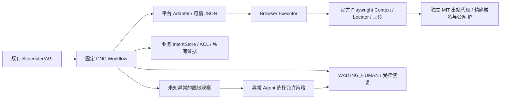

# CNC 浏览器最小增量设计（BR-2026-10-21）

## 1. 目标、缺口与任务边界

依据 [源码分析](browser-reference-analysis.md)，业务 backend 尚无 Browser Executor。用户已批准创建修订任务并推进实现。本轮先修订了父任务和 01–05 的需求/设计/计划/上下文，再冻结本文，最后启动编码。共用能力唯一归属 `cnc-browser-reuse`，本文件是接口/安全设计的权威入口。

| Trellis ID | 本轮责任 / 后续接入 |
| --- | --- |
| cnc-browser-reuse（BR） | 本文定义的共用 Playwright 层、可独立复用的 MIT 出站组件、无真实平台依赖的契约与测试 |
| cnc-mvp-01-platform-gates | 真实账号、许可、可报价 STEP/几何与提取依据，保持原 gates |
| cnc-mvp-02-first-quote | 接入共用层、RapidDirect 实际 Adapter、业务持久 intent/会话仓储/ACL、S01–S11 与正式异常 Agent、证据/API |
| cnc-mvp-03-second-platform | 同层接入独立 Xometry US Adapter；保留 01 美国 E2 和 02 真闭环前置 |
| cnc-mvp-04-monitoring | 既有 SchedulerUtil 入队、业务租约/预算/调度去重/历史；消费同一执行层 |
| cnc-mvp-05-demo-acceptance | 既有 Web 与人工接管/恢复入口、真实模型/平台/两轮监测验收 |

改动范围仅 `backend/app/modules/cnc/browser/`、对应测试、可选依赖/lock/安装说明、相关任务及本文档。保留 Agno/管理后台、原用户改动与参考仓库；本轮不添加未验证的平台定位器、完整 API/迁移/UI/调度器、通用 Agent 框架或 BrowserSkill gateway。共用组件可在 live gates 未通过时本地验证，02–05 的业务顺序保持。

## 2. 最小架构

Playwright 对象只在创建它们的 asyncio loop 内使用，由单一消费者持有；不移植 DeerFlow 跨 loop 线程。按 owner_id/platform_code/account_id 区分会话；同账号独占、总容量默认 1。组件在上下文退出时释放，人工长期暂停/跨 worker 租约由 02/04 持久实现，不能用进程锁冒充分布式锁。

正常路径直接调用适配器，不调用模型；未知页面/定位失配抛出类型化停止原因，由既有领域流程决定进入受控异常分支或人工。页面文本始终不可信，不得解释成策略、域名、字段或操作授权。

## 3. 接口契约

具体 Python 符号/路径以交付代码和 `browser-test-report.md` 为准，以下为必须保持的行为。

- `SessionScope(owner_id, platform_code, account_id)`：不可变服务端身份。拒绝空值；实例不得降级到 default/global key。外部 API 不能自己选择他人的账号。
- `BrowserPolicy(allowed_hosts, ...)`：可信精确主机名（无通配符），只允许 HTTPS/443，无 userinfo。Context 路由拦截支持的请求，逐请求观察为非法重定向等设置停止标记；公网解析验证与 SOCKS 实际连接 IP 固定负责最终连接拒绝。SDK route 不保证每个重定向跳重复拦截，不能单独作为出站防线。允许的 CDN/登录域须先核验再版本化。
- `BrowserExecutor.session(scope, policy, ...)`：async context manager，惰性调用 async_playwright/chromium.launch/new_context；Service Worker、下载和未经核验的 WebSocket 默认禁用。总容量/账号忙即有界拒绝；启动中失败、取消及关闭失败仍尝试释放其他资源。关闭/释放错误显式报告。
- 加密会话 codec：使用既有 `CryptoUtil.encrypt/decrypt` 注入，不另写加密算法；把 scope 与 storage_state 一并加密，恢复时比对 scope。解密数据只在内存交给 new_context；不得写 state.json、日志、模型或 checkpoint。storage_state 请求包含 IndexedDB；sessionStorage/设备绑定等机制仍须平台验证。身份复验前不能导出“已登录”会话。
- 文件描述：受信根目录内的 STEP/STP、预期 SHA-256、最大字节数；解析真实路径，拒绝越界/符号链接逃逸、扩展名/大小/哈希异常；读取已校验字节交给官方 set_input_files，避免校验和上传间文件变更。动态文件框使用官方 expect_file_chooser，不自建 OS 文件对话框自动化。
- 平台 Adapter：认证状态/挑战、上传前后状态与远端引用、配置和全量 effective 参数、提交回执、真实报价与交期读取均为确定性方法。允许复用原生 Locator，选择器来自工程核验的适配器；Agent 无 Page、Context、JS、任意路径、通用 click 权限。
- 工作流辅助契约：认证 → 上传 → 配置并完整回读 → 提交 → 提取/验证，步骤主导权在代码；业务 02 扩展到完整 S01–S11。文件/参数冻结在同一 item；不同参数须新 item，禁止原 item 重试静默修改。
- `IntentStore`（注入的业务仓储端口）：唯一键是 scope + item + execution_generation + operation，fingerprint 是冻结输入的比对值，不纳入唯一键；改参不能通过新 fingerprint 获得第二次执行。领域 runner 在同一逻辑 item 的重试/恢复中保持 generation 不变，改参须新 item。动作前原子持久占位；成功回执和不明结果分别保存。已有 intent 不重执行，先返回已确认回执或只读协调/人工。上传、配置 Apply/save 和提交各自占位；取消/超时/网络错误后保持不明。02 必须提供应用 DB 的真实持久实现后才可接生产；测试替身不能替代它。
- 报价：仅真实页面同次参数/零件/回执；Decimal 精确值与字符串序列化、币种、单价/行价范围、交期原文及有效字段。完整匹配 requested/effective 且非零几何、确定价格/币种/交期和新鲜度才可 QUOTED；缺值/待审/零尺寸保持非报价状态，不能回退 0、目录价或模型猜测。

## 4. 故障、重试与人工接管

| 条件 | 本组件行为 | 02–05 的接入要求 |
| --- | --- | --- |
| 登录态失效/验证码/身份不符 | 在上传前停止，类型化人工原因 | owner 人工登录/核验；不绕过挑战；复验身份后再继续 |
| 无/多定位、页面变体未知 | Locator 严格定位失败，不猜测其他按钮 | 已验证变体或受控异常 Agent；新定位建议需工程核验 |
| 安全只读操作超时 | 最多 2 次自动重试、总 attempt<=3，可取消 | 原 item 总 600 秒/恢复预算仍由领域 runner 控制，不在每步重置 |
| 上传/配置保存/提交超时或取消 | intent 保留不明，不自动重放 | 只读协调远端对象；无法确认 WAITING_HUMAN |
| 配置回读不同/几何为零 | 拒绝成功并保留原因 | 停止、记录原始有效值；禁止静默替代 |
| 截图/DB 本地失败 | 不重新请求报价 | 只补 S10/S11；远端回执保持 |
| 浏览器断连/关闭/重建 | 释放所有自有资源 | 用业务 intent/远端引用重入安全步骤；checkpoint 不能恢复浏览器 |
| 人工待办恢复 | 组件不因页面出现某段文字自动继续 | 明确 owner 授权，复验会话/完整参数/远端 intent/版本及安全 resume_step |

人机接管首先使用受控托管会话的业务暂停契约。本轮只提供安全停止/会话边界，无接管 UI 或长期保留窗口的交付声明。有实际个人 Chrome 登录态复用需求时另评估 BrowserSkill 0.3.1 的 mode、配对/撤销/租借/归还；其 remote 不支持上传，不能把本机文件路径传给远端扩展当作已上传。CDP 默认 profile 的隔离和 SSRF 限制不满足本基线。

## 5. 安全与第三方组件

直接使用 Playwright 1.58.0 async SDK（可选 browser extra），对应浏览器需单独安装/记录；本地 E2E 可显式启动全新 headless Chrome channel，不连接已有登录标签页。依赖兼容依据见源码分析；lock 必须实际解析，失败如实报告。

将 DeerFlow 固定 Commit 的独立 `community/browser_automation/egress.py` 放在本模块的明确第三方边界，保留 MIT 归属/全文与来源，列出适配差异；其公网 resolver 注入本项目精确允许域政策，限制实际出口。此组件避免重写 SOCKS/连接固定协议，不引入 DeerFlow harness。测试同时验证连接处校验及拒绝路径。浏览器仍须部署在隔离运行环境，生产 egress/密钥/ACL 未验收不得对外开放。

认证/上传内容、Cookie/Authorization、带 token 的 URL query/fragment、原始异常/DOM/网络日志不得进模型/公开日志。异常使用固定原因码。证据/Trace 默认关闭；Trace 没有通用可靠脱敏保证，真实 trace 如需开启只能进入授权私有诊断存储并有保留期限。本轮 Chromium E2E 只用合成文件/身份，Trace 为私有临时产物，不能提交真实会话。

实施期环境发现：Windows/Python 3.12.13 的 Proactor 在连接重置时可能先于 socket.close/server detach 抛错；本轮发现了真实 transport 未关闭警告。继承组件中清理超时的静默忽略已改为向 BrowserExecutor 报告失败，其他资源继续尝试释放。该失败基线不能作为 BR-03 通过依据，也不得通过私有运行时补丁/全局异常过滤弱化验收；修复后运行环境复验见测试报告。

2026-10-22 最小修复设计：SDK 配套 Headless Shell 145 已实测 10/11，通过了正常上传/报价和严格取消，禁止域重定向仍复现 Windows peer reset 清理问题。共用层可增加一个 Windows 专用的接受连接 Adapter：以公开 `loop.sock_accept` 接受本组件自建监听 socket，以公开 `socket.detach` 明确转移到本组件的 socket 子类，再通过官方 `asyncio.open_connection(sock=...)` 将所有权交给 Streams。仅该自建 socket 的 shutdown 将 Windows 已断开连接的 `ConnectionResetError(winerror=10054)` 视为无需半关闭，随后仍由标准 transport 执行 close；其他错误继续报告。连接、接受任务及清理均有显式所有权和有界释放；Linux 保留原 asyncio.start_server。此改动不重写 SOCKS、DNS/IP 固定或 Playwright 协议，不修改解释器或第三方仓库。必须有真实拒绝连接/重定向、取消、初始化失败和其他 socket 错误不被吞掉的回归，再由独立 check 复验；未经实测不能据此宣称修复。

实现交接补充：上述边界现位于 `windows_streams.py` 的 `start_windows_server` / `WindowsStreamServer`，原 MIT 组件只按 Windows 分派监听器。真实 TCP 重置还会让 Streams 的 `wait_closed` 传回已经交给 reader 的 `ConnectionResetError(winerror=64)`；只在其与公开 `reader.exception()` 是同一对象、且已调用 writer.close 时识别该读取结果。自建 socket 的独立 shutdown 结果记录仍须核对，避免读取错误掩盖未知关闭失败。任务启动前取消的 raw socket 由 listener 保有；交接后只使用 Streams，wrapper 跟踪直到 writer 关闭，监听器关闭有界。实际测试数量与独立验收以报告为准。

## 6. 实施与验收映射

1. BR：完成源码分析与任务基线，修订原六个相关任务，保留 bootstrap 和历史研究；冲突审计见任务复核文档。
2. BR：读 backend specs 和复用指南，添加最小 contracts/policy/session/workflow 及独立代理组件；不改既有 routes/DB/Agno。
3. BR：增加 optional browser extra、依赖锁定及安装说明；代码无浏览器 extra 时仍可导入，实际启动返回清晰依赖错误。
4. BR：单元/Mock 集成验证 scope/加密/域/文件/参数/价格/重试/intent/取消/资源；真实 Chromium 合成站点执行 STEP 文件框/真实 DOM 自动等待/参数与价格回读/会话隔离/重定向和释放，严格标记合成。
5. BR：独立 Trellis check 审查安全、许可、任务依赖及未验证声明，保存实际命令/结果；未通过不标完成。
6. 01/02：具备授权平台条件后完成真实登录/上传/解析/报价/交期/重算。03 扩第二家；04 两轮调度；05 整体验收，均不得用 BR 合成结果代替。

验收 IDs：BR-01/02 对文档/任务；BR-03/04 对隔离/安全/释放；BR-05 对上传/字段/副作用；BR-06 对证据分层。原 V/F/S/M/D 与 TC-WF/TC-DA/TC-CFG 保持，不在本轮勾选真实欠项。

回滚：停用可选 browser extra 和本组件入口即可，不修改参考库/业务历史或清除 intent。未上线组件无 DB 迁移；生产接入失败先保留远端引用及不明 intent，再人工协调，禁止以删库/换 item 掩盖重复提交风险。
