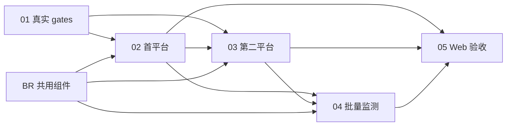

# Trellis 浏览器需求复核与冲突检查

修订：BR-2026-10-21；用户已明确允许创建修订任务并推进实现，并要求与原任务无冲突。检查范围为 `.trellis/tasks` 递归所有任务及相关研究/执行规划，而非只查活动目录名称。

## 1. 基线与保留规则

修改前保存了 7 项完整 task.json 及 67 个需求/规划/研究文件的 SHA-256，位于 [task-baseline.json](../.trellis/tasks/10-21-cnc-browser-reuse/research/task-baseline.json)。旧树为 bootstrap + CNC 父任务 + 01–05，未发现已完成或归档任务。本轮没有重置或归档原任务。

| 原任务 ID | 原状态 / 当前状态 | 本轮修改 |
| --- | --- | --- |
| 00-bootstrap-guidelines | in_progress / in_progress | 无修改；全部基线文件哈希不变 |
| cnc-pricing-mvp | in_progress / in_progress | 共用组件归属/分级验收、D-14、任务图及执行交接；task.json 只在 children 增加 BR |
| cnc-mvp-01-platform-gates | in_progress / in_progress | 继续真实身份/许可/样件/上传/真价验证；feasibility 不重复基础引擎；V-BR-01/02 |
| cnc-mvp-02-first-quote | planning / planning | 浏览器基础能力从“本任务自建”改为消费 BR，平台 adapter/持久 intent/ACL/Agent/真价归属不变；F-BR-01/02 |
| cnc-mvp-03-second-platform | planning / planning | 消费同一层，仅增独立美国映射/adapter；S-BR-01/02 |
| cnc-mvp-04-monitoring | planning / planning | SchedulerUtil 入队、持久租约/intent/观测，消费同层；M-BR-01/02 |
| cnc-mvp-05-demo-acceptance | planning / planning | owner 人工恢复/复验、接管模式限制与独立测试层级；D-BR-01/02 |
| cnc-browser-reuse（新增） | 新建 planning → in_progress | 唯一共用组件责任，BR-01～06；按标准 task.py 创建/validate/start |

保留原任务 ID/title/status/parent、原 children 顺序、历史 notes/meta、原验收 ID/未完成勾选状态及依赖。父 children 末尾增加新任务，其余 metadata 与基线完全一致。无已完成任务，因而无需为已完成项重开；后续若发现历史完成项受影响，只能新增后续修订，不回写完成状态。

## 2. 实际文件修改清单与前后差异

父任务及 01–05 各自的 `prd.md`、`design.md`、`implement.md`、`implement.jsonl`、`check.jsonl` 已实际修改，共 30 份；新增 BR 标识/责任和可测试验收，设计/计划链接统一契约，implement/check 清单追加同一设计入口。02 原三个重复基础实现表述已替换为“复用 BR，保留平台接入责任”，不是仅新增一篇建议文档。

父任务另修改 8 份：`task.json`（仅 children）、`task-map.md`、`decisions.md`、`requirements-review-handoff.md`、`execution-status.md`、`workflow-design.md`、`agent-design.md`、`research/mvp-contract.md`。原停止记录保留历史范围，追加本轮明确授权与执行边界。共修改 38 个原文件；其余 29 个基线文件不变，包括历史样件、平台 JSON/Schema、真实试价证据、SDK/input 探针及结果。

| 旧要求/歧义 | 当前要求 | 责任与验收 |
| --- | --- | --- |
| 02 建浏览器/session，03/04 可能再造底层 | BR 一处实现官方 SDK 薄层与独立出站组件；02/03/04 消费 | BR-03/04；各任务 BR-01 |
| 泛化“Playwright/浏览器工具”无实际来源界限 | 固定 SDK 1.58.0，源码来源/许可/依赖可追溯；不复制框架/Ref/CDP 协议 | BR-01，源码分析/第三方说明 |
| 研究用 CDP 可能被当成生产账号隔离 | 托管 Context、服务端 scope、加密状态；个人默认 Context 不作为基线 | BR-03/04，F/S-BR-01 |
| “支持上传”可能混淆本机/远程 | 官方文件框/字节上传；BrowserSkill 0.3.1 remote 不支持上传 | BR-05，F-BR-01 |
| 重试可能重发上传/提交 | 副作用 intent 先原子持久化；不明只读协调/人工；读操作有限重试 | BR-05；原 F-05/M-05 保留 |
| Agent 工具可能拿到底层页面或策略权限 | 只有脱敏观察与当前允许策略；Workflow 控制步骤/动作 | 父 D-13 不变；TC-WF/TC-DA 保留 |
| 验证目录/Mock 容易冒充真价 | 单元/Mock、真实 Chromium 合成站点、真实模型、真实平台分别报告 | BR-06；原 F/S/M/D live 条目保留 |

这些修订包含实现步骤、依赖、异常出口、秘密/SSRF/交易安全及 observable 验收。详细接口/故障矩阵只在 [统一设计](browser-implementation-design.md) 维护，避免各子任务形成不同协议。

## 3. 依赖与执行顺序



BR 只读取 01 已有研究，不依赖 01 能取真价或 02 产品实现，因此无环。它能先做本地组件，原 01 真价/权限/样件进入条件不会被跳过。BR 不拥有平台 adapter、正式 Agent 工厂/持久业务仓储、调度或 Web；这些仍按原五阶段交付，父子归属不充当依赖系统。

## 4. 可复查检查

```powershell
python -B .trellis/tasks/10-21-cnc-browser-reuse/research/review_task_tree.py --output .trellis/tasks/10-21-cnc-browser-reuse/research/task-review-result.json
python .trellis/scripts/task.py validate 10-21-cnc-browser-reuse
```

审计脚本校验原 metadata（仅父 children 合法新增）、旧文件未丢失/改动白名单、唯一 task ID、parent/children 双向关系、明确业务依赖 DAG 无环、六项任务三种需求/设计/计划及双 manifest 都引用 BR。DAG 使用本次逐项阅读任务后核对的显式映射；脚本没有自动解析任意 Markdown 依赖语句。实际结果保存在 [task-review-result.json](../.trellis/tasks/10-21-cnc-browser-reuse/research/task-review-result.json)，测试/审查结论见 [测试报告](browser-test-report.md)。它不把任务 artifact 校验解释为产品实现或真实平台验收。
