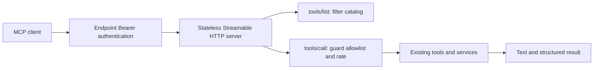

# WeKnora MCP Server: Source Analysis and CNC Adaptation

## Reference checkout

The requested `website-docs/03-features/mcp.md` has been renamed to [`08-mcp.md`](../../rag-platform/website-docs/03-features/08-mcp.md) in the local WeKnora checkout. The current embedded-server reference starts at line 416. The independent Python service under `mcp-server/` is explicitly deprecated at line 494.

This analysis concerns WeKnora **serving tools to external MCP clients**. Its outbound MCP client, OAuth connections to external servers, and Agent tool approvals are separate features.

## How the embedded server works

WeKnora uses `github.com/mark3labs/mcp-go` to provide stateless Streamable HTTP inside its existing Go backend. An external client calls `/mcp/<endpoint_id>` with that endpoint's Bearer token. The server translates the authenticated endpoint into the application's existing authorization context, then delegates to native business tools and services.

| Concern | Source in the local WeKnora checkout | Implementation |
| --- | --- | --- |
| Public transport | [`internal/router/routes_mcp_endpoint.go`](../../rag-platform/internal/router/routes_mcp_endpoint.go) | Registers POST, GET, and DELETE on `/mcp/:endpoint_id` before global REST authentication, with dedicated MCP authentication. |
| Endpoint administration | Same router, `RegisterMCPEndpointRoutes` | Exposes endpoint CRUD, tool catalog, and token rotation under `/api/v1/mcp-endpoints`, with separate read/admin guards. |
| Credential lifecycle | [`internal/application/service/mcp_endpoint.go`](../../rag-platform/internal/application/service/mcp_endpoint.go) | Generates 32 random bytes, prefixes the token, stores its SHA-256 digest, and returns the plaintext only on creation/rotation. Authentication looks up the hash and checks the addressed endpoint ID and enabled state. |
| Endpoint configuration | [`internal/types/mcp_endpoint.go`](../../rag-platform/internal/types/mcp_endpoint.go) | Stores workspace, enabled state, token hash/hint, tool allowlist, knowledge-base restrictions, default Agent, rate limit, and last-use time. |
| Request identity | [`internal/middleware/mcp_endpoint_auth.go`](../../rag-platform/internal/middleware/mcp_endpoint_auth.go) | Accepts a header Bearer token, checks the workspace state, and installs a synthetic endpoint user, principal, workspace, endpoint, and API-key-style scope. |
| Scope conversion | [`internal/types/mcp_endpoint_tools.go`](../../rag-platform/internal/types/mcp_endpoint_tools.go) | Converts enabled tools into retrieve/chat/ingest capabilities and restricted knowledge-base IDs. Downstream services reuse their existing scope checks. |
| SDK integration | [`internal/mcpserver/server.go`](../../rag-platform/internal/mcpserver/server.go) | Creates one tool catalog, adds a request-specific tool filter and invocation middleware, and enables stateless HTTP. |
| Business adapters | [`tools_retrieve.go`](../../rag-platform/internal/mcpserver/tools_retrieve.go), [`tools_ingest.go`](../../rag-platform/internal/mcpserver/tools_ingest.go), and other `internal/mcpserver/tools_*.go` files | Define model-facing descriptions/schemas and call existing Agent tools or application services. |
| Resource scope | [`internal/mcpserver/scope.go`](../../rag-platform/internal/mcpserver/scope.go) | Resolves accessible knowledge bases and applies resource-level access checks. |
| Result adaptation | `toolResultFromAgentTool` in `server.go`, `jsonResult` in `tools_retrieve.go` | Returns readable text and structured data through native MCP result objects. |

Two checks enforce the allowlist. `filterTools` removes tools from discovery; `guardTool` checks again before execution. A client cannot gain authority simply by remembering or guessing a hidden tool's name. The invocation guard also applies a per-endpoint rate limit and periodically updates last-use time. Stateless transport allows independent backend replicas to answer requests without a persistent MCP session identifier.

The reusable pattern is: **protocol adapter -> authenticated application identity -> bounded tools -> existing business authorization and services**. An MCP transport alone does not provide business permissions, credential privacy, or transaction boundaries.

## Application to this repository

This project already has a user-session model and CNC management services, so the adaptation embeds an MCP server without duplicating WeKnora's knowledge-base or endpoint administration features.

| WeKnora behavior | CNC implementation decision |
| --- | --- |
| Embedded Go MCP server | Embedded official Python MCP SDK server inside the existing FastAPI process. |
| Streamable HTTP | Stateless Streamable HTTP on backend `/mcp/`, reachable through the existing `/api/v1` deployment prefix. |
| Per-endpoint machine principal | Existing user access token and Redis-backed session, authenticated for every HTTP request. |
| Endpoint tool allowlist | Fixed four-query catalog, filtered by the existing account/drawing query and detail permissions. |
| Knowledge-base scope | Existing role data scopes and additional account creator checks. |
| Native Agent/business tool reuse | Direct adapters to `CncAccountService` and `CncPartService`, using existing Pydantic business schemas. |
| Optional knowledge-base writes | No mutation tools, adapters, or enable setting; this integration is permanently query-only. |
| Separate endpoint administration | Existing application configuration and session lifecycle; no additional endpoint table or UI. |
| Endpoint rate limits | No new per-endpoint rate policy or token-management subsystem in this limited integration. |

The transport uses the supported Python SDK API rather than copying the deprecated standalone Python server. Official [ASGI integration guidance](https://py.sdk.modelcontextprotocol.io/run/asgi/) requires the host application to run the MCP session manager's lifespan when mounting a sub-application. The SDK also provides [low-level handlers](https://py.sdk.modelcontextprotocol.io/advanced/low-level-server/) for application-owned tool catalogs and results. Host and Origin validation follow the [Streamable HTTP transport requirements](https://modelcontextprotocol.io/specification/2025-11-25/basic/transports).

## Existing code contracts retained

- [`backend/app/core/dependencies.py`](../backend/app/core/dependencies.py): `_authenticate` validates the access token, Redis session, session expiry/revocation, refresh-token exclusion, and current user existence. `AuthPermission` owns action authorization. A JWT signature check by itself is insufficient.
- [`backend/app/core/base_crud.py`](../backend/app/core/base_crud.py): `_build_conditions` applies `Permission._permission_condition`, retaining existing role-based self, department, and all-data access. The class docstring is incomplete; the executable query builder is authoritative.
- [`backend/app/plugin/module_cnc/cnc_account/service.py`](../backend/app/plugin/module_cnc/cnc_account/service.py): `page` and `detail` additionally enforce account creator scope for ordinary users. The MCP adapter calls these query methods only.
- [`backend/app/plugin/module_cnc/cnc_account/schema.py`](../backend/app/plugin/module_cnc/cnc_account/schema.py): the independent account output model excludes passwords, credential ciphertext, session ciphertext, and browser state. MCP output uses this safe model.
- [`backend/app/plugin/module_cnc/cnc_part/service.py`](../backend/app/plugin/module_cnc/cnc_part/service.py): existing drawing CRUD and upload-authorization fields remain authoritative. File metadata is not a promise that file bytes were uploaded or that vendor submission is permitted.
- Query transaction handling matches `db_getter`; safe result serialization and error handling remain inside the existing request/session boundary. No MCP adapter calls a business mutation method.

The only exported tools are `cnc_account_list`, `cnc_account_detail`, `cnc_part_list`, and `cnc_part_detail`. Drawing queries expose existing metadata, including `upload_authorized`, without modifying records or authorizations.

## Scope

The exposed operations are account and drawing list/detail queries. Create/update/delete/status changes, platform/configuration/quote/monitor tools, browser input, spreadsheet import/export, arbitrary HTTP/SQL/filesystem access, file-byte upload, and third-party upload are excluded. There is no write-enable configuration.

See [CNC MCP Server usage](./cnc-mcp-server.md) for configuration, tool arguments, permissions, and client connection examples. The user access token has the existing session lifetime and logout/revocation behavior; this implementation does not introduce a long-lived machine API key or a full OAuth authorization server.

WeKnora's role as an MCP client is not implemented: no outbound MCP connections, external-service management, OAuth client, client UI, or Agent MCP-client integration is added. Official SDK clients in tests validate this MCP Server's wire behavior only.
